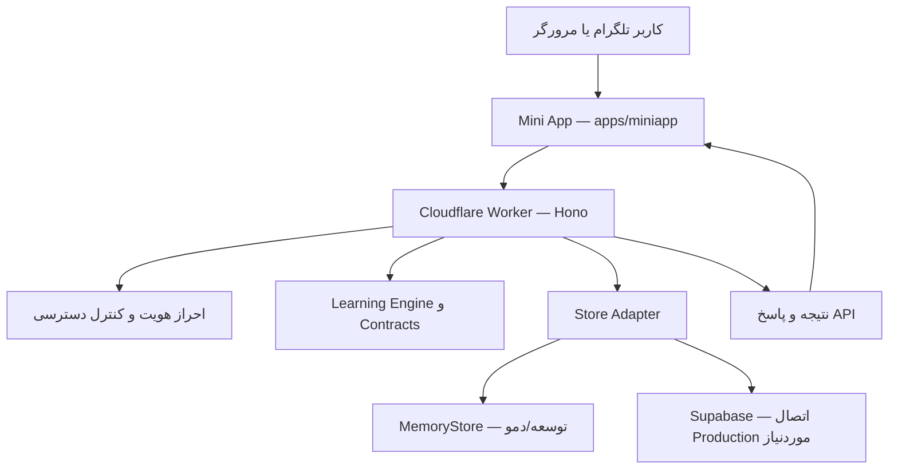

<div align="center">

# AEL — آموزش کنکور
### سامانهٔ یادگیری تطبیقی کنکور کارشناسی ارشد و دکتری مدیریت

**از بانک سؤال و درسنامه تا آزمون تطبیقی، مرور هوشمند و تحلیل عملکرد**

<p>
  
  
  
  
  
</p>

[ستارهٔ قطبی](#-ستارهٔ-قطبی-و-راهبرد-محصول) · [شروع سریع](#-شروع-سریع) · [معماری](#-معماری-سامانه) · [وضعیت واقعی](#-وضعیت-فعلی-و-محدودیتها) · [تست‌ها](#-تست-و-اعتبارسنجی) · [مستندات](#-مستندات) · [معماری لایه اول](docs/architecture/LAYER_1_ACADEMIC_FOUNDATION_FA.md)

</div>

---


راهنمای مسیر یادگیری، مدیریت مالی، آزمون و فایل آفلاین در [docs/ael-next/00_START_HERE_FA.md](docs/ael-next/00_START_HERE_FA.md) قرار دارد.

## 🎯 دربارهٔ پروژه

**AEL (Adaptive Exam Learning)** یک سامانهٔ آموزشی و تمرین تطبیقی برای داوطلبان کنکور مدیریت است. هدف آن فقط نمایش تست نیست؛ سامانه تلاش می‌کند بر اساس پاسخ‌های واقعی داوطلب، نقاط ضعف را پیدا کند، مرورها را اولویت‌بندی کند و مسیر یادگیری بعدی را پیشنهاد دهد.

مخزن شامل دو سطح محصول است:

- **اپلیکیشن React/Vite** در ریشهٔ مخزن: رابط گسترده‌تر و مجموعه‌ای از داده‌ها، درسنامه‌ها، کتابخانه و شبیه‌سازهای سالانه که فعلاً مسیر توسعه و استفادهٔ محلی آن محسوب می‌شود.
- **Telegram Mini App + Cloudflare Worker** در `apps/miniapp` و `apps/worker`: مسیر سبک‌تر و متصل به API سرور که برای استقرار عمومی طراحی شده و در گزارش فعال‌سازی ۳ نوامبر ۲۰۲۶، انتشار و سلامت زندهٔ آن ثبت شده است.

> **اصل مهم:** وجود یک قابلیت در اپ React به معنی در دسترس بودن همان قابلیت در Mini App نیست. هم‌ترازی کامل محتوا، رابط‌ها و موتورهای دو مسیر هنوز یک کار توسعه‌ای باز است؛ وضعیت واقعی در بخش‌های بعدی و گزارش‌های ممیزی توضیح داده شده است.

## 🧭 ستارهٔ قطبی و راهبرد محصول

### ستارهٔ قطبی (North Star)

> **تبدیل زمان مطالعهٔ داوطلب به تسلط واقعی، قابل‌اثبات و ماندگار بر مباحث آزمون؛ با تشخیص دقیق نقاط ضعف، آموزش و ترمیم هدفمند، سنجش مستقل و برنامه‌ای متناسب با زمان و نیاز هر فرد.**

AEL باید به داوطلب کمک کند بداند **چه چیزی را واقعاً بلد است، چه چیزی را هنوز بلد نیست، چرا در آن مبحث مشکل دارد، قدم بعدی چیست و از کجا می‌توان فهمید که یادگیری اتفاق افتاده است.**

نسخهٔ کوتاه وعدهٔ محصول:

**هر پاسخ، یک شاهد؛ هر خطا، یک سرنخ؛ هر برنامه، یک قدم سنجش‌پذیر به‌سوی تسلط.**

این ستارهٔ قطبی یک جهت‌گیری بلندمدت محصول است، نه ادعای اثربخشی اثبات‌شدهٔ نسخهٔ فعلی.

### مأموریت (Mission)

ساخت یک همراه آموزشی فارسی و مبتنی بر شواهد برای داوطلبان آزمون‌های مدیریت؛ همراهی که محتوای معتبر، گراف دانش، ارزیابی، حافظه و برنامه‌ریزی را در یک چرخهٔ پیوسته به هم متصل کند تا مطالعه از «حل تست بیشتر» به «یادگیری بهتر و قابل‌سنجش» تبدیل شود.

### چشم‌انداز (Vision)

تبدیل AEL به یک زیرساخت قابل‌اعتماد برای آمادگی آزمون‌های مدیریت که بتواند برای هر داوطلب، تصویر شفافی از وضعیت یادگیری ارائه کند؛ محتوای آن منشأ و سطح اعتبار مشخص داشته باشد؛ برنامهٔ مطالعه‌اش با زمان و وضعیت واقعی فرد سازگار باشد؛ و پیشرفت را نه با حدس یا فعالیت ظاهری، بلکه با شواهد مستقل و ماندگاری یادگیری بسنجد.

چشم‌انداز نهایی، ساخت یک سامانهٔ یکپارچه است که در آن وب، تلگرام و سایر رابط‌های مجاز، تجربه‌های متفاوتی از **یک محتوای معتبر، یک وضعیت یادگیرنده و یک منطق آموزشی قابل‌ردیابی** ارائه کنند.

### مسئله‌ای که حل می‌کنیم

داوطلب معمولاً با چند مسئلهٔ هم‌زمان روبه‌رو است:

1. **نمی‌داند شکاف واقعی دانش او کجاست.** درست یا غلط بودن یک تست به‌تنهایی تصویر کاملی از تسلط بر یک فصل یا پیش‌نیازهای آن نمی‌دهد.
2. **نمی‌داند خطا از چه چیزی ناشی شده است.** فراموشی، بدخوانی، فشار زمان، خطای محاسباتی، سوءبرداشت مفهومی و ضعف پیش‌نیاز، مداخلهٔ یکسانی نمی‌خواهند.
3. **نمی‌داند اکنون چه چیزی بیشترین ارزش مطالعه را دارد.** ضریب آزمون، فاصله تا آزمون، تسلط، احتمال فراموشی، پیش‌نیاز و زمان در دسترس باید با هم دیده شوند.
4. **نمی‌تواند مطمئن شود یادگیری پایدار رخ داده است.** تکرار همان سؤال یا خوداظهاریِ «بلدم» جای سنجش مستقل با سؤال تازه را نمی‌گیرد.
5. **با داده‌های آموزشی ناهمگون مواجه است.** سؤال رسمی، سؤال تألیفی، محتوای نمایشی و سؤال قرنطینه نباید بدون برچسب و منشأ یکسان عرضه شوند.

AEL برای پاسخ به همین مسائل طراحی شده است؛ نه برای بیشینه‌کردن تعداد کلیک، تعداد تست یا زمان حضور در اپلیکیشن.

### منطق متمایزکنندهٔ محصول

در مرورگرهای فاصله‌دار ساده، یک پاسخ غلط ممکن است فقط همان کارت را به زمان دیگری منتقل کند. در AEL، پاسخ باید در چارچوب ساختار دانش تفسیر شود:

1. **بازخورد مستقیم:** وضعیت کارت و زمان مرور متناسب با پاسخ به‌روزرسانی شود.
2. **بازبینی مبحث:** اگر شواهد ضعف مفهومی وجود دارد، مبحث مرتبط دوباره در اولویت قرار بگیرد.
3. **بررسی پیش‌نیاز:** اگر درک موضوع به دانش پایه وابسته است، مسیر ترمیم آن پیش‌نیاز دیده شود.
4. **ارتباط بین‌درسی:** در صورت وجود رابطهٔ معتبر در گراف دانش، مفهوم مرتبط در درس یا گرایش دیگر نیز بررسی شود.

این موج نباید برای هر خطا کورکورانه اجرا شود. طبقه‌بندی خطا باید از شواهد قابل‌مشاهده استفاده کند؛ مثلاً یک لغزش یا پاسخ عجولانه لزوماً به معنی ضعف کل فصل نیست. ظرفیت روزانه و زمان داوطلب نیز باید رعایت شود.

**حلقهٔ اصلی یادگیری AEL:**

تشخیص ← آموزش/ترمیم ← تمرین هدفمند ← سنجش مستقل ← به‌روزرسانی وضعیت ← برنامهٔ بعدی

این حلقه باید در هر بار استفاده، یک تصمیم بهتر و قابل‌توضیح‌تر تولید کند.

### کاربران اصلی و کار مورد انتظار آن‌ها

| گروه کاربر | کاری که می‌خواهد انجام دهد (Job to Be Done) | ارزش مورد انتظار |
|---|---|---|
| داوطلب کارشناسی ارشد مدیریت | بفهمد برای آزمون و گرایش انتخابی کدام درس‌ها و مباحث اولویت دارند و چه میزان از آن‌ها را واقعاً آموخته است. | برنامهٔ متناسب با ساختار آزمون، سؤال‌های قابل‌ردیابی و سنجش پیشرفت |
| داوطلب دکتری مدیریت | ساختار آزمون و سطح آمادگی خود را از دادهٔ معتبر و به‌روز دنبال کند. | تفکیک دقیق ساختار دکتری، محتوای رسمی و محتوای تمرینی؛ بدون ادعای پوشش ساختگی |
| داوطلب شاغل یا دارای زمان محدود | در زمان محدود روزانه، بهترین فعالیت بعدی را انتخاب کند. | صف روزانهٔ بودجه‌بندی‌شده، اولویت شفاف و مرور به‌موقع |
| مدرس یا متخصص محتوای آزمون | سؤال، پاسخ، منبع، نگاشت مبحث و کیفیت علمی محتوا را بازبینی کند. | منشأ روشن، وضعیت اعتبار، گزارش شکاف و امکان ممیزی |
| مدیر علمی/محتوا | بداند کدام درس، مهارت یا سال هنوز پوشش ناکافی یا دادهٔ تأییدنشده دارد. | داشبورد پوشش و کیفیت که کمبود را پنهان نکند |

### وعدهٔ تجربه به داوطلب

پس از هر فعالیت آموزشی، محصول باید تا حدی که دادهٔ معتبر وجود دارد به پنج پرسش پاسخ دهد:

- **چه اتفاقی افتاد؟** پاسخ درست یا غلط بود؟ با چه میزان اطمینان و چه شواهدی؟
- **چرا مهم است؟** این پاسخ چه چیزی دربارهٔ کارت، مهارت، مبحث یا پیش‌نیاز نشان می‌دهد؟
- **قدم بعدی چیست؟** مطالعه، تمرین، ترمیم پیش‌نیاز یا مرور؟
- **چه زمانی برگردم؟** زمان پیشنهادی مرور و دلیل اولویت چیست؟
- **از کجا بفهمم یاد گرفته‌ام؟** چه سؤال یا ارزیابی مستقلی می‌تواند تسلط را تأیید کند؟

اگر داده برای پاسخ دقیق کافی نیست، سامانه باید «نامشخص» یا «شواهد ناکافی» بگوید؛ نباید نمره یا ضعف فرضی بسازد.

---

### شاخص ستارهٔ قطبی (North Star Metric)

نام پیشنهادی شاخص:

**تسلط پایدارِ اثبات‌شده به‌ازای هر داوطلب فعال هفتگی**  
*Weekly Verified Durable Mastery Gains per Weekly Active Learner*

تعریف عملیاتی پیشنهادی:

تعداد جفت‌های یکتای **داوطلب–مهارت** که در یک بازهٔ هفتگی:

1. در ابتدای مسیر، تسلط اثبات‌شده نداشته‌اند یا هنوز وضعیتشان نامعلوم/اثبات‌نشده بوده است؛
2. با پاسخ‌های مستقل به سؤال‌های معتبر و قابل‌ردیابی، از آستانهٔ شواهد موتور عبور کرده‌اند؛
3. صرفاً با خوداظهاری، مشاهدهٔ درس، تکرار یک سؤال یا پاسخ نمایشی به وضعیت تسلط نرسیده‌اند؛
4. در بازهٔ مرورِ از پیش تعریف‌شده، یک سنجش تأخیری با سؤال یا سؤال‌های دیده‌نشده را با موفقیت گذرانده‌اند.

برای مقایسهٔ دوره‌ای، این تعداد بر تعداد داوطلبان فعال هفتگی تقسیم و به‌ازای هر ۱۰۰ داوطلب فعال گزارش می‌شود. واحد تحلیل باید جفت یکتای داوطلب–مهارت باشد تا یک کاربر با تکرار بی‌پایان یک مبحث، شاخص را متورم نکند.

**قاعدهٔ محاسبه:** فقط سؤال‌هایی در شواهد تسلط معتبرند که وضعیت منشأ و کلید آن‌ها روشن و برای آن مرحله از ارزیابی مجاز باشند. سؤال‌های Demo، قرنطینه، کلیدهای در انتظار بازبینی یا سؤال‌های قبلاً دیده‌شده نباید به‌عنوان اثبات مستقلِ یادگیری شمرده شوند.

**وضعیت فعلی شاخص:** این تعریف، معیار راهبردی آینده است و هنوز به‌عنوان یک شاخص کامل در محصول اندازه‌گیری نمی‌شود. کاتالوگ فعلی ۱۳ سنجهٔ مبتنی بر شواهد دارد؛ از جمله proofCoverage و learningVelocity7d. برای محاسبهٔ شاخص ستارهٔ قطبی، باید رویداد سنجش تأخیری و دیده‌نشده، زمان آن و منشأ سؤال به‌صورت قابل‌ردیابی ثبت و در پایلوت واقعی اعتبارسنجی شوند.

### شاخص‌های پشتیبان و محافظ (Guardrails)

ستارهٔ قطبی به‌تنهایی کافی نیست. برای جلوگیری از رشد ظاهری یا آسیب به تجربهٔ یادگیری، شاخص‌های زیر باید همراه آن پایش شوند:

| حوزه | شاخص پشتیبان | قاعدهٔ تفسیر |
|---|---|---|
| پوشش محتوا | سهم سؤالات رسمیِ ثبت‌شده از کل سؤال‌های دفترچهٔ مرجع | مخرج باید از دفترچهٔ رسمی و نسخهٔ آزمون مشخص شود؛ سؤال تألیفی به پوشش رسمی اضافه نمی‌شود. |
| منشأ محتوا | سهم آیتم‌های دارای منبع، سال، شماره، کلید و وضعیت بازبینی روشن | فقط آیتم‌های دارای شواهد کامل می‌توانند برچسب تأییدشده بگیرند. |
| کیفیت یادگیری | دقت در سؤال‌های دیده‌نشده و آزمون تأخیری | دقت روی سؤال تکراری، اثبات یادگیری جدید نیست. |
| کیفیت سنجش | تعداد شواهد مستقل، تنوع سؤال و پوشش مهارت | نرخ بدون تعداد نمونه و سطح دشواری تفسیر نشود. |
| برنامه‌ریزی | نسبت برنامه‌های داخل بودجهٔ زمانی کاربر و بار کارت‌های سررسیدشده | صف روزانه نباید از زمان قابل‌استفادهٔ فرد عبور کند. |
| صحت وضعیت | نرخ تلاش‌های تکراری که وضعیت یادگیری را دوباره تغییر می‌دهند | Retry شبکه نباید پاداش، تسلط یا سابقه را دوباره ثبت کند. |
| امنیت ارزیابی | نشت کلید پاسخ پیش از ثبت پاسخ | هدف صفر؛ هر مورد، مانع انتشار است. |
| تداوم داده | از دست‌رفتن یا دوپاره‌شدن وضعیت یادگیرنده بین رابط‌ها | وضعیت یادگیری باید در مخزن پایدار و واحد نگهداری شود. |
| تجربه | تکمیل فعالیت برنامه‌ریزی‌شده، زمان واقعی و رهاکردن جریان | باید کنار کیفیت یادگیری تفسیر شود؛ به‌تنهایی موفقیت نیست. |
| پایداری فنی | خطاهای API، زمان پاسخ، سلامت ذخیره‌سازی و رخدادهای امنیتی | عملکرد محلی جایگزین سنجش Production نیست. |

ورود، تعداد Session، streak، سکه، XP و تعداد کلیک شاخص یادگیری نیستند. می‌توان از آن‌ها برای تجربهٔ کاربری استفاده کرد، اما نباید به‌عنوان نتیجهٔ آموزشی یا معیار ستارهٔ قطبی گزارش شوند.

---

### اهداف راهبردی محصول (Strategic Objectives)

#### هدف ۱ — محتوای آزمون باید قابل‌ردیابی و صادقانه باشد

داوطلب باید بداند هر سؤال از کجا آمده، مربوط به کدام سطح و سال است، کلید آن چه وضعیتی دارد و به کدام مبحث متصل شده است.

**نتایج کلیدی و شروط پذیرش:**

- هر آیتمی که «رسمی و تأییدشده» نام می‌گیرد، باید شناسهٔ منبع قابل‌دسترسی، سطح آزمون، سال، کد/ترکیب مرتبط، شمارهٔ سؤال، وضعیت کلید و نگاشت محتوایی معتبر داشته باشد.
- سؤال فاقد کلید رسمی یا بازبینی علمی در وضعیت‌هایی مانند pending_review یا quarantine باقی بماند و به‌عنوان سؤال رسمی تأییدشده سرو نشود.
- تعداد سؤال‌های ثبت‌شده، تعداد سؤال‌های دفترچه و نسبت پوشش برای هر سال، سطح و گرایش جداگانه گزارش شوند.
- ساختار ارشد و دکتری، از جمله کدها و ضرایبشان، به‌اشتباه با یکدیگر ترکیب نشوند.
- تأیید ساختاری داده از تأیید علمی سؤال، کلید و درجهٔ دشواری تفکیک شود.
- تحلیل روان‌سنجی مانند CTT/IRT فقط پس از فراهم‌شدن دادهٔ پاسخ کافی و روش معتبر انجام شود؛ پارامتر فرضی تولید نشود.

**معیار موفقیت:** هیچ ادعای پوشش یا اعتبار رسمی بدون مدرک و مخرج قابل‌راستی‌آزمایی منتشر نشود.

#### هدف ۲ — تسلط باید از شواهد یادگیری به‌دست آید، نه از حدس

محصول باید فرق «مطالعه کرده»، «احساس می‌کند بلد است»، «در سؤال پاسخ درست داده» و «تسلط را با ارزیابی مستقل اثبات کرده» حفظ کند.

**نتایج کلیدی و شروط پذیرش:**

- خوداظهاری و میزان اعتمادبه‌نفس، از وضعیت شواهد و تسلط مستقل ذخیره و گزارش شوند.
- وضعیت اولیهٔ فاقد شواهد، unknown یا معادل آن باشد؛ مقدار پیش‌فرض ۵۰ نباید به‌عنوان سنجش واقعی نمایش داده شود.
- ارتقای تسلط به شواهد معتبر، تعداد نمونه، تنوع و تازگی پاسخ وابسته باشد.
- آزمون‌های Holdout/Proof واقعاً دیده‌نشده بمانند و با تمرین عادی لو نروند.
- هر پاسخ در محیط عمومی در سمت سرور تصحیح شود و کلید قبل از پاسخ به کلاینت نرسد.
- منطق اصلی FSRS، تسلط، خطا و اولویت‌گذاری به یک مرجع اجرایی برسد؛ اختلاف باقی‌مانده بین مصرف‌کنندگان باید مستند و با تست پوشش داده شود.

**معیار موفقیت:** هیچ وضعیت «مسلط» بدون شاهد مستقل و قابل‌ردیابی ساخته نشود.

#### هدف ۳ — برنامهٔ مطالعه باید شخصی، توضیح‌پذیر و قابل‌اجرا باشد

برنامه باید نشان دهد چرا یک فعالیت اکنون اولویت دارد و در عین حال از ظرفیت واقعی داوطلب فراتر نرود.

**نتایج کلیدی و شروط پذیرش:**

- اولویت فعالیت از وزن آزمون، شکاف یادگیری، ریسک فراموشی، اهمیت پیش‌نیاز، نزدیکی آزمون، منفعت مورد انتظار و زمان لازم محاسبه شود.
- منطق اولویت‌بندی یک پیاده‌سازی معتبر و آزمون‌شده داشته باشد؛ مستندات و کد باید یک فرمول را بیان کنند.
- پیش‌نیازهای لازم پیش از فعالیت‌های وابسته دیده شوند.
- صف روزانه به بودجهٔ زمانی کاربر احترام بگذارد و زمان فعالیت‌های از پیش تعهدشده را هم لحاظ کند.
- مرور فاصله‌دار، بازیابی فعال و ترکیب هدفمند مباحث با سطح دانش فرد هماهنگ شوند.
- خطاهای خاص مانند slip یا کمبود شواهد، به‌صورت خودکار ضعف قطعی فصل تلقی نشوند.
- دلیل اولویت و علت پیشنهاد هر فعالیت برای داوطلب قابل‌فهم باشد.

**معیار موفقیت:** برنامهٔ تولیدشده از بودجهٔ زمانی عبور نکند، اولویت‌هایش قابل‌توضیح باشد و به پیش‌نیازهای ثبت‌شده احترام بگذارد.

#### هدف ۴ — همهٔ رابط‌ها باید یک محصول واحد باشند

وب، Mini App تلگرام و هر رابط آینده می‌توانند از نظر طراحی متفاوت باشند، اما نباید داده، منطق یادگیری یا سابقهٔ مستقل و متناقض داشته باشند.

**نتایج کلیدی و شروط پذیرش:**

- یک منبع معتبر برای محتوای آموزشی، مشخصات آزمون و نسخهٔ بانک سؤال تعریف شود.
- یک قرارداد API و یک وضعیت canonical برای هر داوطلب وجود داشته باشد.
- React و Mini App از یک Backend و وضعیت یادگیری واحد استفاده کنند.
- مهاجرت مصرف‌کنندگان Legacy با ماتریس قابلیت و تست رگرسیون انجام شود؛ حذف صفحه یا قابلیت بدون تصمیم ثبت‌شده ممنوع باشد.
- آزمون‌های Parity، سناریوهای واقعی و مرزهای تفاوت رابط‌ها را پوشش دهند.
- هر Deployment، Commit و نسخهٔ محتوای قابل‌شناسایی داشته باشد.
- هیچ نشانی عمومی کاربر را به نسخهٔ ناامن یا منسوخ هدایت نکند.

**معیار موفقیت:** یک اقدام یکسان کاربر، فارغ از رابط ورود، منطق و سابقهٔ یادگیری سازگار تولید کند.

#### هدف ۵ — امنیت، حریم خصوصی و تداوم داده بخشی از خود محصول باشند

اعتماد آموزشی بدون حفاظت از پاسخ‌ها، هویت و سابقهٔ یادگیرنده ممکن نیست.

**نتایج کلیدی و شروط پذیرش:**

- احراز هویت تلگرام با اعتبارسنجی امضای Init Data در سمت سرور انجام شود؛ شناسهٔ تلگرام به‌تنهایی مدرک ورود نباشد.
- مسیرهای مدیریتی و Webhook محافظت‌شده باشند.
- کلید پاسخ، توکن، دادهٔ شخصی یا اطلاعات محرمانه در Bundle، Log یا Repository عمومی قرار نگیرد.
- محیط Production از دیتابیس پایدار و Migrationهای تأییدشده استفاده کند؛ MemoryStore فقط برای توسعه/دمو مجاز باشد.
- بازیابی از Backup، Rollback نسخه و رفتار خطا مستند و تمرین شوند.
- پایش خطا، هشدار، لاگ ساختاریافته و سیاست نگهداری داده فراهم شود.
- سیاست حریم خصوصی، شرایط استفاده، نگهداری و حذف داده پیش از عرضهٔ عمومی بازبینی شوند.

**معیار موفقیت:** اگر احراز هویت، ذخیره‌سازی، مجوز یا مرز اعتماد تأیید نشده است، قابلیت نباید به‌عنوان Production-ready عرضه شود.

#### هدف ۶ — اثر آموزشی باید در پایلوت واقعی اثبات شود

قبولی، افزایش رتبه یا بهبود یادگیری را نمی‌توان تنها از روی تست‌های نرم‌افزار یا دادهٔ ساختگی نتیجه گرفت.

**نتایج کلیدی و شروط پذیرش:**

- پایلوت با داوطلبان واقعی و معیار ورود، رضایت و روش ثبت داده تعریف شود.
- پیش‌آزمون، فعالیت‌های آموزشی، پس‌آزمون هم‌سطح و سنجش تأخیری طراحی شوند.
- کیفیت سؤال، کلید، دشواری و نگاشت با متخصص انسانی بازبینی شود.
- نرخ تکمیل برنامه، بار زمانی، خطاهای تجربه و میزان حفظ یادگیری گزارش شوند.
- اثر محتوا و موتور از اثر تفاوت در سطح دشواری یا انتخاب داوطلب تفکیک شود.
- گزارش نتایج همراه با حجم نمونه، دورهٔ مشاهده، محدودیت و عدم‌قطعیت منتشر شود.
- در صورت نبود شواهد کافی، نتیجه «نامشخص» ثبت شود، نه «موفق».

**معیار موفقیت:** ادعای اثربخشی فقط زمانی مطرح شود که دادهٔ پایلوت و ارزیابی مستقل از آن پشتیبانی کند.

#### هدف ۷ — محصول باید برای استفادهٔ واقعی و پایدار قابل‌اعتماد باشد

- مسیرهای اصلی در موبایل، وب و محیط واقعی Telegram آزمایش شوند.
- رابط فارسی و RTL، دسترس‌پذیری، خطاها و وضعیت‌های خالی بررسی شوند.
- Performance در runtime واقعی Cloudflare و در بار هم‌زمان سنجیده شود؛ Benchmark محلی به‌جای آن معرفی نشود.
- مانیتورینگ، SLA، بازیابی و برنامهٔ پاسخ به حادثه تعریف شوند.
- انتشار عمومی تنها پس از عبور از Release Gate علمی، امنیتی، داده‌ای و عملیاتی مجاز باشد.

---

### اصول تصمیم‌گیری محصول

این اصول برای همهٔ توسعه‌دهندگان، ایجنت‌ها، بازبینان علمی و تصمیم‌گیرندگان محصول لازم‌الاجرا هستند:

1. **Evidence over activity:** فعالیت بیشتر، معادل یادگیری بیشتر نیست.
2. **Provenance before officiality:** بدون منشأ معتبر، برچسب رسمی نده.
3. **Unknown is a valid state:** نبود شواهد را به ضعف یا تسلط تبدیل نکن.
4. **One learner state:** سابقهٔ داوطلب نباید بین رابط‌ها چندپاره شود.
5. **Server is authoritative:** کلید پاسخ و نتیجهٔ نهایی ارزیابی در اختیار سرور است.
6. **Adaptation must be explainable:** هر پیشنهاد باید دلیل قابل‌فهم داشته باشد.
7. **Respect the learner's capacity:** برنامه نباید از زمان واقعی فرد بیشتر شود.
8. **Do not reward gaming:** سکه و streak جایگزین شواهد آموزشی نیستند.
9. **Fail closed on trust boundaries:** در صورت نبود احراز هویت یا پیکربندی حساس، رفتار امن انتخاب شود.
10. **Measure before claiming:** تست کد، صحت علمی و اثربخشی آموزشی سه نوع مدرک متفاوت‌اند.
11. **Preserve user progress:** مهاجرت و اصلاح معماری نباید بدون طرح بازیابی، دادهٔ یادگیرنده را از بین ببرد.
12. **Accessibility is core:** فارسی، RTL، موبایل و دسترس‌پذیری، ویژگی جانبی نیستند.

### چه چیزی عمداً هدف محصول نیست؟

AEL نباید به این موارد تبدیل شود یا چنین ادعاهایی داشته باشد:

- یک ربات سادهٔ ارسال تست یا فلش‌کارت بدون مدل دانش.
- سامانه‌ای که صرفاً تعداد تست و ساعت حضور را به‌عنوان یادگیری معرفی کند.
- پیش‌بینی قطعی رتبه، تراز، دانشگاه یا قبولی بر پایهٔ دادهٔ محدود و بدون کالیبراسیون معتبر.
- شبیه‌ساز «رسمی» برای سال، سطح یا دفترچه‌ای که ساختار و سؤال‌های آن تأیید نشده‌اند.
- مولد کلید پاسخ یا محتوای آزمون که خروجی تأییدنشدهٔ آن به‌صورت رسمی عرضه شود.
- محصولی که برای افزایش engagement، بار مطالعهٔ نامعقول یا مرور بی‌پایان تولید کند.
- جایگزین دفترچه، اطلاعیه یا مرجع رسمی سازمان سنجش.
- سامانهٔ مشاورهٔ قطعی آموزشی/روان‌شناختی یا تضمین‌کنندهٔ نتیجهٔ آزمون.

### نقشهٔ راه راهبردی

ترتیب زیر بر اساس وابستگی‌های واقعی است؛ پیشرفت ظاهری در یک بخش نباید مانع‌های زیربنایی بخش دیگر را پنهان کند.

| مرحله | هدف | خروجی پذیرش |
|---|---|---|
| ۰. تثبیت اعتماد | ایمن‌سازی مسیر پاسخ، احراز هویت، داده و انتشار | بدون نشت کلید؛ تست امنیتی؛ پیکربندی Production قابل‌اثبات |
| ۱. یکپارچه‌سازی هسته | منبع واحد محتوا، Engine، API و وضعیت یادگیرنده | مهاجرت مصرف‌کنندگان Legacy؛ تست Parity گسترده؛ یکپارچگی داده |
| ۲. اعتبار محتوایی | تکمیل بانک رسمی و نگاشت دقیق سؤال به مبحث | منبع، کلید، سال، شماره، سطح، کد و وضعیت بازبینی برای آیتم‌های تأییدشده |
| ۳. تکمیل تجربهٔ یادگیری | هم‌ترازی وب و Mini App در مسیرهای حیاتی | تجربهٔ تشخیص، یادگیری، ترمیم، آزمون، مرور و گزارش با Backend واحد |
| ۴. پایلوت علمی | سنجش واقعی یادگیری و رفتار داوطلب | شرکت‌کنندگان واقعی، بازبینی SME، سنجش تأخیری و گزارش محدودیت‌ها |
| ۵. عرضهٔ کنترل‌شده | اثبات امنیت، پایداری و آمادگی عملیاتی | Staging، E2E میزبانی‌شده، مانیتورینگ، Rollback، حریم خصوصی و Release Gate سبز |

**اولویت جاری:** اتصال ذخیره‌سازی پایدار Production و اجرای مهاجرت‌های لازم، رفع مسیرهای احراز هویت/دمو، تکمیل مهاجرت امن رابط React، همگرایی وضعیت یادگیرنده، بازبینی علمی محتوا و اجرای پایلوت. این ترتیب از افزودن قابلیت تزئینی مهم‌تر است.

### معیار پایان یک قابلیت (Definition of Done)

هیچ قابلیت فقط با ساخت UI یا اضافه‌شدن API تکمیل محسوب نمی‌شود. هر قابلیت باید:

- نیاز و کاربر هدف مشخص داشته باشد.
- منبع داده و قرارداد آن تعریف شده باشد.
- جریان موفق و خطا را پوشش دهد.
- دسترسی و مرز امنیتی آن بررسی شده باشد.
- تست واحد و یکپارچگی متناسب داشته باشد.
- در رابط(های) هدف با E2E بررسی شود.
- وضعیت محتوا و سطح اعتبار آن برای کاربر روشن باشد.
- رویدادهای لازم برای اندازه‌گیری را ثبت کند.
- مستندات و وضعیت Deployment آن به‌روز باشد.
- شواهد پذیرش و محدودیت‌های حل‌نشده را ثبت کند.

### مرز میان هدف، پیاده‌سازی و اثبات

برای جلوگیری از تبدیل برنامه به ادعای نادرست، تمام قابلیت‌ها باید یکی از وضعیت‌های زیر را داشته باشند:

| وضعیت | معنی |
|---|---|
| **PLANNED** | هدف یا طراحی تصویب شده؛ هنوز پیاده‌سازی نشده است. |
| **IMPLEMENTED_UNVERIFIED** | کد وجود دارد؛ آزمون و شواهد پذیرش کافی نیست. |
| **PASS_WITH_EVIDENCE** | فقط در قلمروی مشخص و با شاهد قابل‌بازبینی آزمون شده است. |
| **BLOCKED** | وابسته به دسترسی، محتوا، متخصص، داده یا زیرساخت بیرونی است. |
| **NOT_STARTED** | هنوز آغاز نشده است. |
| **DEFERRED** | با تصمیم ثبت‌شده به مرحلهٔ بعد موکول شده است. |

**قاعدهٔ انتشار:** عبور از تست محلی به معنی Go برای انتشار محصول نیست. تا وقتی پایلوت واقعی، بازبینی علمی، ذخیره‌سازی پایدار، امنیت و عملیات Production و الزامات حریم خصوصی تکمیل نشده‌اند، تصمیم انتشار عمومی باید مطابق Release Gate و وضعیت مستندشدهٔ **NO-GO / DEFER** باقی بماند.

---

## ✨ قابلیت‌ها و اجزای محصول

### یادگیری تطبیقی

- **FSRS** برای مدل‌سازی فراموشی و زمان‌بندی مرور.
- **Ripple Engine** برای پیگیری اثر پاسخ اشتباه در کارت، مبحث، پیش‌نیاز و پیوندهای بین‌درسی.
- صف روزانهٔ مطالعه و مرور بر اساس اولویت، سررسید، ارزش آزمون و وضعیت یادگیری.
- آزمون تشخیصی و سنجش شواهد واقعی تسلط.
- کارت‌های ترمیمی و مسیرهای جبرانی برای مباحث و پیش‌نیازهای ضعیف.
- ثبت تلاش‌ها با شناسهٔ یکتا و جلوگیری از ثبت دوبارهٔ ناخواسته.
- تحلیل پیشرفت، کوییز شبانه، زنجیرهٔ مطالعه و پیام‌های راهنمای منتور.

### آموزش و محتوای درسی

- گراف دانش و پیوند میان درس، فصل، مبحث و پیش‌نیاز.
- درسنامه‌های تعمیقی و محتوای آموزشی تعاملی.
- کتابخانهٔ مرجع کتاب‌محور و خلاصهٔ فصل‌ها.
- بسته‌های محتوایی نسخه‌دار، نگاشت مهارت‌ها و اعتبارسنجی ساختاری محتوا.
- ابزارهای استخراج، تحلیل و یکپارچه‌سازی منابع و داده‌های سؤال.

### آزمون و ارزیابی

- بانک سؤال و تمرین موضوعی.
- ساخت صف سؤال بر اساس گرایش‌ها و وضعیت یادگیری.
- آزمون تشخیصی و زیرساخت شبیه‌سازی آزمون.
- ثبت پاسخ و تصحیح سمت سرور در مسیر Worker.
- دفتر خطا و گزارش عملکرد جلسه در مسیرهایی که پیاده‌سازی شده‌اند.
- ساختار نسخه‌بندی‌شدهٔ آزمون بر اساس سال و سطح تحصیلی.

### تجربهٔ کاربری

- رابط فارسی و راست‌به‌چپ (RTL).
- طراحی واکنش‌گرا برای نمایشگرهای کوچک و بزرگ.
- Mini App سبک برای اجرا در تلگرام.
- مدیریت حالت‌های بارگذاری، خطا، خالی و موفقیت در مسیرهای پیاده‌سازی‌شده.

---

## 🧭 وضعیت فعلی و محدودیت‌ها

این جدول وضعیت ثبت‌شده در مستندات مخزن تا **۳ نوامبر ۲۰۲۶** را خلاصه می‌کند. این اطلاعات، گزارش وضعیت‌اند و جایگزین بررسی زندهٔ حساب‌های Cloudflare، Telegram یا Supabase نیستند.

| بخش | وضعیت مستندشده | توضیح |
|---|---|---|
| Cloudflare Worker | منتشرشده و بررسی زنده‌شده | سلامت `/api/health`، سرو Mini App و مانور Rollback نسخه‌ای در گزارش فعال‌سازی ثبت شده است؛ این شواهد به‌تنهایی آمادگی کل محصول را اثبات نمی‌کنند. |
| Mini App | روی Worker سرو می‌شود | فایل‌های `apps/miniapp` به‌عنوان Static Assets استفاده می‌شوند و `/api/*` به Worker می‌رود. |
| ذخیره‌سازی پایدار | **مسدود / تکمیل‌نشده** | اتصال Production به Supabase و اجرای Migration شمارهٔ ۰۰۱۵ در Runbook انجام‌نشده ثبت شده است؛ Worker در وضعیت گزارش‌شده از MemoryStore استفاده می‌کند و دادهٔ کاربر پایداری Production ندارد. |
| Telegram | **فعال‌سازی کامل تأیید نشده** | Secretهای Worker در فهرست Secrets گزارش شده‌اند، اما تنظیم دکمهٔ منو و اتصال نهایی تجربهٔ کاربر به دلیل در دسترس نبودن توکن در محیط اجرای محلی تکمیل نشده است. وضعیت زندهٔ Webhook باید جداگانه بررسی شود. |
| صفحهٔ ورودی عمومی | آمادهٔ آزمون محلی | بیلد جداگانه به نشانی تأییدشدهٔ Worker پیوند می‌دهد. انتشار به تأیید Release Gate وابسته است. |
| اپ React | مسیر محلی/Legacy | داده‌های آفلاین و کلیدها را در بیلد خصوصی نگه می‌دارد. از `npm run dev` یا `npm run build:legacy` استفاده کنید. |
| یکپارچگی محتوا و Engine | در حال تکمیل | محتوای React و Worker هنوز کاملاً یک منبع حقیقت مشترک ندارند؛ Parity Harness فقط سناریوهای مشخص را مقایسه می‌کند. |
| Rate Limit سراسری | مسدود در زیرساخت | محدودسازی فعلی per-isolate است؛ راهکار سراسری نیازمند Durable Objects و مجوز مناسب Cloudflare است. |
| آمادگی عرضهٔ عمومی محصول | **NO-GO / DEFER** | Worker زنده است، اما پایلوت واقعی، بازبینی SME، Supabase پایدار، E2E میزبانی‌شدهٔ تلگرام، مانیتورینگ و بازبینی حریم خصوصی هنوز Gateهای باز هستند. |

### واقعیت پوشش محتوای آزمون

بر اساس [ممیزی پوشش آزمون دکتری](docs/status/phd-coverage-audit-2026-11.md):

- ۱۵ دفترچهٔ ثبت‌شده مربوط به **آزمون کارشناسی ارشد مدیریت، کد ۱۱۴۲، سال‌های ۱۳۹۱ تا ۱۴۰۵** هستند.
- از مجموع ۴٬۴۸۰ سؤال اعلام‌شده در این دفترچه‌ها، ۹۶ سؤال در بانک سالانه ثبت شده است؛ پوشش آرشیو ارشد حدود **۱٫۹٪** است.
- ۲۲ سؤال با سطح دکتری در سامانه وجود دارد، اما **دفترچهٔ رسمی دکتری در سامانه ثبت نشده است**.
- بانک سؤال اصلی ۱۵۶ سؤال دارد که در گزارش ممیزی، سطح ۱۴۵ مورد از آن‌ها هنوز مشخص نشده است.
- ۱۴ کتاب مرجع و ۱۴۰ فصل محتوایی در گزارش ثبت شده‌اند.

بنابراین پروژه هنوز نباید به‌عنوان بانک کامل سؤالات کنکور یا شبیه‌ساز رسمی کامل دکتری معرفی شود. افزایش پوشش مستلزم ورود سؤال رسمی با سال، شماره، کلید، منبع و متادیتای قابل راستی‌آزمایی است.

---

## 🏗️ معماری سامانه

ساختار فعلی یک Monorepo مبتنی بر npm workspaces است:

```text
konkortelegrambot/
│
├── src/                         # اپ React و Vite (مسیر محلی/Legacy)
│   ├── components/               # صفحات و اجزای رابط
│   ├── data/                     # داده‌های درسی، سؤال‌ها و آزمون‌های سالانه
│   ├── engine/                   # پیاده‌سازی موتور مورد استفادهٔ React
│   ├── tests/                    # تست‌های اپ
│   ├── utils/                    # ابزارهای رابط و منطق کمکی
│   ├── App.tsx
│   └── index.css
│
├── apps/
│   ├── miniapp/                  # رابط مستقل Telegram Mini App
│   │   ├── index.html
│   │   ├── app.js
│   │   └── styles.css
│   │
│   └── worker/                   # Backend مبتنی بر Hono و Cloudflare Workers
│       ├── src/
│       │   ├── index.ts          # API و Routeها
│       │   ├── auth.ts           # احراز هویت
│       │   ├── store.ts          # لایهٔ ذخیره‌سازی
│       │   ├── memory-store.ts   # ذخیره‌سازی حافظه‌ای
│       │   └── ...               # داده‌ها و ماژول‌های Worker
│       ├── tests/
│       └── wrangler.jsonc
│
├── packages/
│   ├── contracts/                # قراردادها و Typeهای مشترک
│   ├── learning-engine/          # موتور یادگیری سمت Worker
│   └── utils/                    # محاسبات و اولویت‌بندی
│
├── content/
│   ├── examples/                 # بسته‌های نمونه
│   ├── knowledge/                # گراف دانش و نگاشت مهارت‌ها
│   ├── markdown/                 # محتوای متنی و کتاب‌ها
│   └── ...                       # داده‌ها و خروجی‌های پردازش محتوا
│
├── supabase/
│   ├── migrations/               # مهاجرت‌های SQL
│   ├── seeds/                    # داده‌های اولیه
│   └── tests/                    # تست‌های یکپارچگی دیتابیس
│
├── scripts/                      # تست، استخراج، اعتبارسنجی و عملیات
├── docs/                         # معماری، API، ممیزی و نقشهٔ راه
├── .github/workflows/            # CI و مسیر GitHub Pages
├── package.json
└── package-lock.json
```

### جریان درخواست در مسیر Mini App



### نکتهٔ معماری دربارهٔ دو موتور

در حال حاضر React از `src/engine/aelEngine.ts` استفاده می‌کند و Worker از پکیج `packages/learning-engine`. اسکریپت `scripts/engine-parity-harness.mts` تعدادی سناریوی قطعی را بین این دو مسیر مقایسه می‌کند؛ این تست، به‌تنهایی اثبات‌کنندهٔ یکپارچگی کامل تمام مصرف‌کنندگان، داده‌ها یا وضعیت یادگیرنده نیست. یکپارچه‌سازی کامل موتور و محتوا از کارهای باز معماری است.

---

## 🚀 شروع سریع

### پیش‌نیازها

- Node.js نسخهٔ **۲۴ یا بالاتر**
- npm همراه Node.js
- Git
- برای اجرای Worker محلی: ابزار Wrangler از طریق npx
- برای تست دیتابیس محلی: وابستگی‌های ثبت‌شده در `package-lock.json`

نسخهٔ Node در فایل `.nvmrc` برابر ۲۴ تعیین شده است.

### دریافت و نصب

```bash
git clone https://github.com/rrasi90/konkortelegrambot.git
cd konkortelegrambot

# nvm-windows (PowerShell):
nvm use 24
# macOS/Linux with nvm: nvm use
npm ci
```

اگر از nvm استفاده نمی‌کنید، اطمینان حاصل کنید Node.js 24 یا نسخهٔ جدیدتر فعال است.

### اجرای Mini App و API محلی

مسیر پیشنهادی برای توسعهٔ مسیر Worker/Mini App:

```bash
npm run dev:miniapp
```

سرور محلی روی پورت **۸۷۸۷** اجرا می‌شود:

`http://localhost:8787`

این محیط از Worker محلی و MemoryStore همراه بستهٔ دمو استفاده می‌کند. داده‌های آن Production نیستند و برای نگهداری پایدار اطلاعات کاربران طراحی نشده‌اند.

### اجرای اپ React

```bash
npm run dev
```

Vite روی پورت **۳۰۰۰** اجرا می‌شود:

`http://localhost:3000`

خروجی `npm run build:legacy` در `dist-legacy/` قرار می‌گیرد و برای استفادهٔ محلی است. برای اجرای همان خروجی با سرور محلی، `DEV_SURFACE=react npm run dev:miniapp` را اجرا کنید.

### بیلد ورودی عمومی

`npm run build` تنها صفحهٔ ورود به Worker را در `dist/` می‌سازد. نشانی تأییدشدهٔ محیط یادگیری را با `VITE_AEL_APP_URL` به بیلد بدهید. برای پیش‌نمایش از `npm run preview` و برای بررسی از `npm run audit:client-bundle` استفاده کنید. آموزش، آزمون، احراز هویت و دریافت بازخورد در محیط Worker انجام می‌شود.

---

## 🧪 تست و اعتبارسنجی

پیش از هر Pull Request یا انتشار، متناسب با دامنهٔ تغییر، تست‌های زیر را اجرا کنید.

| فرمان | کاربرد |
|---|---|
| `npm run typecheck` | بررسی TypeScript کل پروژه |
| `npm test` | اجرای تست‌های Vitest |
| `npx tsx scripts/engine-parity-harness.mts` | مقایسهٔ سناریوهای منتخب دو مسیر Engine |
| `npm run validate:content` | اعتبارسنجی بسته‌های محتوایی |
| `npm run build:worker` | Build/Typecheck مربوط به Worker |
| `npm run audit:miniapp` | اسکن Assetهای واقعی Mini App و بررسی تنظیمات Wrangler |
| `npm run audit:client-bundle` | اسکن خروجی عمومی و کنترل حضور فایل‌های مجاز |
| `npx --yes wrangler deploy --dry-run --config apps/worker/wrangler.jsonc` | اعتبارسنجی بستهٔ Worker بدون انتشار |
| `npm run test:db` | اجرای تازه، Replay با Ledger، کنترل Drift و Backup/Restore روی PostgreSQL توکار |
| `node scripts/e2e-miniapp.mjs` | اجرای سناریوهای E2E با Chrome؛ ابتدا سرور محلی را در ترمینال جداگانه با `npm run dev:miniapp` اجرا کنید. |

### آزمون مرورگر E2E

این اسکریپت به Chrome محلی و سرور توسعه نیاز دارد. در ترمینال اول سرور را اجرا کنید و در ترمینال دوم تست را:

```bash
# Terminal 1
npm run dev:miniapp

# Terminal 2
node scripts/e2e-miniapp.mjs
```

در Windows مسیر پیش‌فرض Chrome روی `C:\\Program Files\\Google\\Chrome\\Application\\chrome.exe` است؛ در صورت نصب در مسیر دیگر، مقدار `CHROME_PATH` را تنظیم کنید.

### بررسی‌های CI

Workflow اصلی در `.github/workflows/ci.yml` دو مسیر دارد:

1. **Quality:** نصب، Typecheck، تست‌ها، DB توکار، Engine Parity، اعتبارسنجی محتوا، بیلد و اسکن ورودی عمومی، Build Worker، اسکن Mini App و Wrangler Dry Run.
2. **Database:** اجرای Migrationها و تست‌های یکپارچگی PostgreSQL در سرویس CI.

مسیر انتشار صفحهٔ ورودی اجرای دستی، تأیید `AEL_PAGES_RELEASE_APPROVED`، نشانی معتبر `AEL_APP_URL` و عبور از اسکن Bundle و فهرست فایل‌های مجاز را لازم دارد.

پیش از انتشار Worker، Migration شمارهٔ `0016` باید از مسیر Migration Ledger خود Supabase تأیید و اعمال شود. کاتالوگ خصوصی `v_worker_question_access` برای Worker لازم است. تست Replay از Ledger مستقل محیط آزمایشی استفاده می‌کند و Migrationهای قدیمی را تغییر نمی‌دهد.

---

## 🔐 امنیت و مرز اعتماد

### تصحیح پاسخ باید سمت سرور انجام شود

در مسیر Worker:

1. کلاینت سؤال عمومی را بدون کلید پاسخ دریافت می‌کند.
2. کلاینت شناسهٔ تلاش، شناسهٔ سؤال و گزینهٔ انتخابی را به API می‌فرستد.
3. Worker پاسخ را با دادهٔ معتبر سمت سرور ارزیابی می‌کند.
4. نتیجه و پاسخ مجاز پس از ثبت تلاش برگردانده می‌شود.

نمونهٔ ارسال پاسخ:

```http
POST /api/answers
Authorization: Bearer <session_token>
Content-Type: application/json
```

```json
{
  "attemptId": "unique-attempt-uuid",
  "questionId": "demo-q-001",
  "selectedOption": 2
}
```

کلاینت نباید بتواند با دستکاری JavaScript یا درخواست HTTP نتیجهٔ تصحیح را جعل کند.

### اصول امنیتی

- اعتبارسنجی Telegram Web App Init Data در سمت سرور.
- استفاده از Session Token برای APIهای محافظت‌شده.
- اعتبارسنجی Header وب‌هوک با `X-Telegram-Bot-Api-Secret-Token`.
- محافظت مسیرهای مدیریتی وب‌هوک با `ADMIN_API_TOKEN`.
- جلوگیری از انتشار کلید پاسخ در Bundle عمومی.
- محدودسازی نرخ درخواست و اعتبارسنجی ورودی‌ها.
- عدم نگهداری Secret در Git، Frontend یا Logهای عمومی.
- استفاده از Idempotency برای جلوگیری از ثبت چندبارهٔ یک تلاش.

### Secretها و متغیرهای محیطی Worker

مقادیر واقعی را فقط در Cloudflare Worker Secrets یا محل امن و متناسب با محیط اجرا تعریف کنید؛ آن‌ها را داخل مخزن Commit نکنید.

| نام | کاربرد |
|---|---|
| `TELEGRAM_BOT_TOKEN` | اعتبارسنجی و ارتباط با Bot API |
| `TELEGRAM_WEBHOOK_SECRET` | اعتبارسنجی درخواست‌های ورودی تلگرام |
| `ADMIN_API_TOKEN` | حفاظت از مسیرهای مدیریتی |
| `SESSION_SECRET` | امضای Session |
| `SUPABASE_URL` | آدرس پروژهٔ Supabase |
| `SUPABASE_SERVICE_ROLE_KEY` | دسترسی امن Worker به Supabase |
| `ENVIRONMENT` | در Production باید `production` باشد |
| `ALLOW_DEMO_AUTH` | ورود نمایشی؛ در Production باید غیرفعال باشد |

در Production، نبود پیکربندی پایدار و احراز هویت امن باید مانع فعال‌سازی واقعی محصول شود.

---

## ☁️ انتشار Cloudflare Worker

نام Worker در `apps/worker/wrangler.jsonc`:

`adaptive-exam-worker`

آدرس ثبت‌شده در Runbook:

**[adaptive-exam-worker.ael-worker.workers.dev](https://adaptive-exam-worker.ael-worker.workers.dev)**

پیکربندی فعلی Assetها از `apps/miniapp` استفاده می‌کند و مسیرهای `/api/*` را ابتدا به Worker می‌فرستد.

### اعتبارسنجی و انتشار

ابتدا:

```bash
npm ci
npm run typecheck
npm test
npm run validate:content
npm run build:worker
npm run audit:miniapp
npx --yes wrangler deploy --dry-run --config apps/worker/wrangler.jsonc
```

برای انتشار واقعی، پس از بررسی حساب، Environment و Secrets:

```bash
npm run --prefix apps/worker deploy
```

این فرمان Worker را Build می‌کند، Assetهای Mini App را اسکن می‌کند و سپس Wrangler را اجرا می‌کند. انتشار واقعی به احراز هویت Cloudflare و پیکربندی Production نیاز دارد.

### سلامت سرویس

```bash
curl -i https://adaptive-exam-worker.ael-worker.workers.dev/api/health
```

انتظار مسیر Health:

```json
{ "ok": true }
```

برای وضعیت جزئی‌تر پیکربندی، Endpoint مدیریتی `GET /api/health/detail` نیازمند توکن مدیریتی است و نباید خروجی آن را عمومی منتشر کرد.

> **وضعیت مهم:** Runbook مورخ ۳ نوامبر ۲۰۲۶، پاسخ ۲۰۰ Health، سرو Mini App و یک آزمون E2E بیست‌مرحله‌ای پس از مانور Rollback را ثبت کرده است. همان Runbook اتصال Supabase، Migration شمارهٔ ۰۰۱۵ و تکمیل تنظیم منوی تلگرام را باز می‌گذارد. بنابراین Health سبز به معنی آماده‌بودن ذخیره‌سازی Production یا تکمیل راه‌اندازی تلگرام نیست.

---

## 🤖 تلگرام و Mini App

مسیر Mini App از طریق فایل‌های `apps/miniapp` عرضه می‌شود و درخواست‌های API آن به Worker می‌رسند.

آدرس وب‌هوک مورد انتظار در Worker:

`https://adaptive-exam-worker.ael-worker.workers.dev/api/telegram/webhook`

قبل از فعال‌سازی Bot:

1. توکن واقعی Bot را از منبع امن دریافت کنید.
2. Secretهای Worker را بررسی کنید.
3. URL واقعی Mini App را روی دامنهٔ Worker تنظیم کنید.
4. Webhook را با Secret Token ثبت کنید.
5. خروجی `getWebhookInfo` را بررسی کنید.
6. دریافت پیام و بازشدن Mini App را با حساب آزمایشی تست کنید.
7. احراز هویت تلگرام و ثبت پاسخ را end-to-end آزمایش کنید.

### هشدار دربارهٔ سرویس Polling قدیمی

اسکریپت `npm run bot`، یعنی `scripts/telegram-bot-service.mjs`، برای Long Polling است و هنگام شروع، Webhook را حذف می‌کند تا بتواند از `getUpdates` استفاده کند. آن را هم‌زمان با Webhook Production اجرا نکنید؛ ممکن است اتصال ورودی ربات را مختل کند. برای مسیر Worker، Webhook باید با روش امن و مستندشده مدیریت شود.

---

## 🗃️ API

Backend با **Hono** روی Cloudflare Workers پیاده‌سازی شده است. جزئیات قراردادها و پاسخ‌ها در [مرجع API](docs/api/api.md) نگهداری می‌شود.

| مسیر | کاربرد |
|---|---|
| `GET /api/health` | بررسی سلامت Worker |
| `POST /api/auth/telegram` | ورود با Telegram Init Data |
| `POST /api/auth/demo` | ورود نمایشی در محیط مجاز توسعه |
| `GET /api/me` | اطلاعات کاربر جاری |
| `GET /api/home` | داشبورد و خلاصهٔ وضعیت یادگیری |
| `GET /api/tracks` و `PUT /api/tracks` | خواندن و تنظیم گرایش‌های فعال |
| `GET /api/queue` | دریافت صف مطالعه و مرور |
| `POST /api/answers` | ثبت پاسخ و دریافت گزارش تصحیح |
| `GET /api/map` | نقشهٔ مسیر یادگیری |
| `GET /api/night-quiz` | کوییز شبانه |
| `GET /api/diagnostic` | آزمون تشخیصی |
| `GET /api/exam-structure` | ساختار مدل‌شدهٔ آزمون بر اساس سطح و سال |
| `POST /api/exam-simulation/start` | شروع جلسهٔ شبیه‌سازی |
| `POST /api/exam-simulation/answer` | ثبت پاسخ جلسهٔ شبیه‌سازی |

به‌جز مسیرهای احراز هویت و Health، مسیرهای محافظت‌شده به هدر زیر نیاز دارند:

```http
Authorization: Bearer <session_token>
```

اگر شبیه‌سازی رسمی یک سطح یا سال در Backend موجود نباشد، API باید آن را صریح اعلام کند؛ ساختار یا محتوای ساختگی نباید به‌عنوان آزمون رسمی نمایش داده شود.

---

## 📚 محتوا و اعتبار علمی

محتوای آموزشی از کد رابط، بسته‌های ماشینی، داده‌های استخراج‌شده و اسناد ممیزی تشکیل شده است. این منابع از نظر بلوغ و میزان پوشش یکسان نیستند.

برای استفادهٔ علمی یا آمادگی آزمون:

- سال، کد مجموعه، شمارهٔ سؤال، کلید و منبع را برای سؤال رسمی حفظ کنید.
- محتوای تألیفی و نمونه را از سؤال رسمی تفکیک کنید.
- سؤال‌های قرنطینه یا Holdout را در تمرین عادی وارد نکنید.
- پوشش واقعی هر سال و هر گرایش را گزارش کنید.
- از معرفی شبیه‌ساز ارشد به‌عنوان دفترچهٔ رسمی دکتری خودداری کنید.
- صحت علمی پاسخ تشریحی را مستقل از معتبر بودن Schema داده ارزیابی کنید.

فرمان اعتبارسنجی بسته‌های محتوایی:

```bash
npm run validate:content
```

ابزار استخراج و ممیزی منابع:

```bash
npm run extract:konkor
```

---

## 🤝 مشارکت و گردش‌کار توسعه

مخزن فعلاً خصوصی است. تغییرات را در Branch مجزا انجام دهید و از Pull Request برای بازبینی استفاده کنید.

```bash
git fetch origin
git switch main
git pull --ff-only origin main

git switch -c feat/short-description

# تغییرات و تست‌های مرتبط

git add <changed-files>
git commit -m "feat: describe the change"
git push -u origin feat/short-description
```

### قواعد مشارکت

- قبل از تغییر، قراردادها و مصرف‌کنندگان موجود را پیدا کنید.
- تغییرات یک حوزه را تا حد امکان در یک PR متمرکز نگه دارید.
- برای تغییر رفتار، تست رگرسیون اضافه کنید.
- Migration مخرب بدون Backup و برنامهٔ Rollback ممنوع است.
- فایل‌های Lock را فقط با npm و هماهنگ با `package.json` به‌روزرسانی کنید.
- Guardهای امنیتی را برای سبزشدن CI حذف یا ضعیف نکنید.
- Deployment آزمایشی را Production معرفی نکنید.
- Secret، اطلاعات شخصی کاربران و دادهٔ حساس را در Issue یا Log قرار ندهید.
- قبل از Merge، CI و بازبینی امنیتی را بررسی کنید.

### سیاست Package Manager

`package-lock.json` قفل‌فایل رسمی مخزن است. برای نصب قابل‌تکرار از `npm ci` استفاده کنید. قفل‌فایل جایگزین مانند `bun.lock` را بدون تصمیم معماری و به‌روزرسانی CI اضافه نکنید.

---

## 🗺️ اولویت‌های توسعه

بر اساس گزارش‌های ممیزی موجود، اولویت‌های اصلی توسعه عبارت‌اند از:

1. **تکمیل بانک سؤال رسمی:** افزایش پوشش سال‌به‌سال با ثبت شناسنامه، کلید، منبع و متادیتای معتبر.
2. **پوشش واقعی دکتری مدیریت:** گردآوری و اعتبارسنجی دفترچه‌های رسمی؛ در وضعیت ممیزی‌شده، دفترچهٔ رسمی دکتری وجود ندارد.
3. **یکپارچه‌سازی منبع محتوا:** حذف واگرایی داده‌های React و Worker و تعریف بسته‌های محتوایی مشترک.
4. **یکپارچه‌سازی Engine:** کاهش منطق تکراری و گسترش تست‌های Parity از سناریوهای محدود به مسیرهای واقعی کاربر.
5. **مهاجرت امن React:** حذف کلیدهای پاسخ از Bundle و انتقال مصرف‌کنندگان قدیمی به API سمت سرور.
6. **فعال‌سازی Production پایدار:** اتصال Supabase، اجرای Migrationهای باقی‌مانده، بستن ورود نمایشی و تأیید پایداری داده.
7. **تکمیل تلگرام:** تنظیم URL منو، بررسی Webhook و اجرای E2E با Bot واقعی.
8. **Rate Limit سراسری و مانیتورینگ:** تکمیل زیرساخت توزیع‌شده، مجوزهای لازم و Alerting.

---

## 📖 مستندات مهم

| سند | توضیح |
|---|---|
| [مرجع API](docs/api/api.md) | مسیرها، ورودی‌ها، خروجی‌ها و قواعد احراز هویت |
| [ستون فقرات مسئله و راه‌حل محصول](docs/product/product-brief.md) | صورت‌بندی مسئلهٔ مرور جزیره‌ای و حلقهٔ تشخیص تا ترمیم |
| [معماری هدف](TARGET_ARCHITECTURE.md) | معماری مقصد و برنامهٔ حذف دوگانگی React و Worker |
| [برنامه‌ریز تطبیقی](ADAPTIVE_PLANNER.md) | منطق اولویت‌بندی، محدودیت زمان و تولید برنامهٔ روزانه |
| [کاتالوگ سنجه‌های یادگیری](docs/phase-4/LEARNING_ANALYTICS_METRICS.md) | تعریف ۱۳ سنجهٔ مبتنی بر شواهد و محدودیت‌های تفسیر آن‌ها |
| [دروازهٔ پذیرش فاز ۵](docs/phase-5/PHASE_5_EXECUTION_TRACKER.md) | وضعیت شواهد تست، آمادگی عملیاتی و تصمیم NO-GO / DEFER |
| [راهنمای ایجنت‌ها](AGENT_INSTRUCTIONS.md) | راهنمای عملیاتی و فنی ایجنت‌ها؛ جزئیات استقرار را با Runbook جدید تطبیق دهید |
| [Runbook فعال‌سازی ۳ نوامبر ۲۰۲۶](docs/deploy/ACTIVATION_RUNBOOK_20261103.md) | شواهد انتشار زنده، مانع‌ها و گام‌های باقی‌مانده |
| [ممیزی یادگیری و محصول](docs/status/learning-audit-2026.md) | ممیزی محتوا، موتور و تجربهٔ محصول |
| [ممیزی پوشش دکتری](docs/status/phd-coverage-audit-2026-11.md) | پوشش واقعی، کدهای آزمون و شکاف‌های دفترچه |
| [چک‌لیست آمادگی Production](PRODUCTION_READINESS_CHECKLIST.md) | ارزیابی آمادگی استقرار |
| [ممیزی امنیت](SECURITY_AUDIT.md) | یافته‌ها و محدودیت‌های امنیتی |
| [گزارش E2E](E2E_TEST_REPORT.md) | شواهد تست انتها‌به‌انتها |
| [گزارش Engine Parity](ENGINE_PARITY_REPORT.md) | مقایسهٔ سناریوهای موتور |
| [اعتبارسنجی محتوای علمی](SCIENTIFIC_CONTENT_VALIDATION.md) | روش و وضعیت بررسی محتوای علمی |

---

## 📌 وضعیت و مسئولیت‌پذیری

این README نمایی از ساختار و وضعیت مستندشدهٔ مخزن است؛ به معنی تضمین قبولی در آزمون، تأیید علمی تمام محتوا، آمادگی Production یا فعال بودن تمام قابلیت‌ها در همهٔ رابط‌ها نیست.

برای تصمیم انتشار، آخرین وضعیت GitHub Actions، تنظیمات Cloudflare، اتصال پایگاه داده، وضعیت Bot و گزارش‌های عملیاتی را مستقیماً بررسی کنید.

<div align="center">

**AEL — یادگیری هدفمند، مرور هوشمند، سنجش مبتنی بر شواهد**

</div>
