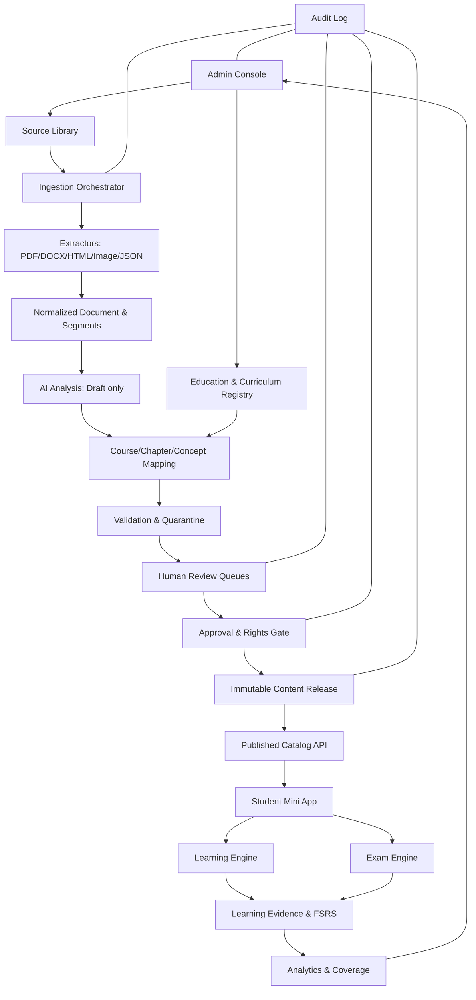

# AEL — Master Execution Plan
## معماری، تحقیق نظام آموزشی ایران، پوشش دروس، خط هوشمند دریافت منابع، پنل مدیریت و تکمیل محصول

**نسخه:** 2.1 — سند اجرایی مادر، بازنگری عمیق و یکپارچه‌سازی کیفیت فارسی  
**تاریخ مبنا:** ۱۴ آبان ۱۴۰۵ / ۵ نوامبر ۲۰۲۶  
**بازنگری کیفیت فارسی:** ۱۴۰۵/۰۸/۱۴ — `ali2000hos/persian-writing` نسخهٔ ۱.۴.۰  
**مخزن:** `rrasi90/konkortelegrambot`  
**شاخه هدف:** `main`  
**وضعیت سند:** دستور اجرایی برای ممیزی، طراحی، پیاده‌سازی، مهاجرت، تست و آماده‌سازی انتشار  
**هدف:** ساخت یک سامانه آموزشی و آمادگی آزمون چندمقطعی، قابل توسعه با افزودن پیکربندی و محتوا؛ نه محصولی که برای هر درس جدید به تغییر دستی کد نیاز داشته باشد.

---

# 0. دستور اصلی به ایجنت

تو مسئول اجرای این سند در مخزن واقعی هستی. هدف تو «تولید گزارش» یا «ساخت چند صفحه نمایشی» نیست؛ هدف، رساندن مخزن به یک سامانه یکپارچه، قابل آزمایش و قابل نگهداری است.

**هدف نهایی:** مدیر یا مالک محتوا بتواند یک کتاب، مقاله، جزوه، PDF، فایل Word، تصویر، دفترچه آزمون، پاسخ‌نامه، فایل متنی یا بسته داده را بارگذاری کند؛ سامانه نوع منبع و دامنه آموزشی آن را تشخیص دهد، محتوا را استخراج کند، ساختار بدهد، به نظام آموزشی/مقطع/رشته/درس/فصل/مبحث/مهارت مرتبط کند، ابهام‌ها را قرنطینه کند، بازبینی‌های لازم را به نقش انسانی ارجاع دهد، پس از تأیید نسخه منتشر کند و آن را بدون تغییر کد به مسیر مطالعه، تمرین، آزمون و مرور وصل کند.

همچنین مدیر باید بتواند یک درس جدید، رشته جدید، گرایش جدید، برنامه درسی جدید یا مجموعه امتحانی جدید را از پنل اضافه کند؛ نه اینکه برای هر مورد مجبور به تغییر `learning-catalog.ts`، افزودن `if` به فرانت‌اند یا انتشار نسخه جدید برنامه باشد.

## 0.1 اصول غیرقابل مذاکره

1. **ابتدا وضعیت واقعی را ثابت کن.** هیچ فایل، تست، PR، مهاجرت یا قابلیت را فقط بر اساس نامش کامل فرض نکن.
2. **از معماری موجود استفاده کن و مهاجرت تدریجی انجام بده.** بازنویسی یک‌باره، حذف سیستم قدیمی یا تغییر Stack بدون ADR و اثبات ضرورت ممنوع است.
3. **قانون و ساختار آزمون را hard-code نکن.** همه مقررات، ضرایب، ترکیب‌ها، وزن‌ها، مواد امتحانی، شیوه پذیرش و تغییرات سالانه باید نسخه‌دار، منبع‌دار و دارای تاریخ اعتبار باشند.
4. **هیچ حدس خامی را به داده قطعی تبدیل نکن.** هر مقدار نامعلوم باید `null` یا وضعیت `unknown/pending_review` داشته باشد؛ مقدار صفر، نامعلوم و غیرقابل‌اعمال یکسان نیستند.
5. **محتوای خام هرگز مستقیماً منتشر نشود.** دریافت، استخراج، تحلیل، نگاشت، بازبینی، تأیید حقوق و انتشار، وضعیت‌های جدا هستند.
6. **پاسخ درست/کلید، حقوق نشر، صحت علمی و نگاشت آموزشی با یکدیگر یکی نیستند.** هر کدام Gate مستقل دارند.
7. **هوش مصنوعی کمک‌کار است، نه مرجع حقیقت.** خروجی مدل پیشنهاد و Draft است. سؤال رسمی، کلید، ضرایب، نقشه درسی یا تأیید علمی باید منبع مستقل و در موارد لازم تأیید انسانی داشته باشد.
8. **گزارش پوشش باید صورت و مخرج مشخص داشته باشد.** 100٪ فقط وقتی مجاز است که دامنه مورد انتظار کامل و رسمی تعریف شده و تمام اجزای آن بررسی و تأیید شده باشند.
9. **هر تغییر باید تست، سند، Migration Plan و Rollback داشته باشد.** موفقیت فقط با خروجی واقعی فرمان‌ها ثابت می‌شود.
10. **هیچ Secret در کد، لاگ، PR، گزارش یا Artifact قرار نگیرد.** از Production DB برای تست مخرب یا Replay استفاده نکن.
11. **ایجنت حق ندارد تأیید انسانی را جعل کند.** ادمین فنی نمی‌تواند خودکار وضعیت `reviewed`, `authorized` یا `official` تولید کند.
12. **هر درس جدید باید از مسیر پیکربندی/داده قابل افزودن باشد.** افزودن درس عادی نباید به Deploy کد نیاز داشته باشد.

## 0.2 شیوه اجرای طولانی‌مدت

- این سند را به Work Packages مستقل با شناسه‌های `AEL-*` تبدیل کن.
- از Superpowers برای تعریف نیازمندی، طراحی، برنامه‌ریزی، TDD، Debugging، Delegation، Code Review و Verification استفاده کن (بخش 13).
- پیش از هر فاز، فهرست فایل‌های درگیر، مدل داده، وابستگی‌ها، خطرات و تست پذیرش را ارائه کن.
- هر فاز را در شاخه مستقل و PR کوچک انجام بده. `main` فقط با CI سبز، بازبینی و عدم وجود Migration Risk به‌روزرسانی شود.
- اگر یک کار به تصمیم علمی/حقوقی/مالک محصول نیاز دارد، آن را با وضعیت `HUMAN_REQUIRED`، دلیل، شواهد و گزینه‌های تصمیم متوقف کن؛ به‌جای حدس، سراغ کار مستقل بعدی برو.
- هرگز برای رسیدن به درصد پیشرفت، وظیفه مسدود را «انجام‌شده» علامت نزن.

---

# 1. وضعیت مبنا و ممیزی اولیه مخزن

این وضعیت در زمان تهیه سند از GitHub خوانده شده و ممکن است بعد از آن تغییر کند. در شروع اجرا، آن را دوباره از API و Git محلی بررسی کن.

| مورد | وضعیت مبنا |
|---|---|
| Repository | `rrasi90/konkortelegrambot` |
| `main` در آخرین بررسی | `b01b3fea266b11b17b91923f380cf2a618b135aa` |
| CI آخرین اجرا | Failure — Run `41934590731` |
| خطای CI | `packages/learning-engine/src/formative-quiz.ts` خطوط حدود 170 و 173: `TS2532` و `TS2322` |
| تست‌ها در آخرین CI | موفق |
| Typecheck اصلی | موفق |
| DB migrations/integrity job | موفق |
| Worker build | ناموفق؛ به همین دلیل `audit:miniapp` و Wrangler dry-run Skip شده‌اند |
| Branch Protection | برای `main` غیرفعال است (`protected=false`) |
| PR باز | #1، #3 و #4؛ هر سه باید دوباره ارزیابی شوند |
| Admin role system | پیاده‌سازی جامع ندارد؛ `ADMIN_API_TOKEN` عمدتاً دروازه عملیات محدود است |
| Admin review queues | در `docs/ael-next/20_SYNC_OPERATIONS_FA.md` طراحی شده، نه پیاده‌سازی کامل |
| Content ingestion | `src/import/pipeline.mjs` برای JSON، pure/no-I/O و با dry-run CLI است؛ OCR واقعی و pipeline پایدار کامل نیست |
| Static catalog | `apps/worker/src/learning-catalog.ts` فعلاً دو بسته مالی و آمار را import می‌کند |
| Legacy ingestion | `src/components/ContentIngestionStudio.tsx` و `src/App.tsx` تزریق محلی React دارند؛ پنل عملیاتی Server-backed نیست |
| Old direct importer | `scripts/import-content.mjs` باید به‌علت پیش‌فرض‌های خطرناک وضعیت انتشار/حقوق بازبینی شود |
| Human review | بسته‌های SRC-04، FIN-01 و HIST-01 آماده بازبینی‌اند، اما امضای انسانی باز است |
| Legal rights | ماتریس SRC-02 پیش‌فرض «ممنوع تا تصمیم» دارد؛ برای منابع غیرتألیفی مجوز استفاده را فرض نکن |

## 1.1 اولین کارهای اجباری

### AEL-BASE-01 — تثبیت Snapshot

1. `git fetch --all --prune` و `git status --short --branch`.
2. `git rev-parse main` و مقایسه SHA محلی و `origin/main`.
3. Pull Requestها، Branchها، Workflowهای اخیر، Deploymentها و Environmentهای واقعی را دوباره بخوان.
4. tree، dependency graph، package scripts، migrations، routeها، Storage adapters و تمام مسیرهای ingest را فهرست کن.
5. `docs/ael-next/10_EXECUTION_STATUS_FA.md`, `STATUS_FA.md`, `BACKLOG_FA.md`, `DECISIONS_FA.md`, `docs/ael-next/20_SYNC_OPERATIONS_FA.md` و Master Roadmap را تطبیق بده.
6. یک `docs/ael-implementation/BASELINE_AUDIT.md` بساز: SHA، تست‌ها، CI، محیط، شکاف‌ها، PRهای باز، محدودیت‌های ناشناخته و لینک شواهد.

### AEL-BASE-02 — سبزکردن CI

1. خطاهای TypeScript در `formative-quiz.ts` را با narrowing و validation درست رفع کن. از non-null assertion، `as string` و حذف strictness برای ساکت‌کردن خطا استفاده نکن.
2. تست‌های `recommendNextActivity` را برای آرایه خالی، مقصد نامعتبر، `undefined`، `null`، count منفی/صفر، زمان ۵/۱۰/۲۰ دقیقه، تساوی countها و ترتیب پایدار کامل کن.
3. `npm ci`, `npm run typecheck`, `npm test`, `npm run test:db`, `npm run build`, `npm run audit:client-bundle`, parity harness، `npm run validate:content`, `npm run validate:learning`, `npm run build:worker`, `npm run audit:miniapp` و Wrangler dry-run را اجرا کن.
4. CI باید در GitHub Actions روی همان SHA سبز باشد؛ نتیجه محلی به‌تنهایی کافی نیست.
5. Branch protection: Require PR, required status checks، no force push، no branch deletion برای main، conversation resolution، حداقل یک review مستقل، dismiss stale approvals در صورت تغییر کد. اگر Permission موجود نیست، با evidence به `BLOCKED_BY_GITHUB_PERMISSION` علامت بزن.

### AEL-BASE-03 — پاکسازی و ادغام PRها

- PR #1 `feat/adaptive-engine-foundation`: معماری قدیمی/متفاوت دارد. کامل Merge نکن. مستندات هنوز معتبر را به اسناد فعلی منتقل کن؛ کد قدیمی را فقط در صورت ارزش مستقل و با پورت تدریجی.
- PR #3 `fix/critical-learning-integrity-20261101`: 46 commit و از `main` به‌شدت diverged است. Merge کامل ممنوع. هر رفتار مهم آن—جداسازی self-rating از mastery، بلیت پاسخ امن، نگاشت صریح فصل، محدودیت‌های Predictor/PhD و اصلاح FSRS—را با مقایسه کد فعلی و تست‌های جدید ارزیابی و فقط اصلاحات واقعاً مفقود را Port کن.
- PR #4 `phase-1/scientific-foundation`: اسناد ساختار آزمون و فرهنگ داده مفیدند، اما Branch از main عقب است. محتوای منحصربه‌فرد را به‌صورت Commit تمیز و مستقل منتقل و بقیه را بعد از مقایسه ببند.
- هیچ Branch یا PR فقط به دلیل قدیمی‌بودن حذف نشود؛ قبل از حذف، commitها و فایل‌های منحصربه‌فرد بررسی و در صورت لزوم Tag/archive ایجاد شود.

### AEL-BASE-04 — مهار مسیر ورود قدیمی

`src/App.tsx` و `ContentIngestionStudio` اکنون داده را در State محلی React می‌افزایند. این مسیر نباید به‌عنوان ورود واقعی و پایدار معرفی شود.

- UI قدیمی را یا به `/admin/content/intake` Server-backed مهاجرت بده یا با Feature Flag/Legacy Banner فقط برای Demo نگه دار.
- `scripts/import-content.mjs` نباید وضعیت `published`, `authorized`, `verified` را از روی پیش‌فرض یا عدم وجود `synthetic` تعیین کند.
- همه importها باید از Domain service واحد و Gate حقوق/کیفیت/بازبینی عبور کنند.
- ورود مستقیم به DB فقط با Service Role در مسیر server-side مجاز است و باید Idempotency، Audit، Dry-run و Rollback داشته باشد.

**تعریف Done:** آخرین Commit در `main` سبز، CI اجباری، Branch Protection فعال یا با Evidence مسدود، مسیرهای قدیمی ایمن/بازنشسته، تصمیم PRها ثبت و Baseline مستند شده باشد.

---

# 2. تحقیق و مدل‌سازی نظام آموزشی ایران

## 2.1 قاعده تحقیق

نظام آموزشی و آزمون‌ها را به شکل «یک درخت ثابت» مدل نکن. دست‌کم پنج نوع داده از هم مستقل‌اند:

1. **ساختار رسمی آموزشی:** مقطع، پایه، شاخه، رشته، دوره، برنامه و مدرک.
2. **برنامه درسی/سرفصل:** درس‌ها، واحدها، اهداف، شایستگی‌ها، فصل‌ها و منابع مورد تأیید.
3. **قواعد سنجش و ارزشیابی:** نمره مدرسه/دانشگاه، آزمون نهایی، آزمون ورودی، ضریب، وزن و حدنصاب.
4. **رویداد آزمون و دفترچه:** سال، نوبت، گروه، مجموعه امتحانی، کد ترکیب، دفترچه، سؤال و پاسخ‌نامه.
5. **محتوای یادگیری:** کتاب، مقاله، جزوه، محتوای تألیفی، درسنامه، مثال، سؤال تمرینی و مهارت.

این پنج لایه با رابطه‌های Many-to-Many به هم وصل می‌شوند؛ مثلاً یک درس در چند برنامه درسی استفاده می‌شود، یک سؤال می‌تواند چند مهارت را بسنجد، و یک منبع می‌تواند به چند درس/مبحث ارتباط داشته باشد. آن‌ها را به یک جدول تخت با `course`, `year`, `topic` و `code` تقلیل نده.

## 2.2 دبیرستان ایران

ساختار عمومی فعلی آموزش و پرورش بر پایه ۶ سال ابتدایی و ۶ سال متوسطه است؛ متوسطه به دو دوره سه‌ساله اول و دوم تقسیم می‌شود (الگوی ۶-۳-۳). این سند برای نسخه اول محصول بر دبیرستان، یعنی پایه‌های دهم، یازدهم و دوازدهم متمرکز است؛ اما مدل داده باید آینده‌پذیر باشد تا دوره ابتدایی و متوسطه اول نیز قابل اضافه‌کردن باشد.

در متوسطه دوم، شاخه/مسیرهای آموزشی باید به‌صورت Data-driven ثبت شوند؛ مانند شاخه نظری، فنی‌وحرفه‌ای و کاردانش، و زیرشاخه‌ها/رشته‌های مرتبط با همان سال و مصوبه. در رشته نظری، گروه‌هایی مانند ریاضی‌وفیزیک، علوم تجربی، ادبیات و علوم انسانی و علوم و معارف اسلامی در طبقه‌بندی رشته‌ها دیده می‌شوند؛ لیست دقیق هر سال را از مرجع رسمی همان سال دریافت کن و هرگز آن را به یک Enum تغییرناپذیر تبدیل نکن.

### آزمون‌ها و ارزشیابی دبیرستان

- ارزشیابی مستمر و مدرسه‌ای با آزمون نهایی کشوری یک چیز نیست.
- آزمون نهایی دروس مشخص می‌تواند در سابقه تحصیلی و پذیرش آموزش عالی اثر بگذارد.
- کنکور سراسری، آزمون اختصاصی و سابقه تحصیلی دو مؤلفه مستقل نمره کل پذیرش‌اند؛ سهم و نوع تأثیر آن‌ها با سال، گروه آزمایشی، نظام آموزشی و مقررات جدید تغییر می‌کند.
- ایجاد سابقه تحصیلی، ترمیم/ایجاد نمره و تفاوت داوطلبان نظام‌های آموزشی قدیمی باید به‌صورت قواعد سالانه جدا مدل شوند.
- آموزش نظری، مهارتی و کارگاهی نباید با یک نوع ارزشیابی واحد نمایش داده شود.

### نمونه مقررات پویا که باید به‌عنوان داده نسخه‌دار ذخیره شوند

- ابلاغیه ۱۰ شهریور ۱۴۰۵ درباره کنکور ۱۴۰۵، طبق متن منتشرشده از مصوبه جلسه ۹۲۷ شورای عالی انقلاب فرهنگی، پایه یازدهم را با تأثیر مثبت و پایه دوازدهم را با تأثیر قطعی در چارچوب سهم کل ۶۰ درصد برای رشته‌های پرمتقاضی اعلام کرده است.
- گزارش منتشرشده در ۲۲ مهر ۱۴۰۵ درباره کنکور ۱۴۰۶، از سهم متفاوت سابقه تحصیلی و آزمون اختصاصی بر حسب گروه‌های آزمایشی خبر می‌دهد؛ از جمله ۶۰/۴۰ برای برخی گروه‌ها و ۳۰/۷۰ برای هنر و زبان. این اطلاعات را صرفاً نمونه تغییرپذیری بدان. قبل از ثبت Rule نهایی، ایجنت باید متن مصوبه و اطلاعیه اصلی شورای عالی انقلاب فرهنگی/سنجش را بازیابی کند، تاریخ/شماره/بند را ثبت و دو منبع مستقل یا نسخه رسمی را تطبیق دهد.

**قانون:** درصد، تعداد درس نهایی، پایه مؤثر، نوع تأثیر مثبت/قطعی، ضرایب، زیرگروه‌ها و تعداد نوبت کنکور نباید در فرانت‌اند یا کد Engine ثابت باشند. فقط از `AssessmentPolicyVersion` و `AdmissionRuleVersion` خوانده شوند.

## 2.3 ورود به کارشناسی (لیسانس)

کنکور کارشناسی یک خانواده آزمون پذیرش بعد از متوسطه است. باید از «برنامه درسی دانشجوی کارشناسی» جدا شود.

- `UndergraduateAdmissionExam` شامل سال/نوبت، گروه آزمایشی، دفترچه‌ها، قواعد نمره کل، سهم سوابق، سهم آزمون اختصاصی، سهمیه‌ها، انتخاب رشته، ظرفیت‌ها و کدرشته‌محل‌هاست.
- رشته دانشگاهی و برنامه کارشناسی به دانشگاه/مؤسسه، سال ورود، نسخه برنامه، تعداد واحد، درس‌های عمومی/پایه/اصلی/تخصصی/اختیاری، پیش‌نیاز، هم‌نیاز و ترتیب نیم‌سال وابسته‌اند.
- سرفصل یک رشته در دو دانشگاه یا دو نسخه سال ورود ممکن است یکسان نباشد؛ صرف عنوان «مدیریت» برای یکی‌کردن آن‌ها کافی نیست.
- آزمون داخلی پایان‌ترم دانشگاه (Midterm/Final/Project/Practical) باید به‌عنوان روش ارزشیابی درس دانشگاه ثبت شود و با کنکور سراسری اشتباه نشود.

## 2.4 کارشناسی ارشد

آزمون کارشناسی ارشد ناپیوسته از «مجموعه‌های امتحانی» استفاده می‌کند. هر مجموعه می‌تواند چند رشته و گرایش را پوشش دهد؛ مواد امتحانی، شماره درس‌ها، ضرایب و کد ضریب برای هر رشته/گرایش ممکن است متفاوت باشد. دفترچه ثبت‌نام و اطلاعیه مواد امتحانی همان سال، مرجع معتبر داده این آزمون است.

**نمونه ساختار واقعی در دفترچه ارشد ۱۴۰۵:** جدول‌ها رشته/گرایش، کد ضریب و ضرایب مواد امتحانی شماره‌گذاری‌شده را کنار هم نشان می‌دهند. بنابراین مدل نباید فرض کند هر مجموعه دقیقاً یک فهرست درس و یک ضریب دارد.

برای هر سال باید ثبت شود:
- `examSetCode`, `examSetTitle`, `subjectNumber`, `subjectTitle`.
- `fieldId`, `majorId`, `subfieldId`, `coefficientCode`.
- نگاشت هر `field/major` به دروس آزمون و ضرایبشان.
- وضعیت‌های رسمی، پیشنهادی، مبهم و نیازمند بازخوانی.
- نظام‌های پذیرش، رشته‌های شناور/اصلی و شرایط خاص همان سال.

پذیرش استعداد درخشان یا مسیرهای بدون آزمون را با کنکور متمرکز یکی نکن؛ آن‌ها Admission Pathهای جدا با اسناد و شرایط مستقل‌اند.

## 2.5 دکتری تخصصی

دفترچه آزمون دکتری ۱۴۰۵ دو مرحله اصلی را تصریح می‌کند:
1. سنجش علمی/آزمون متمرکز.
2. مصاحبه علمی، سنجش عملی و ارزیابی سوابق آموزشی، پژوهشی و فناوری در دانشگاه پذیرنده.

در شیوه آموزشی‌پژوهشی، در همان سال، وزن‌های اعلام‌شده ۵۰٪ آزمون متمرکز، ۲۰٪ سوابق و ۳۰٪ مصاحبه/سنجش عملی بوده‌اند. برای شیوه پژوهش‌محور، وزن‌ها ۳۰٪ آزمون متمرکز، ۲۰٪ سوابق، ۳۰٪ مصاحبه و ۲۰٪ طرح‌واره بوده‌اند. مواد آزمون ۱۴۰۵ نیز زبان با ضریب ۱ و دروس تخصصی سطوح کارشناسی، ارشد و دکتری با ضریب ۵ را نشان می‌دهد و استعداد تحصیلی از مواد آزمون حذف شده است.

این ساختار را به عنوان نمونه سال ۱۴۰۵ نگه دار، نه قانون همیشگی. تغییرات سالانه می‌تواند مواد، ضرایب، مرحله پذیرش، سهم مصاحبه، طرح‌واره، حدنصاب، شیوه استادمحور یا ظرفیت را عوض کند.

برای دکتری، سیستم باید موارد زیر را مستقل پشتیبانی کند:
- مجموعه امتحانی/کد رشته امتحانی/رشته و گرایش/دانشگاه پذیرنده.
- دروس تخصصی و زبان/ضرایب/منابع پیشنهادی.
- سؤال‌های آزمون متمرکز با سال، دفترچه، شماره، کلید و منشأ.
- سوابق آموزشی، پژوهشی، فناوری، مقاله، کتاب، پایان‌نامه و طرح پیشنهادی (به‌عنوان rubrics/portfolio، نه MCQ).
- مصاحبه و سنجش عملی با Rubric نسخه‌دار و امتیازدهی انسانی.
- شیوه آموزشی‌پژوهشی، پژوهش‌محور و هر مسیر دیگر در سال مربوط.
- قواعد کدرشته‌محل، ظرفیت، حدنصاب و انتخاب رشته.

## 2.6 آموزش عالی: برنامه درسی دانشگاه

آیین‌نامه یکپارچه مقررات آموزشی مصوب جلسه ۹۶۲ شورای عالی برنامه‌ریزی آموزشی (۲۵ تیر ۱۴۰۲) دوره‌های کاردانی، کارشناسی، کارشناسی ارشد و دکتری تخصصی را پوشش می‌دهد و برای ورودی ۱۴۰۲-۱۴۰۳ ابلاغ شده است. این یک چارچوب مقررات آموزشی است؛ اما برای ساخت برنامه درسی هر رشته باید چارت و سرفصل رسمی دانشگاه/شورای برنامه‌ریزی مربوط هم ثبت شود.

مدل برنامه دانشگاهی باید امکان ثبت این موارد را داشته باشد:
- دانشگاه، دانشکده، رشته، گرایش، دوره/نظام آموزشی و سال ورودی.
- نسخه برنامه درسی (Curriculum Version) و نیم‌سال‌های اجرا.
- درس، کد درس، واحد نظری/عملی، پیش‌نیاز/هم‌نیاز، گروه درس و سطح.
- اهداف درس، Course Learning Outcomes، مباحث، منابع و Rubric ارزشیابی.
- تغییرات مصوب برنامه و دانشجویان/ورودی‌هایی که نسخه بر آن‌ها اعمال می‌شود.

## 2.7 جمع‌بندی نیازمندی‌های آموزشی

| سطح | موجودیت اصلی | ساختار محتوا | سنجش/آزمون | قاعده مهم |
|---|---|---|---|---|
| دبیرستان | پایه، شاخه، رشته، سال تحصیلی | درس، فصل، هدف یادگیری، کتاب رسمی | ارزشیابی مدرسه، آزمون نهایی، کنکور سراسری | وزن سوابق و مقررات برحسب سال/گروه |
| پذیرش کارشناسی | گروه آزمایشی، کدرشته‌محل | درس‌های آزمون و مباحث | آزمون سراسری و سوابق تحصیلی | قواعد پذیرش و دفترچه همان سال |
| برنامه کارشناسی | دانشگاه، رشته، ورودی | چارت واحدی، دروس، پیش‌نیاز، منابع | امتحان/پروژه/کار عملی | نسخه برنامه تابع دانشگاه و سال ورود |
| کارشناسی ارشد | مجموعه، کد ضریب، رشته/گرایش | مواد امتحانی و منابع هر درس | آزمون متمرکز و مسیرهای خاص پذیرش | ضرایب به تفکیک کد ضریب/گرایش |
| دکتری | رشته امتحانی/گرایش/دانشگاه | تخصصی، زبان، منابع، مهارت پژوهش | آزمون متمرکز، سوابق، مصاحبه و طرح | وزن و Rubric در شیوه پذیرش و سال متفاوت |

## 2.8 کنترل کیفیت فارسی و راست‌به‌چپ (Persian-first by design)

**Skill مرجع:** [ali2000hos/persian-writing](https://github.com/ali2000hos/persian-writing) — آخرین نسخه‌ای که در بازنگری سند بررسی شد `v1.4.0` است. مخزن شامل `SKILL.md`، `AGENTS.md`، منابع نگارش و دستورخط، ابزارهای lint/cleanup و راهنماهای قالب‌های RTL است. این Skill برای هر کاری که متن فارسی یا مخاطب ایرانی دارد فعال می‌شود، نه فقط برای نگارش اسناد.

### دامنه اجباری استفاده

1. **محصول و UI:** متن دکمه، منو، فرم، خطا، خالی‌بودن صفحه، onboarding، اعلان، راهنمای آزمون، پیام تلگرام و محتوای دسترس‌پذیری.
2. **محتوای آموزشی:** عنوان درس، توضیح مفهوم، درسنامه، مثال، فرمول توضیح‌دار، سؤال، گزینه، پاسخ تشریحی، بازخورد اشتباه و راهنمای مطالعه.
3. **ادمین و عملیات:** نام وضعیت‌ها و برچسب‌ها، صف بازبینی، یادداشت بازبین، گزارش خطا، audit log قابل نمایش، گزارش پوشش و داشبورد.
4. **مستندات و ارتباطات:** README فارسی، راهنمای نصب، راهنمای کاربر، Release notes، پیام پشتیبانی، ایمیل و محتوای راهنما.
5. **اسناد تولیدشده:** Markdown، HTML، DOCX، PDF، XLSX، PPTX، تصویر و محتوای خروجی؛ برای هر قالب، راهنمای مرتبط همان Skill را بخوان.

### مراحل استفاده و نصب

1. Harness را شناسایی کن. برای Codex/Cursor/Claude Code/OpenCode/Pi و ابزارهای مشابه، ابتدا روش رسمی همان میزبان را بررسی کن؛ هیچ دستور نصب مختص Claude Code را کورکورانه برای Codex اجرا نکن.
2. نسخهٔ release شدهٔ `v1.4.0` را Pin کن؛ در صورت دریافت `main`، commit SHA واقعی و تاریخ دریافت را ثبت کن. «latest» را بدون ثبت شماره نسخه/commit نپذیر.
3. برای Agentهای Markdown-skill-compatible، مخزن را در مسیر Skills همان Harness یا مسیر پروژه‌ای مورد تأیید آن قرار بده و در `AGENTS.md` دستور صریح اضافه کن: برای هر متن فارسی، `SKILL.md` و مراجع مرتبط را بخوان و اجرا کن.
4. برای محیط‌هایی که Skill folder را پشتیبانی نمی‌کنند، از فایل universal رسمی همان نسخه به‌عنوان Knowledge/Project Instructions استفاده کن؛ اگر امکان بارگذاری فایل ندارد، دستورهای ضروری را در system/project rules منعکس کن و این fallback را مستند کن.
5. وابستگی‌های اختیاری را جدا بررسی کن. اجرای lint/cleanup طبق مستندات Skill به Python و فایل‌های واژه‌نامه نیاز دارد؛ هیچ فونت/فایل binary را بی‌دلیل commit نکن. فایل‌های فونت را به‌عنوان داراییِ نصب‌شدهٔ محیط/منبع رسمی مدیریت کن، نه فایل عمومی برای انتشار بدون بررسی License و حجم.
6. License کد Skill را بررسی کن و مجوز فونت‌ها/واژه‌نامه/ابزارهای تجمیع‌شده را جدا رعایت کن. MIT بودن کل مخزن به معنی MIT بودن همه دارایی‌های ثالث نیست.
7. پس از نصب، یک تست فارسی واقعی و یک تست حفاظتی روی code fence، JSON، LaTeX، جدول Markdown و متن مخلوط فارسی/لاتین اجرا کن. نسخه و نتیجه را در Manifest ذخیره کن.

### قرارداد املایی و نگارشی AEL

- حروف فارسی «ی» و «ک» به‌کار بروند؛ نویسه‌های عربی `ي` و `ك` در متن عادی فارسی نمانند. متن نقل‌قول‌شدهٔ اصل منبع در صورت نیاز به وفاداری، جداگانه و با برچسب Source Quote حفظ شود.
- نیم‌فاصله در ترکیب‌های لازم، مانند «می‌شود»، «می‌توان»، «به‌روزرسانی»، «داده‌محور» و «پیش‌نیاز»، درست استفاده شود.
- گیومهٔ فارسی «…» در متن فارسی؛ نشانه‌گذاری فارسی بدون تغییر ناخواستهٔ رشته‌های کد.
- لحن باید با خروجی سازگار باشد: علمی برای متن درس و گزارش پژوهشی؛ رسمی و کوتاه برای پنل/مقررات؛ محاورهٔ روشن و محترمانه برای داوطلب؛ اداری برای نامه و گردش کار.
- اعداد فارسی در متن نمایشی فارسی، اما شناسه‌ها، سال‌های ISO/Unix، کدهای آزمون، API، مقادیر machine-readable، فرمول و کد در قالب canonical/ASCII نگهداری شوند. نمایش عدد فارسی از مقدار اصلی جدا باشد.
- اصطلاح تخصصی انگلیسی در نخستین کاربرد همراه معادل فارسی بیاید؛ پس از آن از یک واژه‌نامهٔ مصوب و یکسان استفاده شود. نام رشته، درس، مقطع و اصطلاحات رسمی را با ابداع معادل تغییر نده.
- متن آموزشی نباید برای «انسانی جلوه دادن» دچار تغییر محتوا شود. De-AI/humanizer صرفاً برای روانی نثر، بدون جعل نویسنده/منبع یا تغییر معنا مجاز است.

### کنترل RTL در رابط

- direction و language باید بر اساس locale تعیین شوند؛ از آمیختن ترتیب بصری با ترتیب واقعی داده خودداری کن.
- در UI فارسی از `dir="rtl"` و logical CSS properties (`margin-inline`, `padding-inline`, `inset-inline`) استفاده کن؛ آدرس، ایمیل، URL، شناسه، کد و فرمول در `dir="ltr"` یا isolation مناسب نمایش داده شوند.
- از Unicode isolation برای قطعه‌های LTR در میان متن RTL استفاده کن؛ ترتیب علائم نگارشی، پرانتز، شماره گزینه و اعشار را در Chromium/Android واقعی آزمایش کن.
- فونت فارسی fallback مشخص و دارای پوشش نویسه باشد؛ Vazirmatn می‌تواند گزینه پیش‌فرض باشد، اما بارگذاری فونت باید license، وزن، حجم و عملکرد را رعایت کند.
- هیچ اصلاح خودکار نباید code block، JSON، YAML، SQL، TypeScript، URL، شماره سؤال، لاتک، جدول، فرمول، شناسه یا دادهٔ منبع را دستکاری کند.

### گیت کیفیت فارسی

هر متن فارسی تولیدشده پیش از انتشار باید این مسیر را بگذراند:

`Draft → Register Detection → Source/Meaning Check → Persian Writing Skill → Orthography/Lint → Format/RTL QA → Human Review (when required) → Publish`

- خروجی محتوا از نظر علمی/حقوقی Gate جداگانه دارد.
- اصلاح خودکار فقط روی متن‌هایی مجاز است که format-aware parser آن‌ها را درست تشخیص داده است. فایل خام را با regex سراسری اصلاح نکن.
- برای JSON/کد، parse و test؛ برای Markdown، حفظ headings/tables/lists/fences؛ برای HTML، تست DOM و RTL؛ برای DOCX/PDF/PPTX/XLSX، renderer و verifier همان قالب.
- `fa_lint.py --check` و `persian_cleanup.py --spellcheck` یا معادل نسخهٔ Pin‌شده اجرا شوند. اجرای `--edit` ابتدا روی کپی/branch و سپس با diff review؛ خروجی باید idempotent باشد.
- قبل/بعد را با تست حفظ تعداد خطوط، headings، پاراگراف‌ها، جدول، code fence، لینک، فرمول و byte-sensitive fields کنترل کن.
- تست انسانی native reader برای نمونه‌های UI و محتوای آموزشی لازم است؛ lint به‌تنهایی کیفیت ادبی، صحت علمی یا وضوح آموزشی را تضمین نمی‌کند.

### تست‌های فارسی حداقلی

`FA-01` ی/ک فارسی؛ `FA-02` نیم‌فاصله؛ `FA-03` اعداد و تاریخ؛ `FA-04` گیومه و علائم؛ `FA-05` متن RTL+URL؛ `FA-06` فرمول و نمادهای ریاضی؛ `FA-07` کد/JSON بدون تغییر؛ `FA-08` جدول و فهرست Markdown؛ `FA-09` پاراگراف‌های mixed-direction؛ `FA-10` فونت در Android؛ `FA-11` فرم و خطاهای UI؛ `FA-12` صفحه‌خوان/کیبورد و ترتیب focus؛ `FA-13` PDF/HTML pagination/RTL؛ `FA-14` idempotency پاک‌سازی.

## 2.9 منابع تحقیق و قاعده استناد

منابعی که در طراحی فعلی استفاده شده‌اند:

1. [مصوبه ۱۰۵۴ شورای عالی آموزش و پرورش، ۲۰ اسفند ۱۴۰۳](https://hoghogh.ai/circulars/c-3609e5da) — چارچوب شایستگی‌ها، دوره‌ها، حوزه‌های یازده‌گانه تربیت و یادگیری، شاخه‌ها، عناوین درس، راهنمای تفصیلی درس و بسته‌های یادگیری.
2. [برنامه درسی ملی — ساختار و زمان آموزش](https://fa.wikisource.org/wiki/برنامه_درسی_ملی_جمهوری_اسلامی_ایران/ساختار_و_زمان_آموزش) — برای ساختار ۶ سال ابتدایی + ۶ سال متوسطه؛ نسخه اصلی/آخرین ابلاغیه باید در مرحله تحقیق رسمی دوباره بازیابی شود.
3. [راهنمای ارزشیابی سال تحصیلی ۱۴۰۵-۱۴۰۴](https://www.oerp.ir/news/ID/13849) — نمونه انتشار راهنمای سالانه ارزشیابی و بارم‌بندی؛ محتوا نباید بدون نسخه‌گذاری به سال بعد تعمیم یابد.
4. [دفترچه دکتری ۱۴۰۵](https://irantahsil.org/wp-content/uploads/2025/11/دفترچه-ثبت-نام-آزمون-دکتری.pdf) — نسخه در دسترس عمومی از دفترچه سازمان سنجش؛ ساختار دومرحله‌ای و وزن‌های شیوه‌های پذیرش.
5. [اطلاعیه مواد، ضرایب و شیوه پذیرش دکتری ۱۴۰۵](https://www.sarkhat.com/fa/news/148556595/) — گزارش متن اطلاعیه سازمان سنجش؛ برای ورود داده نهایی، اصل اطلاعیه در دامنه سازمان سنجش را بازیابی کن.
6. [دفترچه ثبت‌نام کارشناسی ارشد ناپیوسته ۱۴۰۵](https://pasokhbama.com/wp-content/uploads/2022/10/Download-the-Masters-Degree-Exam-Registration-Booklet-1405.pdf) — نسخه عمومی دفترچه و نمونه جدول کد ضریب/ضرایب؛ اصل سند از sanjesh.gov.ir را نیز بازیابی و هش آن را ثبت کن.
7. [آیین‌نامه یکپارچه مقررات آموزشی کاردانی تا دکتری، مصوب ۱۴۰۲](https://phdinfo.ir/آیینن-نامه-یکپارچه-مقررات-آموزشی-دوره/) — گزارش ابلاغ وزارت علوم؛ اصل آیین‌نامه و پیوست‌های آن در مرحله ساخت کاتالوگ مقررات تأیید شوند.
8. [ابلاغ تغییرات سوابق تحصیلی کنکور ۱۴۰۵، ۱۰ شهریور ۱۴۰۵](https://www.tasnimnews.ir/fa/news/1405/06/10/3685807/) — متن خبر حاوی بخش‌هایی از مصوبه جلسه ۹۲۷؛ اصل ابلاغیه باید به مخزن منابع رسمی افزوده شود.
9. [گزارش تغییرات کنکور ۱۴۰۶، ۲۲ مهر ۱۴۰۵](https://newsmedia.tasnimnews.ir/fa/news/1405/07/22/3722464/) — نشانه‌ای از تغییر گروهی سهم آزمون و سوابق؛ تا تطبیق با اصل مصوبه، `secondary_source_only` باقی بماند.
10. [Superpowers — README/Installation](https://github.com/obra/superpowers) و [Awesome Claude Skills](https://github.com/karanb192/awesome-claude-skills) — منابع نصب و گزینش مهارت‌های مهندسی.
11. [Persian Writing Skill](https://github.com/ali2000hos/persian-writing) — نگارش طبیعی فارسی، دستورخط، نیم‌فاصله، کنترل RTL، lint و بررسی قالب؛ نسخهٔ Release بررسی‌شده `1.4.0`.

**دستور تحقیق تکمیلی برای ایجنت:** منابع فوق نقطه شروع هستند، نه بسته حقیقت کامل. برای هر قانون جاری، مرجع اولویت‌دار عبارت است از: متن رسمی مصوبه/بخشنامه → دفترچه سازمان سنجش همان سال → اطلاعیه مرجع ذی‌صلاح → سایت رسمی دانشگاه/وزارت → گزارش خبرگزاری. خبرگزاری یا وبلاگ آموزشی نباید منبع نهایی وضعیت `official_verified` باشد. هر اختلاف را در `regulatory_conflicts` ثبت کن.

---

# 3. محصول نهایی و تجربه کاربر

## 3.1 اصل سادگی

داوطلب نباید با درخت پیچیده سازمانی یا پنل تنظیمات آموزشی مواجه شود. ساختار پیچیده برای پشت‌صحنه است؛ در سطح داوطلب فقط این سؤال‌ها پاسخ داده شوند:

1. برای چه آزمون/رشته/مقطعی آماده می‌شوم؟
2. الان چه کاری را انجام بدهم؟
3. چرا این فعالیت پیشنهاد شده است؟
4. بعد از آن چه چیزی یاد گرفتم و چه چیزی هنوز اثبات نشده است؟
5. چطور منبع، پاسخ، بازخورد یا پیشرفت خود را ببینم؟

## 3.2 مسیر Onboarding

- گام ۱: انتخاب هدف اصلی: دبیرستان/کنکور کارشناسی، درس دانشگاهی کارشناسی، ارشد، دکتری یا مسیر آزاد.
- گام ۲: انتخاب سال و نسخه آزمون/برنامه آموزشی؛ اگر سال هنوز رسمی نیست، وضعیت `not_yet_published` را نشان بده.
- گام ۳: انتخاب گروه/شاخه/رشته/گرایش/دانشگاه (فقط فیلدهایی که برای آن مسیر کاربرد دارند).
- گام ۴: انتخاب هدف و زمان در دسترس؛ آزمون تشخیصی اختیاری و بدون پیش‌فرض تسلط.
- گام ۵: ورود به صفحه خانه؛ یک اقدام اصلی، یک جایگزین کوتاه، و نمایش شفاف پیشرفت.

از پرسیدن اطلاعاتی که قبلاً در پروفایل/هدف ثبت شده خودداری کن. انتخاب رشته/سال کاربر نباید به ساختار global catalog آسیب بزند.

## 3.3 ناوبری اصلی داوطلب

1. **خانه:** ادامه مطالعه، برنامه امروز، تمرین کوتاه، مرور سررسید و آخرین نتیجه.
2. **درس‌ها:** فهرست درس‌های هدف، سرفصل رسمی/آموزشی، فصل و مبحث.
3. **مطالعه:** درسنامه، منبع و صفحه/بخش، مثال، نکته، واژگان، فرمول و یادداشت شخصی.
4. **تمرین:** تمرین موضوعی، سؤال مشابه/انتقالی، آزمون کوتاه و بازخورد.
5. **آزمون:** شبیه‌ساز دفترچه، آزمون ترکیبی، آزمون زمان‌دار و آزمون سال/نوبت مشخص.
6. **مرور:** غلط‌ها، نزده‌ها، فلش‌کارت/یادآوری، پاسخ‌های تشریحی در انتظار و موارد سررسیدشده.
7. **پیشرفت:** پوشش دروس، شواهد تسلط، تاریخچه و ضعف‌های تأییدنشده.
8. **تنظیمات:** مقطع/هدف، زمان مطالعه، اعلان‌ها، حریم خصوصی، داده و Export.

## 3.4 اصول UX

- هر صفحه یک Primary Action داشته باشد.
- اصطلاحات رسمی را در لایه اطلاعات نمایش بده؛ نه اینکه تمام کدهای ترکیب/ضریب روی صفحه خانه ظاهر شوند.
- فیلترهای پیشرفته را در پنل/Popover یا صفحه جدا قرار بده.
- برای هر درس Badgeهای واضح داشته باش: «رسمی»، «تألیفی»، «در حال بررسی»، «نسخه قدیمی»، «منبع مجاز»، «پوشش ناقص».
- میان «خوانده شد»، «تمرین شد»، «در آزمون پاسخ صحیح بود» و «تسلط تأیید شد» تفاوت قائل شو.
- self-rating برای اعتمادبه‌نفس مفید است ولی mastery score را مستقیماً ارتقا نمی‌دهد.
- رتبه، تراز، احتمال قبولی و تضمین قبولی بدون دیتاست معتبر و اعتبارسنجی Out-of-sample نمایش داده نشود.
- فارسی RTL، اعداد، تاریخ شمسی، فرمول LaTeX، جدول‌ها، نمودار، کیبورد و VoiceOver/TalkBack بررسی شوند.
- روی شبکه ضعیف، مسیر مطالعه و ذخیره امن پاسخ‌ها باید قابل بازیابی باشد.

---

# 4. معماری کلان: یک کاتالوگ واحد، چند ماژول مستقل

## 4.1 تصمیم معماری

در فاز فعلی **Modular Monolith** را انتخاب کن، نه Microservices. مخزن TypeScript monorepo و Cloudflare Worker را حفظ کن. مرز ماژول‌ها در Packageها و Serviceهای مستقل تعریف شوند. جداکردن سرویس‌ها فقط پس از اندازه‌گیری Load، پیچیدگی Deployment یا نیاز سازمانی و با ADR مجاز است.

اجزای هدف:

1. **Education Registry:** نظام آموزشی، مقطع، پایه، شاخه، رشته، دانشگاه، برنامه و سال اعتبار.
2. **Curriculum Registry:** برنامه درسی، درس، واحد، فصل، سرفصل، هدف یادگیری و پیش‌نیاز.
3. **Assessment Registry:** آزمون، رویداد آزمون، کد مجموعه، دفترچه، قوانین، ضرایب، وزن‌ها و Rubric.
4. **Source Library:** منابع خام، نسخه فایل، ناشر/نویسنده، حقوق، هش و محل نگهداری.
5. **Ingestion Orchestrator:** صف کار، استخراج فرمت، OCR، تبدیل، اعتبارسنجی و پردازش مجدد.
6. **Knowledge Graph:** مفهوم، مهارت، رابطه، پیش‌نیاز، توانایی و نگاشت سؤال به مهارت.
7. **Content Authoring:** درسنامه، خلاصه، سؤال تألیفی، پاسخ تشریحی، کارت و تمرین.
8. **Review & Governance:** صف تأیید علمی، حقوق، اصالت، پاسخ‌نامه، نگاشت و انتشار.
9. **Publishing Registry:** انتشار نسخه immutable، رهاسازی، rollback و snapshot کاتالوگ.
10. **Learning Engine:** تشخیص، صف روزانه، FSRS، تمرین انتقالی، برنامه‌ریز و شواهد تسلط.
11. **Exam Engine:** ساخت آزمون، انتخاب سؤال، زمان، نمره، کلید امن و تحلیل.
12. **Admin Console:** کنترل همه اجزای بالا بر اساس Permission.
13. **Student Mini App:** تجربه ساده و مبتنی بر نسخه منتشرشده.
14. **Analytics & Audit:** پوشش، عملکرد محتوا، رویداد، خطا، SLA، هزینه و تاریخچه.
15. **Integration Adapters:** Telegram، Supabase، Cloudflare، Object Storage و سرویس OCR/AI.

## 4.2 نقشه ارتباط ماژول‌ها



## 4.3 مرز اعتماد

- Admin API و Student API باید جدا از نظر Permission و Data Exposure باشند.
- `correct_option`, `answer_key`, hidden proof item و private source text نباید از Published Student API به‌صورت زودهنگام نشت کنند.
- Admin-only queryها از `service_role` فقط در سمت سرور استفاده کنند.
- Content extraction job به مجوز ارسال متن به بیرون نیاز دارد؛ قرارداشتن یک فایل در Storage به‌معنی اجازه ارسال آن به مدل خارجی نیست.
- Object Storage و Database referenceها با شناسه مستقل پیوند بخورند؛ URL عمومی به فایل خصوصی داده نشود.

---

# 5. مدل اطلاعات و هویت‌های پایدار

## 5.1 قاعده هویت

عنوان فارسی کلید اصلی نیست. هر موجودیت `id` پایدار و غیرقابل‌تغییر، `slug` اختیاری، `display_name` و `aliases` دارد. تغییر عنوان نباید رابطه‌ها یا تاریخچه دانش‌آموز را بشکند.

## 5.2 موجودیت‌های دامنه‌ای هدف

### ساختار آموزشی

- `education_authorities`: سازمان سنجش، آموزش و پرورش، وزارت علوم، دانشگاه و مراجع تصویب.
- `education_systems`: نظام آموزشی رسمی/نوع نظام قدیم و جدید.
- `education_levels`: secondary، associate، bachelor، master، phd و مسیرهای آینده.
- `education_stages`: پایه/دوره/سال تحصیلی/نیم‌سال.
- `education_tracks`: نظری، فنی‌وحرفه‌ای، کاردانش و سایر مسیرهای نسخه‌دار.
- `fields_of_study`, `majors`, `subfields`, `exam_groups`.
- `institutions`, `faculties`, `programs`, `program_versions`.
- `academic_years`, `admission_cycles`.

### برنامه درسی

- `curricula` و `curriculum_versions`.
- `curriculum_courses`: درس با context مشخص در پایه/رشته/برنامه/دانشگاه/سال.
- `course_definitions`: هویت عمومی درس مستقل از استفاده آن در برنامه.
- `course_offerings`: ارائه یک درس در یک سال/رشته/دانشگاه/ترم.
- `course_units`: واحد نظری، عملی، کارگاهی، آزمایشگاهی.
- `syllabus_nodes`: سرفصل/بخش/فصل با parent و ترتیب.
- `learning_outcomes`, `competencies`, `skills`, `knowledge_concepts`.
- `prerequisite_edges`, `concept_relations`, `course_skill_mappings`.

### آزمون و پذیرش

- `exam_families`: سراسری، نهایی، ارشد، دکتری، دانشگاهی و غیره.
- `exam_events`: سال، نوبت، مرجع، تاریخ و وضعیت انتشار.
- `exam_event_versions`: Snapshot رسمی مواد و قواعد همان سال.
- `exam_groups`, `exam_sets`, `exam_combinations`, `exam_fields`.
- `exam_subjects`: مواد/درس‌های امتحانی به ترتیب رسمی.
- `exam_field_subject_assignments`: نگاشت ردیف رشته/گرایش به بسته‌های درسی.
- `exam_coefficients`: ضریب هر ماده برای هر کد ضریب و رشته/گرایش.
- `admission_rules`: ترکیب آزمون/سوابق/مصاحبه/سهمیه/حدنصاب.
- `assessment_components` و `assessment_rubrics`.
- `exam_booklets`, `exam_sections`, `question_appearances`, `answer_key_versions`.
- `score_scales`, `negative_marking_rules`, `time_limits`, `question_counts`.

### منابع و محتوا

- `sources`: کتاب/مقاله/جزوه/دفترچه/پاسخ‌نامه/وب‌منبع/محتوای تألیفی.
- `source_versions`: Edition، چاپ، سال، زبان، ناشر، ISBN/DOI و metadata.
- `source_rights_decisions`: نوع استفاده مجاز، قلمرو، تاریخ، مجوز، تصمیم‌گیرنده.
- `source_files`: Object key، hash، mime type، size، page count و security scan status.
- `document_pages`, `document_segments`, `document_tables`, `document_figures`.
- `content_items`, `content_versions`: lesson, explanation, summary, exercise, question, note.
- `question_versions`, `question_options`, `answer_key_versions`, `solution_versions`.
- `question_skill_mappings`, `question_course_mappings`, `question_source_mappings`.
- `content_source_attributions`: دقیقاً مشخص کند کدام قسمت از کدام منبع آمده.
- `content_release`, `release_items`, `release_audit`.

### خط پردازش و نظارت

- `ingestion_jobs`, `ingestion_job_steps`, `ingestion_artifacts`, `ingestion_attempts`.
- `review_tasks`, `review_decisions`, `review_comments`, `approval_signatures`.
- `validation_runs`, `validation_findings`, `quarantine_items`.
- `audit_events`, `admin_actions`, `feature_flags`, `system_settings`.
- `coverage_scopes`, `coverage_snapshots`, `coverage_gaps`.

### یادگیری و کاربر

- `users`, `user_profiles`, `learner_goals`, `learner_enrollments`.
- `learner_course_progress`, `learner_skill_states`, `learning_evidence`.
- `study_sessions`, `attempt_tickets`, `answer_events`, `review_cards`, `mastery_history`.
- `exam_sessions`, `exam_session_items`, `exam_responses`, `exam_results`.
- `learner_notes`, `bookmarks`, `mistakes`, `notification_preferences`.

## 5.3 روابط کلیدی

- یک `course_definition` می‌تواند در چند `curriculum_course` استفاده شود.
- یک `curriculum_course` به یک نسخه برنامه و context آموزشی وابسته است.
- یک `exam_subject` می‌تواند به چند `course_definition`/`syllabus_node` نگاشت شود و بالعکس.
- یک `source` می‌تواند چند نسخه، فایل، فصل و صفحه داشته باشد.
- یک `question` می‌تواند چند occurrence در دفترچه‌های چند سال داشته باشد؛ occurrenceها نباید سؤال مستقل یا تکرار آموزشی تلقی شوند مگر سیاست تحلیل این‌طور تعریف کند.
- یک سؤال می‌تواند Primary و Secondary Skill داشته باشد؛ وزن و نقش هر mapping ذخیره شود.
- یک Content Release از نسخه‌های Immutable تشکیل می‌شود تا تغییر محتوا به صورت پنهان روی آزمون‌های قبلی اثر نگذارد.

## 5.4 Versioning الزامی

هر تغییر در این موارد باید نسخه بسازد: ساختار آزمون، مواد، ضرایب، برنامه درسی، سرفصل، فصل کتاب/چاپ، سؤال، کلید، توضیح، نگاشت سؤال-مهارت، Rubric و حقوق منبع.

الگوی نسخه:
- `version`: عدد صحیح افزایشی یا SemVer برحسب دامنه.
- `effective_from`, `effective_until`.
- `status`: draft / pending_review / approved / published / superseded / rejected.
- `source_ids`, `decision_id`, `created_by`, `approved_by`, `created_at`.
- `change_reason`, `previous_version_id`, `content_hash`.

سؤال/پاسخ/کلید تغییرکرده نباید نتیجه آزمون گذشته را از نو محاسبه کند؛ نشست امتحان به نسخه‌ای که با آن شروع شده Pin می‌شود.

---

# 6. سیستم پوشش‌دهی دروس و سرفصل‌ها

## 6.1 Coverage یک عدد واحد نیست

برای هر برنامه/آزمون/درس، این شاخص‌ها را جدا محاسبه کن:

1. **Official Structure Coverage:** چه تعداد از دروس/بسته‌ها/رشته‌های مورد انتظار رسمی شناخته شده‌اند؟
2. **Syllabus Coverage:** چه تعداد از سرفصل‌های رسمی/تأییدشده به مدل ساختاریافته تبدیل شده‌اند؟
3. **Source Coverage:** برای هر مبحث چه منابع دارای منشأ و نسخه معتبر دریافت شده‌اند؟
4. **Question Coverage:** چه تعداد سؤال از مخرج مورد انتظار و مشخص قابل ردیابی وجود دارد؟
5. **Answer-Key Coverage:** چه تعداد سؤال کلید معتبر و مستقل‌تطبیق‌شده دارند؟
6. **Skill Coverage:** چه تعداد مهارت تعریف عملیاتی و سؤال سنجش‌پذیر دارند؟
7. **Learning Content Coverage:** چه تعداد درسنامه/مثال/تمرین تأییدشده دارند؟
8. **Rights Coverage:** چه تعداد از اقلام وضعیت حقوق روشن برای نوع استفاده موردنظر دارند؟
9. **Review Coverage:** چه تعداد علمی، نگاشتی و حقوقی تأیید شده‌اند؟
10. **Published Coverage:** چه تعداد وارد نسخه منتشرشده شده‌اند؟

اگر مخرج رسمی مشخص نباشد، به‌جای درصد، `denominator_unknown` نشان بده. «سؤال‌های دریافت‌شده» را با «کل سؤال‌های آن سال» اشتباه نگیر.

## 6.2 Coverage Status

مقادیر پیشنهادی برای هر واحد پوشش:

- `not_in_scope`
- `unknown_scope`
- `expected_not_received`
- `received_unprocessed`
- `extracted`
- `needs_mapping`
- `mapped_unverified`
- `pending_scientific_review`
- `pending_rights_review`
- `pending_answer_key_review`
- `approved`
- `published`
- `superseded`
- `rejected`
- `blocked`

Coverage status باید در هر نوع scope مستقل ثبت شود. مثلاً یک فصل ممکن است از نظر ساختار رسمی پوشش داده شده باشد ولی سؤال تمرینی نداشته باشد، یا سؤال داشته باشد ولی حق انتشار آن مشخص نباشد.

## 6.3 Coverage Matrix

در پنل ادمین نمای درختی/جدولی بساز:

`مقطع → سال/نظام → شاخه/رشته → برنامه/آزمون → درس → فصل → مبحث → مهارت`

ستون‌های لازم:
- تعداد مورد انتظار / تعداد دریافت‌شده / تعداد پردازش‌شده.
- تعداد تأیید علمی / تعداد تأیید حقوق / تعداد منتشرشده.
- منبع مرجع و نسخه.
- آخرین فعالیت و مسئول.
- Gapهای باز و علت آن‌ها.
- درصد پوشش فقط با مخرج معتبر.

فیلترها: مقطع، رشته، گرایش، دانشگاه، سال آزمون، دوره/نوبت، درس، فصل، نوع منبع، وضعیت، مالک و بازبین.

## 6.4 قواعد کیفیت پوشش

- هر مبحث بدون تعریف Scope رسمی یا تعریف صاحب‌نظر به عنوان رسمی منتشر نمی‌شود.
- فهرست کتاب مرجع، کتاب کمک‌آموزشی، منبع پیشنهادی و سرفصل رسمی باید نوع منبع جدا داشته باشد.
- «تکرار در کنکور» فقط از question appearances تأییدشده و deduplicated محاسبه شود.
- رخدادهای دو دفترچه یا دو نوبت یک سؤال نباید به‌اشتباه دو سؤال یکتا شمرده شوند.
- missing question به معنی کم‌اهمیت یا غیرپرتکرار نیست.
- گزارش باید پوشش ارشد و دکتری را به تفکیک رشته/کد ضریب/مجموعه نشان دهد.

---

# 7. فرآیند افزودن درس جدید بدون تغییر کد

این مهم‌ترین قابلیت محصول است. طراحی و پیاده‌سازی آن باید پیش از گسترش محتوای چندمقطعی کامل شود.

## 7.1 مسیر ادمین

1. مدیر از بخش «کاتالوگ آموزشی» گزینه «افزودن درس/مبحث/برنامه» را انتخاب می‌کند.
2. مقطع، سال/نسخه، شاخه/رشته، گروه، آزمون/دانشگاه و نوع درس را مشخص یا از منبع استخراج‌شده تأیید می‌کند.
3. سیستم موارد مشابه را جست‌وجو می‌کند (عنوان فارسی، نام انگلیسی، کد رسمی، aliases، شناسه محتوا).
4. اگر Exact Match یکتا و معتبر وجود دارد، استفاده از هویت موجود پیشنهاد می‌شود؛ در غیر این صورت Draft جدید ساخته می‌شود.
5. سیستم Template مناسب را اعمال می‌کند: درس دبیرستان، درس دانشگاهی، ماده آزمون ارشد، ماده آزمون دکتری، زبان، مهارت عملی، پروژه یا مصاحبه.
6. فصل‌ها و سرفصل‌ها از منبع استخراج یا دستی وارد می‌شوند؛ هر جزء شناسه پایدار و جایگاه درختی می‌گیرد.
7. مدیر پیش‌نیازها، رابطه مفاهیم، منابع و آزمون‌های مرتبط را تأیید می‌کند.
8. Coverage Scope برای این درس ایجاد و وضعیت اولیه `expected_not_received`/`received_unprocessed` ثبت می‌شود.
9. برای منبع جدید، Intake Job آغاز می‌شود.
10. پس از Validation و Review، مدیر می‌تواند آن را به یک Release آزمایشی یا عمومی اضافه کند.
11. API کاتالوگ و Mini App بدون Deploy کد، نسخه جدید را مشاهده می‌کنند.

## 7.2 Auto-placement قواعد

سامانه می‌تواند پیشنهاد جایابی بسازد اما تنها در شرایط زیر اتصال خودکار قطعی مجاز است:
- `official_code` دقیق، یکتا و معتبر برای همان مرجع/سال وجود داشته باشد؛ یا
- `canonical_id` قبلاً تصویب شده باشد و قواعد context با آن یکسان باشد.

در سایر شرایط:
- Similarity Score فقط برای رتبه‌بندی پیشنهادهاست، نه تصمیم قطعی.
- اگر بیش از یک کاندید نزدیک باشد، `needs_human_mapping` ثبت شود.
- mapping مبهم به یک فصل دلخواه یا اولین نتیجه وصل نشود.
- اگر هیچ مقصدی پیدا نشود، محتوا در `unmapped_content` بماند و باعث شکستن کل پردازش نشود.

## 7.3 قرارداد افزودن دوره/بسته محتوا

هر بسته در یک Schema JSON نسخه‌دار تعریف شود، اما رجیستری آن DB-backed باشد:

```json
{
  "schemaVersion": "1.0.0",
  "packageId": "stable-id",
  "context": {
    "educationLevelId": "...",
    "academicYearId": "...",
    "curriculumVersionId": "...",
    "examEventVersionId": null,
    "programVersionId": null
  },
  "course": {
    "courseDefinitionId": "...",
    "courseOfferingId": "...",
    "title": "...",
    "aliases": [],
    "language": "fa-IR"
  },
  "nodes": [],
  "skills": [],
  "sourceRefs": [],
  "questions": [],
  "rights": {"status": "pending_review"},
  "review": {"scientific": "pending", "mapping": "pending", "answerKey": "not_applicable"}
}
```

این JSON نمونه قرارداد است؛ آن را به عنوان حقیقت قطعی Schema تلقی نکن. Schema نهایی را در `packages/contracts` تعریف و Version، Validation، migration compatibility و error report برای آن بساز.

## 7.4 Static Catalog به Dynamic Catalog

`apps/worker/src/learning-catalog.ts` فعلی که به فایل‌های JSON مالی و آمار وابسته است باید تدریجاً به Registry خواندنی از DB/Published Snapshot تبدیل شود:
- `PublishedCatalogService` تنها Releaseهای published را برمی‌گرداند.
- Worker API در صورت نبود اتصال پایدار، فقط آخرین snapshot مجاز را ارائه می‌کند؛ نباید Draft را به کاربر نشان دهد.
- Offline build می‌تواند از Published Catalog export نسخه‌دار بسازد.
- فایل‌های محتوایی قدیمی تا پایان Migration از بین نروند؛ مهاجرت یک‌بار با checksum، گزارش مقایسه و rollback انجام شود.
- افزودن Course/Topic از Admin باید بدون تغییر source code ممکن باشد.

**Acceptance:** درس آزمایشی جدید را از UI ادمین اضافه کن، به دو فصل و چند مبحث متصل کن، بسته JSON/سؤال را وارد کن، تأیید و Publish کن؛ سپس Mini App باید آن را بدون Deploy جدید نمایش دهد.

---

# 8. Content Intelligence Pipeline — پردازش هر منبع

## 8.1 فرمت‌های ورودی فاز اول

- PDF متنی
- PDF اسکن‌شده / تصویر
- DOCX
- TXT / Markdown
- JSON / JSONL / CSV
- PNG / JPG / TIFF
- EPUB در صورت پایداری ابزار
- HTML/URL فقط با درخواست مجاز و ثبت URL/تاریخ/نسخه؛ Scraping بدون کنترل حقوق ممنوع

فرمت‌های PPTX/XLSX می‌توانند در فاز بعد اضافه شوند، اما معماری Adapter باید از ابتدا قابل گسترش باشد.

## 8.2 مراحل Pipeline

### Stage 0 — Intake
- دریافت فایل، MIME sniffing، محدودیت اندازه، file signature، Virus/Malware scan، rate limit، quota.
- تولید `source_id`, `file_id`, SHA-256 و زمان دریافت.
- ثبت uploader، organization/owner، هدف استفاده، اعلان privacy و permission.
- ذخیره Original در Object Storage Private و جلوگیری از public URL.
- Duplicate detection بر اساس hash و near-duplicate fingerprint؛ duplicate به Source Version قبلی اشاره کند.

### Stage 1 — Classification
- تشخیص نوع: textbook، article، lecture_note، exam_booklet، answer_key، syllabus، regulation، report، authored_pack، image یا unknown.
- تشخیص زبان، سال/ویرایش، ناشر/نویسنده/DOI/ISBN/Exam Year/Authority.
- تشخیص مقطع، شاخه، رشته و درس به‌صورت پیشنهاد همراه confidence و evidence.
- اگر منبع با چند درس مرتبط است، multi-map بساز.
- هر فیلدی که از متن قطعی نیست به `unknown` بماند.

### Stage 2 — Rights & Privacy Gate
- مالکیت/منشأ منبع، license، نوع استفاده مجاز و restrictions را ثبت کن.
- نوع استفاده جداگانه کنترل شود: internal reference، extract metadata، text display، image display، derived learning content، offline download، public republishing، AI processing/external provider.
- محتوای حقوق نامعلوم می‌تواند در حالت Internal Restricted پردازش محدود شود، اما ارسال به مدل خارجی یا انتشار ممنوع بماند مگر تصمیم مجاز باشد.
- داده‌های شخصی/اطلاعات محرمانه در اسناد قبل از استفاده در LLM redaction شوند.
- برای تصمیم حقوقی از مدل هوش مصنوعی استفاده نکن؛ مدل می‌تواند بندها را استخراج کند، ولی تصمیم مالک/مشاور لازم است.

### Stage 3 — Extraction
- PDF متنی: حفظ صفحه، پاراگراف، heading، جدول، پاورقی، فرمول، تصویر و ترتیب خواندن.
- PDF اسکن: OCR با confidence per word/line/page، تشخیص چرخش، فونت فارسی، عدد فارسی/لاتین، فرمول و جدول.
- DOCX: متن، Heading، جدول، تصویر، footnote، hyperlink و numbering.
- Image: OCR، layout، caption و source locator.
- Exam booklet: تفکیک صفحه، شماره سؤال، صورت، گزینه‌ها، جدول، نمودار و answer key.
- هر Extracted Segment یک locator دقیق داشته باشد: `page_no`, `bounding_box`, `paragraph_id`, `table_id`, `row_id`, `line_span`.

### Stage 4 — Normalization
- نرمال‌سازی Unicode، نیم‌فاصله، RTL markers، اعداد فارسی/عربی/لاتین، نشانه‌گذاری و فاصله‌ها.
- متن اصلی دست‌نخورده نگهداری شود؛ Normalized Text نسخه مشتق‌شده با hash داشته باشد.
- فرمول LaTeX از متن و تصویر جدا و با Preview قابل بررسی باشد.
- ترتیب گزینه‌ها در سؤال حفظ شود.
- شماره‌گذاری، جدول و ارجاع صفحات حفظ شود.
- داده‌های OCR با اطمینان پایین بدون بازبینی منتشر نشوند.

### Stage 5 — Structural Analysis
برای کتاب: کتاب → بخش → فصل → زیرفصل → heading → concept → example → figure/table → end-of-chapter question.
برای مقاله: عنوان → نویسنده/سال/DOI → abstract → section → method → results → discussion → reference.
برای جزوه: عنوان/جلسه/موضوع → متن/فرمول/مثال → تمرین.
برای سؤال: exam metadata → question → options → answer key → explanation → topic/skill.
برای مقررات: مرجع/شماره/تاریخ → ماده/بند/تبصره → effective date → affected exam/year/group.

### Stage 6 — AI Analysis (Draft Only)
- استخراج موضوع، مفهوم، تعریف، نظریه، فرمول، طبقه‌بندی، مثال، دام تستی، مهارت و پیش‌نیاز.
- ایجاد خلاصه و درسنامه تألیفی جدید فقط در صورت رعایت حقوق و انتساب.
- پیشنهاد نگاشت فصل/مبحث/درس و برچسب سطح شناختی (Bloom).
- تولید سؤال تمرینی جدید با provenance و `origin=authored_ael`؛ سؤال تولیدشده هرگز به‌عنوان رسمی یا occurrence کنکور شناخته نشود.
- تولید Rubric و معیار تصحیح تشریحی.
- هر claim علمی مهم باید حداقل به source locator متصل باشد.
- خروجی LLM شامل `model`, `prompt_version`, `input_hash`, `output_hash`, `confidence`, `trace_id` و `human_review_status` باشد؛ متن خصوصی کاربر را بدون رضایت در log ذخیره نکن.

### Stage 7 — Mapping
- Map to education level/track/program/year.
- Map to course offering / curriculum course.
- Map source chapter to syllabus node.
- Map content item to concept/skill/outcome.
- Map question to exam occurrence and/or practice topic.
- Validate prerequisite edges and cycle detection.
- Detect duplicate/near-duplicate items.
- Ambiguous mappings → review queue.

### Stage 8 — Validation
اعتبارسنجی ماشینی:
- Schema and required fields.
- ID uniqueness, referential integrity, duplicate IDs.
- One correct answer for single-answer MCQ (unless explicitly multi-select).
- Options count/type, answer index range, missing stem, invalid Unicode, malformed LaTeX.
- Correct answer consistency with explanation (automated consistency checks + independent solution where applicable).
- Unit/number/formula checks for quantitative questions.
- Source attribution and page locator.
- Exam year/session and officiality labels.
- Rights decision and permission scope.
- Question similarity / duplicate occurrences.
- Broken or cyclic prerequisites.
- Confidence threshold and anomaly flags.

### Stage 9 — Quarantine / Human Review
- Quarantine only the failed item or segment, not necessarily the whole book.
- Reason codes: OCR_LOW_CONFIDENCE, STRUCTURE_AMBIGUOUS, ANSWER_KEY_CONFLICT, SOURCE_UNKNOWN, RIGHTS_UNKNOWN, MAPPING_AMBIGUOUS, DUPLICATE_CONFLICT, SCIENTIFIC_CONFLICT, INVALID_FORMULA, OFFICIALITY_UNVERIFIED.
- Reviewer sees original page/image and parsed output side-by-side.
- Every decision has `decision`, `reason`, `reviewer_id`, `timestamp`, evidence, item version and optional second reviewer.
- Critical content uses dual review: author cannot approve their own scientific/rights claims.

### Stage 10 — Approval & Release
- Required approvals vary by content type.
- Release is an immutable set of content versions.
- New release can be staged, previewed, approved, published, rolled back or superseded.
- Rollback changes the active release pointer; it does not delete history.
- API only exposes items in active published release allowed for the user’s program/level.

### Stage 11 — Feedback & Continuous Improvement
- Questions users report as wrong/ambiguous create review tasks.
- New correction makes a new question version; previous attempts stay pinned to the old version.
- Re-run affected content tests and coverage reports.
- Track processing success, OCR confidence, review turnaround, defects, duplicate rate and cost.

## 8.3 Job Orchestration

- Job queue with explicit states: queued, leased, running, awaiting_external, awaiting_review, succeeded, partial_success, retryable_failed, terminal_failed, cancelled.
- Idempotency key: hash of source version + stage + processor version + settings version.
- Retry with bounded exponential backoff and dead-letter queue.
- Lease/heartbeat prevents two workers processing the same job simultaneously.
- Reprocessing creates a new artifact version; original artifacts are immutable.
- `cancel` must stop later stages and preserve already-created artifacts.
- Job detail shows progress stage, elapsed, estimated pages/items, retry count, warnings and responsible operator.
- Do not do long OCR/LLM tasks synchronously inside a user-facing Worker request. Use queue/background processor or local agent runner with a resumable job protocol.

## 8.4 OCR/AI deployment strategy

- Keep `DocumentProcessor`, `OcrProvider` and `LlmProvider` interfaces provider-agnostic.
- Start with deterministic local extraction libraries and JSON import; OCR runs as an asynchronous job.
- For low-cost mode, allow the authorized coding/content agent to process downloaded source files locally and submit a structured artifact through the same API.
- External provider use is opt-in per source rights decision and admin policy.
- Cloudflare Worker request timeout is not a document-processing runtime. Large PDFs should not be fully parsed in a request handler.
- No paid OCR/LLM subscription is a hard dependency for first release. If a provider requires billing/API credentials, flag that feature as optional and preserve the local/manual workflow.

---

# 9. پنل مدیریت و اختیار کامل

## 9.1 نقش‌ها و RBAC

RBAC باید در سمت سرور enforce شود؛ مخفی‌کردن دکمه در UI امنیت نیست.

| Role | دسترسی اصلی |
|---|---|
| `OWNER` | همه تنظیمات و تمام بخش‌ها؛ عملیات حساس با تأیید مجدد و Audit |
| `SUPER_ADMIN` | مدیریت سامانه، نقش‌ها، سیاست‌ها و پیکربندی؛ بدون دور زدن Gate علمی/حقوقی |
| `CONTENT_MANAGER` | مدیریت کاتالوگ، منابع، درس‌ها و Releaseها |
| `INGESTION_OPERATOR` | بارگذاری، شروع/توقف Job، Retry و مشاهده خطا |
| `CONTENT_AUTHOR` | تولید Draft/اصلاح محتوا و نگاشت پیشنهادی |
| `ACADEMIC_REVIEWER` | صحت علمی، کلید، توضیح، Rubric و سطح دشواری |
| `RIGHTS_REVIEWER` | حقوق منبع و مجاز بودن نوع استفاده |
| `MAPPING_REVIEWER` | اتصال محتوا به درس/فصل/مهارت و گراف |
| `PUBLISHER` | انتشار Release فقط پس از تأییدهای لازم |
| `EXAM_MANAGER` | ساخت آزمون، دفترچه، قواعد، وزن‌ها و کدهای رسمی |
| `SUPPORT_AGENT` | کاربران/گزارش‌ها در حداقل داده لازم؛ بدون دسترسی به کلید پاسخ مخفی |
| `OPS_ADMIN` | سلامت سرویس، backup/restore، job queue و incident |
| `ANALYST` | گزارش‌های تجمیعی و read-only |

### قواعد دسترسی
- Least Privilege؛ Default deny.
- Separation of Duties: author ≠ reviewer برای اقلام حساس؛ rights reviewer ≠ publisher.
- Owner/Super Admin می‌تواند emergency stop کند، اما نمی‌تواند یک آیتم بدون ثبت دلیل و امضای لازم به `approved` تبدیل کند.
- تغییر نقش، تغییر permission، مشاهده secret metadata و انتشار Release باید Audit شود.
- تمام Admin mutationها CSRF/Origin/CORS، session, MFA/TOTP یا مکانیزم step-up موجودِ قابل اتکا، re-auth و rate limit لازم دارند.
- `ADMIN_API_TOKEN` فعلی فقط برای service/admin bootstrap است؛ آن را به سیستم نقش‌ها تبدیل نکن.

## 9.2 صفحه‌های پنل

### A. Overview
- Jobs Running/Failed/Waiting.
- منابع جدید امروز/این هفته.
- صف بررسی علمی/حقوقی/نگاشت.
- دروس با بیشترین gap.
- نسخه فعال کاتالوگ و وضعیت CI/DB/Worker.
- KPI با صورت و مخرج مشخص.

### B. Academic Structure Manager
- نظام آموزشی و مرجع قانونی.
- مقطع/پایه/شاخه/رشته/گرایش.
- دانشگاه/برنامه/سال ورود/نسخه چارت.
- Exam Groups, Exam Sets, Combinations, Coefficients.
- Import رسمی CSV/JSON با Preview و Validation.

### C. Course Catalog
- جستجو و فیلتر در همه مقاطع.
- Add Course / Clone Template / Import Curriculum.
- دوره، سطح، رشته، سال و وضعیت رسمی.
- Syllabus Tree Builder با drag/drop و re-order.
- Pre-requisite Graph، روابط مهارت و ارتباط با آزمون.
- Duplicate/alias resolution.

### D. Source Library
- فایل خام و Preview صفحه.
- مشخصات کتاب/مقاله/دفترچه/پاسخ‌نامه.
- نسخه‌ها، hash، ناشر/نویسنده/سال/DOI/ISBN.
- Rights Matrix به تفکیک نوع استفاده.
- رابطه Source → Course → Chapter → Content.

### E. Ingestion Studio
- Upload/Drag & Drop/Batch Upload.
- Auto-detected type, level, course and source version.
- Preview extraction و OCR confidence.
- تنظیم محدوده صفحات، زبان، نوع OCR، انتخاب parser.
- Dry-run, Start, Pause, Cancel, Retry.
- خروجی مراحل و Error list.
- Re-run selected stages بدون پردازش دوباره فایل‌های سالم.

### F. Review Workbench
- صف تفکیک‌شده بر اساس نوع بررسی.
- Original page/image کنار Extracted Text و AI suggestion.
- Question Editor با ترتیب گزینه‌ها و پاسخ.
- حل مستقل سؤال و مقایسه با کلید.
- Mapping Review و انتخاب چند مقصد در صورت نیاز.
- Approve / Needs Changes / Reject / Escalate.
- Reviewer note و history.

### G. Exam Builder
- انتخاب رویداد/سال/دفترچه/ترکیب/گرایش.
- ترتیب اصلی سؤال‌ها و شماره صفحات.
- وزن/ضریب/منفی/زمان از policy version.
- Preview شبیه دفترچه و dry-run نمره‌دهی.
- Conflict و missing data را واضح نمایش بده.
- انتشار دفترچه فقط با Gate حقوق و منشأ.

### H. Release Manager
- Draft Release، staging، preview as student.
- Compare release versions.
- Required approvals checklist.
- Publish, schedule, rollback, archive.
- نمایش impact analysis بر درس‌ها، آزمون‌ها و دانش‌آموزان.

### I. User & Support
- جستجو بر اساس شناسه و فیلتر مجاز.
- مشاهده وضعیت پروفایل، درخواست حذف داده، گزارش ایراد، access history.
- Support impersonation فقط با consent/time limit/banner/Audit و در صورت ضرورت؛ پیش‌فرض خاموش.

### J. Settings & Operations
- Provider settings، Storage، OCR، AI policy، size limits، retention.
- Feature flags، queue config، rate limits و notification caps.
- backup/restore status، incident log، deployment version.
- هر setting دارای type، validation، description، default، secret/nonsecret classification و last_modified_by باشد.

## 9.3 Bulk Operations

برای عملیات گروهی:
- Preview دقیق موارد تحت تأثیر.
- تعداد accepted/skipped/rejected.
- Dry-run و export نتیجه.
- Confirmation برای destructive operation.
- Rollback یا compensation action.
- Audit per item، نه فقط کلی.

---

# 10. API و قرارداد ارتباط ماژول‌ها

## 10.1 اصل

APIها باید Domain-based و versioned باشند، نه routeهایی که منطق کسب‌وکار را داخل UI تکرار می‌کنند.

مسیرهای پیشنهادی:

```text
/api/v1/admin/education-systems
/api/v1/admin/levels
/api/v1/admin/programs
/api/v1/admin/curricula
/api/v1/admin/courses
/api/v1/admin/syllabus-nodes
/api/v1/admin/exam-events
/api/v1/admin/exam-sets
/api/v1/admin/exam-rules
/api/v1/admin/sources
/api/v1/admin/source-versions
/api/v1/admin/rights-decisions
/api/v1/admin/ingestion/jobs
/api/v1/admin/ingestion/jobs/:id
/api/v1/admin/reviews
/api/v1/admin/reviews/:id/decision
/api/v1/admin/coverage
/api/v1/admin/releases
/api/v1/admin/releases/:id/publish
/api/v1/admin/releases/:id/rollback
/api/v1/admin/audit
/api/v1/catalog
/api/v1/catalog/:scope
/api/v1/learning/next-activity
/api/v1/learning/courses/:id
/api/v1/learning/syllabus/:nodeId
/api/v1/exams/sessions
/api/v1/exams/sessions/:id/answer
```

این‌ها نام‌های پیشنهادی‌اند؛ قبل از پیاده‌سازی با قراردادهای موجود و route convention فعلی مقایسه کن.

## 10.2 قراردادهای ضروری

- OpenAPI یا TypeScript Contract واحد در `packages/contracts`.
- Pagination, filtering, sorting, cursor semantics.
- Error envelope: `code`, `message`, `fieldErrors`, `traceId`, `retryable`.
- Idempotency key برای upload, create job, publish, answer submit, import.
- Optimistic concurrency / `If-Match` یا `version` برای edit رقابتی.
- Server clock منبع حقیقت زمان آزمون.
- Private Admin response جدا از public student response.
- Idempotent `POST` با `operationId` برای retry شبکه.
- Batch job progress به‌صورت polling/SSE/WebSocket فقط در صورت پشتیبانی و نیاز واقعی.

## 10.3 Domain Events

Eventهای پیشنهادی:
- `SourceReceived`
- `IngestionStarted`
- `DocumentExtracted`
- `ExtractionFailed`
- `ContentMapped`
- `ReviewRequested`
- `ReviewApproved`
- `RightsApproved`
- `ContentReleased`
- `ReleaseRolledBack`
- `CourseCreated`
- `CurriculumVersionPublished`
- `ExamPolicyUpdated`
- `StudentAnswerRecorded`
- `LearningEvidenceUpdated`

هر event شامل `eventId`, `aggregateId`, `aggregateVersion`, `occurredAt`, `actorId`, `correlationId`, `schemaVersion` باشد. Event handlerها idempotent و قابل retry باشند.

---

# 11. امنیت، حقوق، حریم خصوصی و صحت علمی

## 11.1 Security

- Fail-closed در ENV نامشخص.
- Telegram initData signature, auth_date, session expiry, replay protection.
- RBAC سمت سرور، short-lived sessions و rotation.
- Secret manager فقط محیط مقصد؛ `.env` نمونه بدون credential واقعی.
- CORS allowlist، CSP، CSRF، security headers.
- Rate limit چندلایه (IP + account + action)؛ in-memory isolate-only به‌عنوان global rate limit ادعا نشود.
- Upload security: MIME sniffing، size cap، extension allowlist، virus scan، zip bomb guard، decompression budget.
- Audit trail برای همه عملیات حساس.
- SQL migration transaction و production migration ledger validation.
- Backup و tested restore؛ وجود backup بدون Restore Drill کافی نیست.

## 11.2 Rights Governance

پیش‌فرض هر استفاده از منابع غیرتألیفی تا تعیین تکلیف «مجاز فرض نمی‌شود».

نوع استفاده‌ها جداگانه ثبت شوند:
- Metadata/Reference only.
- Internal text extraction.
- Derived summaries/questions.
- Display excerpt.
- Full text display.
- Image/table reproduction.
- Offline bundle.
- External AI processing.
- Public republishing.

برای هر نوع: permission status، license، territory، attribution، expiration، reviewer و evidence. مجوز ارجاع کتاب، مجوز بازنشر فصل کتاب نیست.

## 11.3 Scientific Quality

- منبع اولیه برای سؤال رسمی/مقررات.
- Independent answer solving برای کلیدهای مهم.
- عدد/فرمول با واحد، فرض، rounding و روش حل.
- سؤال چندگزینه‌ای single-correct باید دقیقاً یک گزینه درست داشته باشد.
- سؤال ambiguous یا اختلاف متن/تصویر quarantined.
- آزمون A/B برای محتوا فقط با طراحی ethical و consent.
- Rubric مصاحبه/تشریحی را مدل زبانی بدون بازبین انسانی نمره نهایی ندهد.
- خروجی آموزشی باید به source locator یا author attribution متصل باشد.

---

# 12. Roadmap اجرایی و Work Packages

## Phase 0 — Stabilize & Safety (P0)

| ID | کار | وابستگی | معیار پذیرش |
|---|---|---|---|
| AEL-000 | Snapshot و Baseline Audit | — | SHA/CI/PR/branch/DB/storage/routes مستند |
| AEL-001 | Fix TypeScript Worker build | 000 | همه CI steps سبز |
| AEL-002 | Branch Protection | 000 | required checks و PR review فعال یا BLOCKED با evidence |
| AEL-003 | PR/Branch reconciliation | 000 | PR #1/#3/#4 تصمیم و port plan مستند |
| AEL-004 | Secure legacy importer | 000 | هیچ status پیش‌فرض `published/authorized/verified` از روی absence صادر نشود |
| AEL-005 | Deprecate local-only ingestion illusion | 000 | UI Demo یا Server-backed؛ پیام موفقیت گمراه‌کننده حذف |
| AEL-006 | Security baseline | 000 | auth, CORS, rate limit, secrets, upload threat model تست‌شده |

**Gate P0:** main green، protected، import routeهای خطرناک حذف/ایمن، بدون regression امنیتی.

## Phase 1 — Education & Assessment Registry (P0/P1)

| ID | کار | معیار پذیرش |
|---|---|---|
| AEL-101 | Research Iran education/admission sources | Source register سال/مرجع/شماره/URL/hash/اعتماد و اختلاف‌ها |
| AEL-102 | Education taxonomy model | levels/stages/tracks/fields/institutions/programs نسخه‌دار |
| AEL-103 | Curriculum model | curriculum version, courses, syllabus tree, outcomes, prerequisites |
| AEL-104 | Exam & Admission model | event, group, set, combination, subject, coefficient, policy, rubric |
| AEL-105 | Data Dictionary + JSON Schema | contracts validate all records and reject unknown officiality |
| AEL-106 | Initial Iran seed packs | دبیرستان + پذیرش کارشناسی + یک برنامه کارشناسی + نمونه ارشد/دکتری با source status |
| AEL-107 | Curriculum/Exam import CLI | Dry-run + warnings + rollback + idempotency |
| AEL-108 | Regulatory version manager | تغییر سالیانه فقط از طریق نسخه جدید؛ historical snapshots محفوظ |

**Gate P1:** دو ساختار متمایز را از صفر بدون تغییر کد اضافه کن: (الف) یک رشته دبیرستان با سه پایه، (ب) یک مجموعه آزمون ارشد با دو کد ضریب متفاوت. آزمون دکتری نیز باید شیوه آموزشی‌پژوهشی و پژوهش‌محور را جدا نمایش دهد.

## Phase 2 — Admin Console & RBAC (P1)

| ID | کار | معیار پذیرش |
|---|---|---|
| AEL-201 | Admin authentication | Admin route unauthenticated inaccessible |
| AEL-202 | RBAC permissions | API-level deny tests for each role/action |
| AEL-203 | Admin layout/navigation | responsive RTL, keyboard accessible |
| AEL-204 | Education/Curriculum Manager | add/edit/version/publish without code deploy |
| AEL-205 | Course/Syllabus editor | tree, prerequisites, aliases, duplicate mapping |
| AEL-206 | Exam Builder | set/combination/coeff/weight versioned |
| AEL-207 | Audit viewer | who/what/when/before/after/reason |
| AEL-208 | User & reviewer management | invite/role revoke, audit, least privilege |
| AEL-209 | Admin overview | queue, gaps, jobs, release, runtime indicators |

**Gate P2:** هیچ عملیات Admin فقط با token مشترک انجام نشود؛ role tests باید API-side باشند؛ content author نتواند خودش approval یا release دهد.

## Phase 3 — Source Library & Ingestion Core (P1)

| ID | کار | معیار پذیرش |
|---|---|---|
| AEL-301 | Source and file schema | original hash + version + owner + rights + secure storage |
| AEL-302 | Upload service | private, resumable/chunk-aware or size-bounded, safe MIME |
| AEL-303 | Job orchestrator | lease, retries, cancel, dead-letter, idempotency |
| AEL-304 | PDF text extractor | page/paragraph/heading/table/figure locators |
| AEL-305 | DOCX/TXT/Markdown/JSON adapters | deterministic output, tests with fixtures |
| AEL-306 | Image/scanned PDF OCR adapter | Persian text, confidence, rotation, page coordinates |
| AEL-307 | OCR review UI | page image/text side-by-side and low-confidence spans |
| AEL-308 | Normalization | original and normalized texts stored separately |
| AEL-309 | Exam booklet parser | question numbers, options, pages, answer key, section structure |
| AEL-310 | Source rights gate | per use case external AI/public/offline rights block |
| AEL-311 | Import dry-run & commit | report counts, quarantine, duplicate, idempotency, rollback |
| AEL-312 | Migration from current JSON sources | reconcile existing 168 index records, 29 authored, 139 traces and 17 quarantined as applicable; no loss |

**Gate P3:** یک کتاب PDF متنی، یک PDF اسکن‌شده و یک فایل سؤال JSON را از Upload تا Extract/Quarantine پردازش کن. خطاهای یک صفحه نباید بقیه فایل را نابود کند. Source original و تمام locators قابل بازیابی بمانند.

## Phase 4 — Analysis, Mapping & Knowledge Graph (P1)

| ID | کار | معیار پذیرش |
|---|---|---|
| AEL-401 | Course/classification suggestions | top candidates + evidence + confidence |
| AEL-402 | Syllabus mapping | unique official mapping auto only; ambiguous requires human |
| AEL-403 | Concept/skill extraction | source locator and definition per item |
| AEL-404 | Knowledge graph editor | DAG validation, cycles, provenance, reviewer |
| AEL-405 | Question dedupe | exact + normalized + semantic duplicate review |
| AEL-406 | Answer key validation | answer index, independent solution, conflict queue |
| AEL-407 | Bloom/difficulty tagging | tag suggestion and human approval |
| AEL-408 | Prerequisite mapping | no inferred mandatory edge without evidence |
| AEL-409 | Source-to-content lineage | every generated/derived item attributed |

**Gate P4:** محتوای یک فصل کتاب به حداقل ۵ مفهوم/مهارت مرتبط شود؛ سؤال‌ها به سرفصل/مهارت وصل شوند؛ نگاشت مبهم به قرنطینه برود؛ Coverage update شود.

## Phase 5 — Review Workflow, Authoring & Release (P1)

| ID | کار | معیار پذیرش |
|---|---|---|
| AEL-501 | Review task queues | scientific, answer, mapping, rights, editorial, release |
| AEL-502 | Human review UI | evidence view, compare, approve/reject/request changes |
| AEL-503 | Role separation | author cannot self-approve sensitive item |
| AEL-504 | Content authoring templates | lesson, MCQ, essay, study note, examples, rubrics |
| AEL-505 | Content package schema | versioned, typed, source-linked, no guessed fields |
| AEL-506 | Human essay grading queue | pending → evaluated with grader/version/history |
| AEL-507 | Immutable release manager | stage/preview/publish/rollback |
| AEL-508 | Published catalog API | student only sees active authorized release |
| AEL-509 | Dynamic course onboarding | a new course can be created and published without code deploy |

**Gate P5:** از Admin یک درس جدید ایجاد کن، دو فصل بساز، یک کتاب را پیوند بده، ۱۰ سؤال وارد کن، ۲ سؤال قرنطینه شود، تأییدهای لازم انجام شود، Release ساخته شود و کاربر آن را مشاهده کند.

## Phase 6 — Student Learning & Exam UX (P1/P2)

| ID | کار | معیار پذیرش |
|---|---|---|
| AEL-601 | Onboarding by level and goal | relevant paths only; rules version pinned |
| AEL-602 | Dynamic Student Catalog | new published course appears without frontend code change |
| AEL-603 | Lesson experience | source, page, section, equations, examples, accessibility |
| AEL-604 | Explainable Next Activity UI | reason, reject, fallback, 5/10/20 min budgets |
| AEL-605 | Exam simulation | rules by event version, secure keys, time and grading |
| AEL-606 | School final exam workflow | grade/course/year/track, final-exam style and rubric |
| AEL-607 | Undergraduate admission workflow | test + GPA policy + group + quota/choice context |
| AEL-608 | Master's workflow | exam set, coefficient code and field-specific weights |
| AEL-609 | PhD workflow | centralized + records + interview + research-project rubrics |
| AEL-610 | Learning evidence separation | self-report vs answer evidence vs proof/holdout |
| AEL-611 | FSRS migration decision | compare current scheduling and FSRS; no silent algorithm switch |
| AEL-612 | Historical question occurrence | same question in multiple booklets linked, not duplicated incorrectly |

## Phase 7 — Coverage, Reports & Analytics (P1/P2)

| ID | کار | معیار پذیرش |
|---|---|---|
| AEL-701 | Coverage engine | separate denominators and dimensions |
| AEL-702 | Curriculum matrix | level/track/field/program/year/course/node |
| AEL-703 | Exam blueprint matrix | expected/received/keyed/verified/published counts |
| AEL-704 | Annual trend analysis | per-year denominators, missing years clearly unknown |
| AEL-705 | Admin analytics | throughput, review SLA, defect and backlog |
| AEL-706 | Learner progress analytics | evidence-based, no misleading mastery or rank claims |

## Phase 8 — Reliability, Pilot & Release (P0/P1)

| ID | کار | معیار پذیرش |
|---|---|---|
| AEL-801 | Production persistence | Supabase or approved durable store verified; no MemoryStore fallback |
| AEL-802 | Object storage and restore | private objects + tested backup/restore |
| AEL-803 | Monitoring | errors, job queue, latency, storage, failed jobs, usage |
| AEL-804 | Rate limit global strategy | correct platform-supported durable implementation or documented bounded mitigation |
| AEL-805 | Mobile & RTL E2E | Android real device, responsive and accessibility matrix |
| AEL-806 | Security/privacy audit | RBAC, upload, source protection, secret scan, privacy and retention |
| AEL-807 | Controlled pilot | limited cohort, consent, rollback/stop controls |
| AEL-808 | Go/No-Go review | every mandatory gate with evidence |

---

# 13. نصب و استفاده از Superpowers و Awesome Claude Skills

این بخش باید در ابتدای اجرای پروژه انجام شود؛ اما نصب ابزارها نباید باعث شود نصب کورکورانه همه skillها یا ورود وابستگی/هزینه غیرضروری رخ دهد.

## 13.1 اول محیط Agent را تشخیص بده

1. مشخص کن Agent فعلی چیست: Codex، Claude Code، Cursor، Qwen Code، OpenCode، Pi، Hermes، Gemini CLI، Antigravity یا ابزار دیگر.
2. نسخه CLI و مسیر plugin/skills را بررسی کن.
3. محدودیت نصب، دسترسی شبکه و policy سازمانی را شناسایی کن.
4. فقط دستور نصب مستند برای همان harness را اجرا کن.
5. اگر نصب ممکن نیست، دلیل دقیق و روش fallback امن را بنویس؛ ادعای نصب موفق بدون verification ممنوع.

## 13.2 Superpowers — نصب رسمی و اجباری

Repository: https://github.com/obra/superpowers

Superpowers یک مجموعه مهارت و Workflow توسعه نرم‌افزار است؛ جایگزین تست و بازبینی واقعی نیست. برای Harnessهای مختلف نصب جداگانه لازم است. از دستورالعمل رسمی README همان روز استفاده کن؛ نمونه‌های شناخته‌شده در نسخه بررسی‌شده:

| Harness | روش نصب مستند |
|---|---|
| Claude Code | `/plugin install superpowers@claude-plugins-official` |
| Codex App | Sidebar → Plugins → Superpowers → Add |
| Codex CLI | `/plugins` → جستجوی `superpowers` → Install Plugin |
| Cursor | `/add-plugin superpowers` یا Marketplace |
| Qwen Code | `qwen extensions install obra/superpowers` |
| Gemini CLI | `gemini extensions install https://github.com/obra/superpowers` |
| Antigravity | `agy plugin install https://github.com/obra/superpowers` |
| Pi | `pi install git:github.com/obra/superpowers` |
| Hermes Agent | `hermes plugins install obra/superpowers --enable` و شروع نشست جدید |
| OpenCode | نصب دقیق طبق `https://raw.githubusercontent.com/obra/superpowers/refs/heads/main/.opencode/INSTALL.md` |

برای نسخه‌های دیگر، README فعلی Superpowers را بخوان؛ دستور حدسی اجرا نکن.

### Verification نصب Superpowers

- نسخه/Commit/Marketplace source ثبت شود.
- skill bootstrap مثل `using-superpowers` باید در شروع نشست قابل فراخوانی/بارگذاری باشد.
- یک Task آزمایشی غیرمخرب اجرا کن و بررسی کن skill واقعاً Trigger/Load شده باشد.
- دستورالعمل‌ها را در یک فایل `docs/agents/SKILLS_AND_HARNESS.md` ثبت کن.
- پس از نصب، نشست جدید باز کن اگر plugin نیاز به restart دارد.

## 13.3 Awesome Claude Skills — گزینش، نه نصب دسته‌جمعی

Repository: https://github.com/karanb192/awesome-claude-skills

این Repository یک فهرست/دایرکتوری از skillهای چندمنبعی است؛ Clone کردن دایرکتوری معادل نصب همه skillها نیست. خود README تأکید می‌کند که هر skill مسیر نصب، محیط پشتیبانی‌شده و مجوز مستقل دارد و Listing به‌معنی Security Audit نیست.

### Skillهای پیشنهادی برای AEL

**معماری و برنامه‌ریزی**
- `enterprise-architect` — Capability map، Target architecture، ADR و roadmap.
- `api-designer` — API contracts و OpenAPI.
- `planning-with-files` یا `executing-plans` — ثبت برنامه و ادامه‌پذیری نشست‌ها.
- `legacy-modernizer` — پورت تدریجی بخش‌های legacy.
- `what-could-break` — بررسی مصرف‌کنندگان، migration و regression.

**توسعه و کیفیت**
- `test-driven-development` — فقط در صورتی که با TDD Superpowers هم‌پوشانی مفید و سازگار داشته باشد؛ در غیر این صورت Superpowers را مرجع واحد نگه دار.
- `systematic-debugging` — root cause قبل از patch.
- `verification-before-completion` یا `prove-it-ran` — Evidence اجرای واقعی تست/build.
- `playwright-expert`, `webapp-testing`, `test-master` — تست UI/E2E.
- `crosscheck` یا `fresh-review` — بازبینی مستقل و skeptical.
- `finishing-a-development-branch`, `requesting-code-review`, `receiving-code-review` — Workflow ادغام.

**پایگاه داده و امنیت**
- `postgres-pro` — PostgreSQL/Supabase schema، migration و performance.
- `deep-security-check` یا `claude-security-skills` — dependency، secrets، auth و threat surface.
- `devops-engineer` — CI/CD، Deploy، monitoring و rollback.

**پردازش فایل و محتوا**
- `pdf` — فقط در صورت ابزار سازگار و منبع محلی.
- `docx`, `xlsx`, `pptx` — فرمت‌های مربوط، در صورت پشتیبانی و مجوز.
- `code-documenter` — API/data dictionary.
- `llm-wiki` / `kgai knowledge-graph` — فقط اگر واقعاً به دانش پیوندی/گراف نیاز است و با معماری اصلی تداخل ندارد.

### روند نصب Skillها

1. Skill را از لینک اصلی خودش در همان دایرکتوری باز کن.
2. `SKILL.md`، اسکریپت‌ها، dependencyها، permissionها، شبکه/API و License را بررسی کن.
3. بررسی کن Skill با Harness فعلی سازگار است.
4. فقط یک Skill را در هر گروه از وظایف فعال کن، مگر نیاز واقعی به چند مورد وجود داشته باشد.
5. اگر Skill درخواست آپلود مکالمه/فایل به سرویس خارجی، API Key، اشتراک پولی یا دسترسی گسترده سیستم دارد، بدون تصمیم مالک آن را فعال نکن.
6. Licenseهای non-commercial، source-available یا دارای محدودیت رقابتی را برای محصول تجاری بدون بررسی حقوقی نصب/استفاده نکن.
7. Skillهای هم‌پوشان با Superpowers را برای جلوگیری از conflict ادغام یا حذف کن.
8. منبع، commit SHA، نسخه، license، harness، مسیر نصب، ریسک و test trigger را در Manifest ثبت کن.

### Manifest پیشنهادی

`docs/agents/skills-manifest.json` باید شامل:

```json
{
  "harness": "detected-name-and-version",
  "superpowers": {
    "source": "obra/superpowers",
    "commit": "pinned-sha",
    "installed": true,
    "verified": true,
    "installMethod": "official-marketplace-or-documentation"
  },
  "skills": [
    {
      "name": "persian-writing",
      "source": "ali2000hos/persian-writing",
      "version": "1.4.0",
      "commit": "actual-release-commit-sha",
      "license": "MIT plus separately verified third-party asset licenses",
      "installed": true,
      "verified": true,
      "purpose": "all Persian writing, orthography, RTL and export QA",
      "risk": "never mutate code, JSON, formulas, official quotations or source facts"
    },
    {
      "name": "enterprise-architect",
      "source": "karanb192/awesome-claude-skills -> canonical-skill-repository",
      "commit": "pinned-sha",
      "license": "verified-license",
      "installed": true,
      "verified": true,
      "purpose": "AEL architecture and ADRs",
      "risk": "none-or-described"
    }
  ]
}
```

فیلدها نمونه‌اند. مقادیر ساختگی/حدسی را وارد نکن.

## 13.4 Persian Writing Skill — نصب و استفاده سراسری

Repository: https://github.com/ali2000hos/persian-writing  
Release بررسی‌شده در این بازنگری: `v1.4.0` — https://github.com/ali2000hos/persian-writing/releases/tag/v1.4.0

این Skill برای AEL اجباری است؛ چون محصول، محتوای درسی و رابط کاربر فارسی‌محورند. Skill باید در هر کاری که فارسی تولید، ویرایش، ترجمه، نمایش یا Export می‌کند Trigger شود.

### نصب بسته به Harness

- **Claude Code:** مسیر رسمی skill folder یا plugin marketplace را از README نسخه Pin‌شده انتخاب کن؛ نصب و `SKILL.md` load را ثبت کن.
- **Codex/Cursor/Windsurf/OpenCode/Agentهای سازگار با Markdown:** مخزن را در مسیر Skills پشتیبانی‌شدهٔ همان محیط نصب کن؛ `AGENTS.md` پروژه را طوری تنظیم کن که در همه وظایف فارسی `SKILL.md` خوانده شود.
- **Chat-only/بدون Skill loader:** فایل `universal/persian-writing-universal.md` از همان Release را به Project Knowledge/Instructions اضافه کن. این مسیر جایگزین اجرای scriptهای lint نیست.
- **CI:** نسخهٔ موردنیاز را در یک cache/checkout کنترل‌شده pin کن؛ build پروژه را به دانلود دائمی از `main` وابسته نکن. ابزارها فقط روی artifact/branch کاری اجرا شوند.

### اجرای الزامی در Workflow

1. پیش از نگارش، register مقصد را تشخیص بده: علمی، رسمی، اداری، محاوره‌ای یا تبلیغاتی. Register سند را بر اساس نوع Deliverable تعیین کن، نه صرفاً لحن prompt.
2. برای هر نوع خروجی، reference فایل مربوط را بخوان: writing-style و orthography برای همه؛ academic برای پژوهش؛ content-structures برای درس/راهنما؛ html-css برای Mini App؛ docx-pdf/pptx/format-skills-fa برای اسناد خروجی.
3. هر محتوای استخراج‌شده از منبع را از لحاظ وفاداری به منبع حفظ کن؛ مهارت نگارش نباید fact، terminology، عدد، فرمول، citation یا uncertainty را اصلاح/تکمیل حدسی کند.
4. از scriptهای `fa_lint.py`, `persian_cleanup.py`, `verify_docx.py`, `verify_pdf.py` طبق نوع خروجی و فقط پس از کنترل ایمنی استفاده کن.
5. قبل از merge، اجرای تست‌های FA-01..FA-14 و بازبینی native speaker را ثبت کن.

### Guardrails خاص فارسی در AEL

- Skill حق تغییر کلید پاسخ، عدد، واحد، فرمول، نماد، سال، ضریب یا نام رسمی آزمون را ندارد.
- متن رسمی سازمان سنجش/وزارت/دانشگاه اگر quote یا متن قانونی است، به شکل Source Snapshot نگهداری می‌شود؛ نسخهٔ نمایشی و ویرایش‌شده در فیلد جداست.
- کدهای رشته/درس/سؤال، شناسه‌ها و کلیدهای JSON هرگز به اعداد فارسی یا نیم‌فاصله تبدیل نشوند.
- خروجی مدل نباید با humanizer برای پنهان‌سازی ماهیت تولید هوش مصنوعی یا جعل تألیف استفاده شود.
- font binary و dictionary را بدون بررسی مجوز، اندازه و ضرورت در bundle عمومی کپی نکن.

## 13.5 Awesome Claude Skills — گزینش، نه نصب دسته‌جمعی

| کار | Workflow/Skill اجباری |
|---|---|
| Discovery و scope | Superpowers brainstorming |
| Design | enterprise-architect + api-designer (با ADR) |
| Planning | Superpowers writing-plans / executing plan |
| هر Bug | systematic-debugging و TDD |
| Migration | postgres-pro + what-could-break + migration rehearsals |
| Persian output / all learner/admin text | `persian-writing` v1.4.0 + FA-01..FA-14 + native-speaker review؛ برای تمام خروجی‌های فارسی |
| Content parser | PDF/DOCX skills فقط برای extraction؛ privacy/rights gate جدا |
| Admin/API | API design + RBAC/security review |
| UI | anti-ui-slop/anti-slop-design یا Playwright/visual check در صورت سازگاری |
| E2E | Playwright expert + test-master |
| Security | deep-security-check + manual independent review |
| Subagent delegation | Superpowers subagent-driven-development؛ task bounded و output inspectable |
| PR | requesting-code-review + receiving-code-review + fresh-review |
| Completion | verification-before-completion؛ evidence per command |

**قانون:** Skill نمی‌تواند به‌جای فرمان واقعی، test result بسازد؛ خروجی ابزار باید قابل بازرسی و قابل تکرار باشد.

---

# 14. ساختار پیشنهادی کد و پوشه‌ها

این طرح باید با ساختار فعلی تطبیق داده شود؛ اگر مسیر متفاوت/بهتر است، ADR ثبت کن.

```text
packages/
  contracts/
    src/education/                 # taxonomy, curriculum, programs
    src/assessment/                # exam policies, sets, coefficients, rubrics
    src/content/                   # source, question, lesson, release schemas
    src/ingestion/                 # job, artifact, review contracts
  domain/
    src/education/
    src/curriculum/
    src/assessment/
    src/content/
    src/review/
    src/publishing/
  learning-engine/
    src/planning/
    src/mastery/
    src/fsrs/
    src/formative-quiz.ts
    src/exam-simulation.ts
  ingestion-engine/
    src/adapters/pdf/
    src/adapters/docx/
    src/adapters/image/
    src/adapters/json/
    src/normalize/
    src/classify/
    src/mapping/
    src/validation/
    src/queue/
  application/
    src/use-cases/
    src/ports/
apps/
  worker/
    src/routes/public/
    src/routes/admin/
    src/services/
    src/repositories/
    src/jobs/
    src/security/
  miniapp/
  admin/
content/
  fixtures/                         # test fixtures only
  seed/                             # reviewed initial dataset
supabase/
  migrations/
  tests/
docs/
  research/iran-education/
  architecture/
  adr/
  data-dictionary/
  agents/
  implementation/
evidence/
  ci/
  migration/
  ingestion/
  e2e/
```

از ساختن Packageهای بیش از حد یا انتقال بی‌دلیل همه فایل‌ها پرهیز کن. ابتدا مرز Domain و dependency rules را با تست enforce کن.

---

# 15. تست‌ها و Acceptance Matrix

## 15.1 Education & Exam Rules

- تست ۶-۳-۳ فقط برای نسخه ساختار مربوط.
- تغییر سال/گروه آزمایشی policy بدون تغییر کد.
- یک رشته ارشد با دو کد ضریب متفاوت.
- یک آزمون دکتری با شیوه آموزشی‌پژوهشی و پژوهش‌محور.
- قوانین کنکور سراسری ۱۴۰۵ و ۱۴۰۶ جدا؛ هیچ rule به سال بعد سرایت نکند.
- داده‌ای که source رسمی ندارد cannot become `official_verified`.
- historical policy snapshot در هر exam attempt pinned بماند.

## 15.2 Ingestion

- فایل سالم متنی PDF.
- PDF اسکن‌شده با OCR confidence بالا.
- OCR خراب با چند صفحه low confidence → فقط صفحات مشکل‌دار quarantine.
- DOCX با Heading/جدول/Footnote.
- JSON سؤال سالم، تکراری و ناقص.
- فایل malicious/mime mismatch/oversize/zip bomb رد شود.
- همان فایل دوباره ingest شود → هیچ duplicate content/job artifact ناخواسته.
- parser version جدید، Artifact جدید تولید کند و Original محفوظ بماند.
- Job cancel/retry/concurrency/lease expiry/dead-letter tests.
- rights unknown و external AI request → denied.

## 15.3 Mapping & Content

- Exact official code → پیشنهاد یکتا.
- Similar title چند کاندید → needs human mapping.
- node missing → unmapped, not silently mapped to first node.
- syllabus cycle → rejected.
- duplicate question same appearance vs same question multiple appearance.
- answer key outside range, multiple correct, missing explanation.
- formula/decimal/percent/unit/negative marking edge cases.
- source citation without page locator cannot claim source-verified.
- generated question never `official_exam_question`.

## 15.4 RBAC & Publishing

- unauthenticated admin denied.
- student token cannot call admin endpoints.
- author cannot approve own content.
- rights reviewer cannot publish alone.
- publisher cannot override missing scientific approval.
- OWNER emergency action logged with reason.
- draft not visible in student API.
- rollback restores previous active release without deleting history.
- user attempts remain pinned to question/release versions.

## 15.5 Coverage

- denominator unknown → percentage null/unknown.
- question counts use deduplicated IDs and occurrences separately.
- quarantined counts separate from approved.
- rights blocked content not counted as published.
- coverage by year/group/course and source type.
- coverage snapshot reproducible from same data version.

## 15.6 UI / Student

- user starts from home in <= 2 actions to continue.
- adding/publishing a course appears without code deployment.
- user sees why activity is suggested and can dismiss it.
- offline mode never exposes hidden answer key before permitted stage.
- screen reader, keyboard, RTL, formula, small-screen and low bandwidth.
- all error/empty/loading/retry states designed.

## 15.7 Reliability & Operations

- migration fresh DB and upgrade DB.
- migration twice where supported/defined; never blindly rerun production migration.
- backup restore into isolated DB.
- rate limiting across instances using supported durable store/platform mechanism.
- load and concurrency test on job queue.
- worker cold start and storage outage.
- telemetry without sensitive content.
- rollback deployment + DB compatibility.

## 15.8 Evidence format

برای هر Acceptance مورد:

```text
ID:
Status: PASS | FAIL | BLOCKED | HUMAN_REQUIRED | NOT_RUN
Code Evidence:
Test Evidence:
Command:
Commit SHA:
Artifact/Log:
Reviewer:
Remaining Risk:
```

`NOT_RUN` یا `BLOCKED` را PASS اعلام نکن.

---

# 16. Migration and Compatibility Strategy

1. اول Data Dictionary و schema target را نهایی کن.
2. تمام منابع داده فعلی را snapshot و hash کن.
3. Mapping از current model به target model بساز؛ ابهام‌ها در quarantine/exception list.
4. Migration Dry-run روی DB جداگانه با row-count، key diff، relation diff و checksum.
5. Migration forward-only و backward-compatible تا حد ممکن.
6. برای تغییرات مخرب، expand → migrate → verify → contract.
7. Historical exam sessions و learner evidence هرگز حذف/overwrite نشوند.
8. Legacy API adapter در دوره migration حفظ شود.
9. Feature flag برای switch کاتالوگ static به dynamic.
10. Canary داخلی، compare output، سپس rollout تدریجی.
11. Rollback plan هم برای app release و هم برای DB/data migration.
12. Production DB فقط با backup، maintenance window/owner approval و Migration Ledger verification.

## 16.1 مهاجرت منابع فعلی

به‌صورت مشخص موارد زیر را reconcile کن:
- `content/learning-evidence/question-index.json` (طبق سند فعلی ۱۶۸ شناسنامه، شامل ۱۳۹ رکورد آزمونی و ۲۹ تألیفی).
- `content/questions/bank-official_traced_arshad.json`, `bank-official_traced_phd.json`, `bank-quarantine.json`.
- `content/learning-courses/financial-management.json` و `statistics-foundations.json`.
- `content/knowledge/*`.
- `content/markdown/books/*`.
- `content/research/source-registry.*`, `book-catalog.*`, annual coverage.
- `content/learning-evidence/source-audit.json`, recurrence, concept rules, question index.
- historical exam booklets and answer keys.

از countهای فایل‌ها به عنوان حقیقت استفاده نکن؛ اول snapshot فعلی و row-level identity را محاسبه و ثبت کن. هر record باید در خروجی migration یکی از این وضعیت‌ها را بگیرد: migrated, merged_duplicate, quarantined, skipped_with_reason.

---

# 17. Release Gates و تعریف پایان پروژه

## Product GO criteria

- [ ] main CI green.
- [ ] Worker deployed from audited SHA.
- [ ] Production `ENVIRONMENT=production`, demo auth disabled.
- [ ] Durable persistent store is active; MemoryStore fallback not used in production.
- [ ] Telegram login/webhook configured and live E2E confirmed, or Telegram marked as non-production preview.
- [ ] Admin RBAC and review workflow tested.
- [ ] Ingestion pipeline works for supported formats with quarantine.
- [ ] All published content passes science/mapping/rights gates.
- [ ] Coverage metrics have denominators and no misleading 100% claim.
- [ ] Backup restore drill verified.
- [ ] Monitoring/alerting and incident rollback.
- [ ] No client bundle answer-key leaks.
- [ ] Real-device accessibility/mobile E2E.
- [ ] At least one controlled pilot with signed human review on selected subjects.

## Content GO criteria

- [ ] Source and edition/official authority documented.
- [ ] File hash and locator available.
- [ ] Mapping to education context validated.
- [ ] Rights for each intended usage approved.
- [ ] Answer key independently checked where relevant.
- [ ] Lesson/question/solution versioned and reviewed.
- [ ] Release includes immutable versions and rollback.

## Course GO criteria

- [ ] Course belongs to a specific curriculum/program/year or explicitly general.
- [ ] Syllabus nodes ordered and unique.
- [ ] Learning outcomes and skills defined.
- [ ] Sources linked with rights status.
- [ ] Exam/assessment mapping is explicit.
- [ ] Coverage scope created with denominator.
- [ ] Initial content reviewed and published.
- [ ] Student catalog can load course without redeploy.

---

# 18. گزارش نهایی اجباری ایجنت

پس از هر فاز و در پایان مأموریت یک گزارش بساز که این بخش‌ها را داشته باشد:

1. **Executive Summary:** چه چیزی واقعاً تکمیل شد و چه چیزی نه.
2. **Starting SHA / Final SHA:** main و Branchهای کاری.
3. **Skill Installation:** Superpowers و skillهای منتخب، نسخه، license، Verification.
4. **Research Register:** منابع آموزشی/قانونی، تاریخ، مرجع، سطح اعتماد، اختلاف‌ها و داده‌های نیازمند SME.
5. **Architecture Delta:** نمودار قبل/بعد و ADRها.
6. **Implemented Work Packages:** ID، Commit، PR، تست و Evidence.
7. **Migration Summary:** countها، data diff، quarantine، rollback readiness.
8. **Coverage Matrix:** به تفکیک مقطع/رشته/درس/سال و dimension.
9. **Security Review:** findings و remediation.
10. **CI/Test Matrix:** command, result, log/artifact URL، SHA.
11. **Deployment Status:** URL، health detail، durable storage، environment، rollback drill؛ بدون Secret.
12. **Human Decisions Required:** دقیقاً چه کسی باید چه تصمیمی بگیرد و چرا.
13. **Known Limitations:** هر چیزی که هنوز وجود ندارد.
14. **Next Work Packages:** وابستگی، اولویت و معیار پذیرش.
15. **Go/No-Go:** بر اساس Gateها؛ بدون عبارت‌های تبلیغاتی.

## 18.1 فرمت گزارش یک Work Package

```text
ID: AEL-XXX
Title:
Status: DONE | PARTIAL | BLOCKED | HUMAN_REQUIRED
Input SHA:
Output Commit/PR:
Files changed:
Data migration:
Tests executed:
Test results:
Evidence URLs:
Security/rights impact:
Regression risks:
Manual review required:
Rollback method:
Next dependency:
```

---

# 19. مأموریت یکپارچه به ایجنت — متن اجرایی

از مخزن `rrasi90/konkortelegrambot` شروع کن. ابتدا Superpowers را مطابق Harness نصب کن و از Awesome Claude Skills فقط مهارت‌های مرتبط، امن، مجاز و سازگار را انتخاب کن. نسخه/Commit/License/Verification آن‌ها را ثبت کن.

سپس وضعیت لحظه‌ای `main`، PRها، Branchها، CI، Deployment، DB، Storage و همه مسیرهای ورود محتوا را دوباره ممیزی کن. خطای فعلی Worker build را رفع کن و CI را سبز کن. Branch Protection را فعال کن یا با Evidence مسدودبودن Permission را ثبت کن. PRهای قدیمی را کامل Merge نکن؛ فقط تغییرات منحصربه‌فرد و درست را Port کن.

در ادامه مدل نسخه‌دار نظام آموزشی ایران را برای دبیرستان، پذیرش کارشناسی، برنامه کارشناسی، ارشد و دکتری طراحی کن. برای هر سال و هر آزمون، مقررات، ضرایب، وزن‌ها، مواد امتحانی، ساختار دفترچه، سهم سوابق/مصاحبه و روش پذیرش را با منبع و تاریخ ثبت کن. داده‌های متناقض را حدس نزن؛ در Conflict Register نگه دار.

بعد Education Registry، Curriculum Registry، Assessment Registry، Source Library، Ingestion Orchestrator، Knowledge Graph، Review Workflow، Publisher، Admin RBAC و Student Dynamic Catalog را طبق این سند بساز. توسعه را به Work Packageهای کوچک تقسیم و با TDD جلو ببر. هر بخش باید به کد، migration، UI، تست، مستندات و Evidence متصل باشد.

هر نوع منبع را از Intake تا انتشار آزمایش کن. برای OCR/AI از Pipeline غیرهم‌زمان و Adapter استفاده کن. هیچ محتوایی بدون حق استفاده و بازبینی لازم منتشر نشود. هر سؤال رسمی باید occurrence و source locator داشته باشد. سؤال تولیدشده به‌عنوان سؤال رسمی ثبت نشود. محتوای مبهم قرنطینه شود. افزودن یک درس جدید باید بدون تغییر کد و Deploy ممکن باشد.

در پایان، سامانه را با سناریوهای Acceptance این سند، تست دیتابیس، امنیت، E2E مرورگر، دستگاه موبایل، backup/restore، deployment و rollback ارزیابی کن. فقط آنچه واقعاً اجرا و مشاهده شده PASS است. Human-requiredها را به صاحب اختیار ارجاع بده و هیچ‌گاه امضای انسانی یا مجوز نشر را جعل نکن.

**هدف پایان:** یک کاتالوگ چندمقطعی و نسخه‌دار + پنل ادمین واقعی + خط پردازش و تحلیل هوشمند منابع + سیستم پوشش قابل سنجش + Mini App ساده + Engine تطبیقی و آزمون قابل اعتماد؛ به نحوی که افزودن درس/رشته/منبع جدید در آینده یک Workflow داده‌محور باشد، نه یک پروژه کدنویسی جدید.

---

# ضمیمه A — تصمیم‌های طراحی که نباید فراموش شوند

1. «درس» (Course) با «ماده امتحانی» (Exam Subject) یک موجودیت نیست.
2. «فصل کتاب» با «سرفصل رسمی» یک موجودیت نیست.
3. «کد مجموعه» با «کد ترکیب» یا «کد ضریب» یکی نیست.
4. «برنامه آموزشی دانشگاه» با «مواد کنکور ورودی» یکی نیست.
5. «سؤال رسمی» با «سؤال تألیفی»، «نمونه تمرینی» یا «سؤال تولید مدل» یکی نیست.
6. «کلید منبع» با «پاسخ بازبینی‌شده مستقل» یکی نیست.
7. «خواندن محتوا» با «شاهد تسلط» یکی نیست.
8. «داشتن فایل» با «حق نمایش/انتشار/ارسال به AI» یکی نیست.
9. «موجود بودن Course در Static TS array» با «امکان افزودن درس توسط Admin» یکی نیست.
10. «CI test pass» بدون Worker build و deployment check، آمادگی Release نیست.
11. «Coverage عددی» بدون Expected Scope، گزارش کامل نیست.
12. «موتور پیشنهاد» بدون اتصال به UI و داده زنده، قابلیت قابل استفاده کاربر نیست.

# ضمیمه B — قالب وضعیت Regulator/Source

برای هر سند قانونی/آزمونی:

```json
{
  "id": "regulation:exam:1406:example",
  "authority": "...",
  "documentTitle": "...",
  "documentNumber": "...",
  "meetingNumber": null,
  "publishedAt": "YYYY-MM-DD",
  "effectiveFrom": "YYYY-MM-DD",
  "effectiveUntil": null,
  "examYear": 1406,
  "examFamily": "...",
  "sourceUrl": "...",
  "sourceHash": "sha256:...",
  "sourceTier": "primary_official | secondary_republication | news_report | internal_note",
  "verificationStatus": "pending | verified | conflicted | superseded",
  "verifiedBy": null,
  "verifiedAt": null,
  "changeSummary": "..."
}
```

هیچ داده مقرراتی از یک خبر بدون `sourceTier` و `verificationStatus` وارد کاتالوگ رسمی نشود.

# ضمیمه C — قالب Coverage Snapshot

```json
{
  "scopeId": "coverage:phd:management:1406",
  "asOf": "...",
  "sourceVersion": "...",
  "dimensions": {
    "officialStructure": {"covered": 0, "expected": null, "status": "denominator_unknown"},
    "syllabus": {"covered": 0, "expected": 0, "status": "not_started"},
    "questions": {"received": 0, "keyVerified": 0, "published": 0, "expected": null},
    "rights": {"approved": 0, "reviewRequired": 0, "blocked": 0},
    "skills": {"mapped": 0, "verified": 0}
  },
  "gaps": [],
  "generatedBy": "coverage-service-version"
}
```

این فقط نمونه قرارداد است؛ هر dimension باید بر اساس موجودیت و مخرج واقعی تعریف شود.

# ضمیمه D — حداقل ADRهای موردنیاز

- ADR-001: Modular Monolith vs Microservices.
- ADR-002: Canonical Academic Taxonomy and Year-versioning.
- ADR-003: DB-backed Catalog and Static Offline Snapshot.
- ADR-004: Source Rights and AI Processing Gate.
- ADR-005: OCR/LLM Provider Abstraction and Async Jobs.
- ADR-006: Content Versioning and Immutable Releases.
- ADR-007: Admin RBAC and Separation of Duties.
- ADR-008: Coverage Denominators and Officiality Labels.
- ADR-009: Migration from legacy static content/learning catalog.
- ADR-010: Learning Evidence, FSRS and Exam Session Pinning.

---

**پایان سند — هر بخش تا زمانی که کد، تست، گزارش و Evidence ندارد، طراحی/پیشنهاد محسوب می‌شود نه پیاده‌سازی.**
