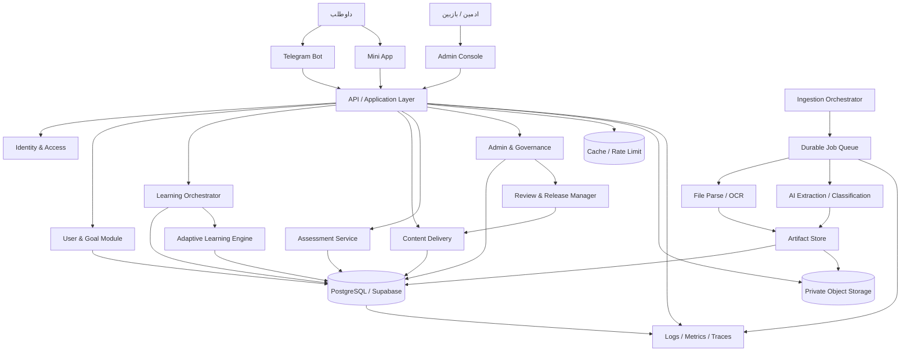
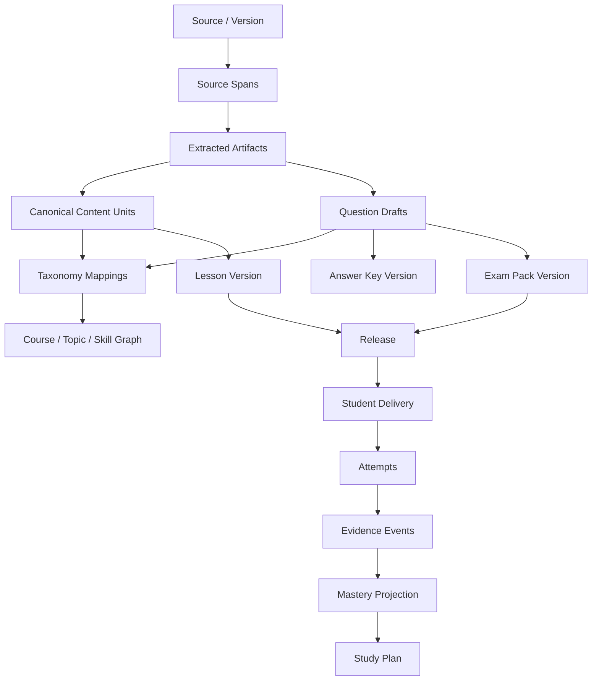
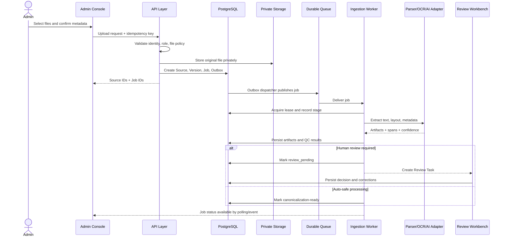
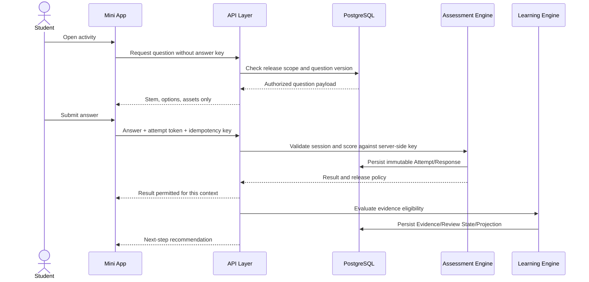
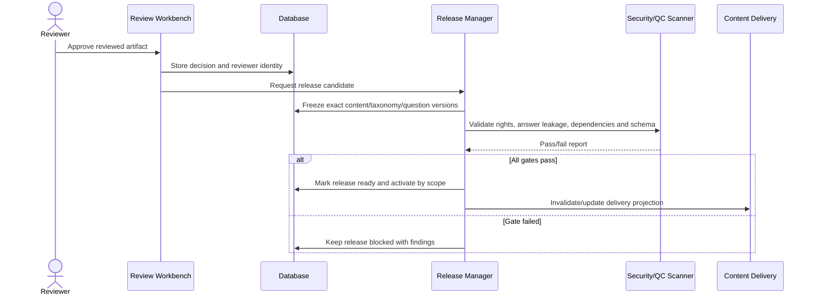

# سند معماری جامع سامانه AEL / آموزش کنکور مدیریت

> **نام سند:** AEL — Product, System, Learning & Content Operations Blueprint  
> **نسخه:** 1.0.0  
> **تاریخ تدوین:** 2026-11-04  
> **نوع سند:** سند مادر محصول، معماری نرم‌افزار، تجربه کاربری، عملیات محتوا، حاکمیت علمی و دستورالعمل پیاده‌سازی  
> **مخزن مرجع شناخته‌شده:** `rrasi90/konkortelegrambot`  
> **مخاطب:** تیم محصول، توسعه‌دهندگان، طراحان، مدیران علمی، اپراتورها و ایجنت‌های هوش مصنوعی  
> **وضعیت:** Target Blueprint؛ این سند وضعیت پیاده‌سازی فعلی را تأیید نمی‌کند و باید با آخرین `main` تطبیق داده شود.

---

# 0. دستور استفاده از این سند و قواعد تفسیر

## 0.1. هدف

این سند مشخص می‌کند سامانه AEL چه چیزی باید باشد، هر جزء چه مسئولیتی دارد، اطلاعات چگونه بین اجزا حرکت می‌کند، چه کسی چه اختیاری دارد، منابع آموزشی چگونه به محتوای قابل‌استفاده تبدیل می‌شوند و چه شواهدی برای اعلام تکمیل لازم است.

این سند صرفاً فهرست قابلیت‌ها نیست. باید به‌عنوان مرجع طراحی، پیاده‌سازی، ممیزی و پذیرش تغییرات استفاده شود. هر قابلیت جدید باید در یکی از ماژول‌های تعریف‌شده جای بگیرد و قرارداد ارتباطش با سایر ماژول‌ها روشن باشد.

## 0.2. سلسله‌مراتب اسناد

در صورت تعارض، ترتیب زیر ملاک است:
1. قوانین امنیت، حریم خصوصی، محرمانگی پاسخ‌ها و یکپارچگی داده.
2. قراردادهای دامنه و invariants این سند.
3. تصمیم‌های معماری تأییدشده و ثبت‌شده در ADR.
4. مشخصات فنی هر ماژول و قرارداد API/Event.
5. رفتار پیاده‌سازی‌شده در کد.
6. توضیح‌های آزاد، کامنت‌ها، READMEهای قدیمی و فرض‌های ایجنت.

کد موجود به‌خودی‌خود دلیل درستی رفتار نیست. اگر کد با قرارداد محصول/دامنه تعارض دارد، ابتدا ریسک و مسیر مهاجرت را مستند کن؛ رفتار موجود را بدون بررسی حفظ یا حذف نکن.

## 0.3. واژگان الزام‌آور

- **MUST / باید:** الزام قطعی؛ نقض آن نقص محسوب می‌شود.
- **MUST NOT / نباید:** ممنوعیت؛ دور زدن آن ممنوع است.
- **SHOULD / بهتر است:** الزام پیش‌فرض؛ تغییر آن به دلیل موجه و ثبت‌شده نیاز دارد.
- **MAY / می‌تواند:** قابلیت اختیاری.
- **Source / منبع:** فایل یا مرجع اولیه مانند کتاب، مقاله، جزوه، نمونه‌سؤال، پاسخ‌نامه یا صفحه وب.
- **Artifact / خروجی پردازش:** متن استخراج‌شده، ساختار فصل، سؤال پیشنهادی، نگاشت مفهومی، گزارش OCR و غیره.
- **Canonical Content / محتوای استاندارد:** محتوای نرمال‌شده و دارای شناسه پایدار که سامانه آن را مرجع استفاده آموزشی می‌داند.
- **Published Content / محتوای منتشرشده:** نسخه‌ای از محتوای تأییدشده که در اختیار گروه مجاز کاربران قرار گرفته است.
- **Evidence / شاهد یادگیری:** رویداد عملکردی معتبر، مانند پاسخ مستقل به سؤال یا ارزیابی تأخیری؛ خوداظهاری به‌تنهایی شاهد تسلط نیست.
- **Holdout / محتوای نگه‌داشته‌شده:** سؤال یا مجموعه‌ای برای سنجش مستقل که نباید پیش از موعد پاسخ آن افشا شود.
- **Human Review / بازبینی انسانی:** تصمیم فرد دارای مجوز درباره محتوای مبهم، حساس یا پرریسک.
- **Idempotency / تکرارپذیری امن:** اجرای دوباره یک عملیات نباید رکورد تکراری یا اثر جانبی ناخواسته ایجاد کند.
- **Provenance / منشأ:** اطلاعات دقیق درباره اینکه هر قطعه محتوا از کدام منبع، نسخه، صفحه، بخش و مرحله پردازش آمده است.

## 0.4. مرز مهم این سند

این سند Target Architecture است. ممکن است بخشی از آن اکنون وجود داشته باشد، بخشی ناقص باشد و بخشی جدید باشد. هیچ ایجنتی مجاز نیست از وجود این سند نتیجه بگیرد که تمام اجزا پیاده‌سازی شده‌اند. اولین وظیفه همیشه ممیزی وضعیت واقعی مخزن و تهیه ماتریس `Implemented / Partial / Missing / Unsafe / Unknown` است.

---

# 1. هویت محصول، هدف و معیار موفقیت

## 1.1. تعریف محصول

AEL یک سامانه آموزش تطبیقی و مدیریت محتوای علمی برای آمادگی آزمون‌های مدیریت است. Telegram کانال ورود و تعامل سریع است؛ Mini App محیط اصلی یادگیری و کار با محتواست؛ پنل مدیریت محیط کنترل علمی، محتوایی و عملیاتی است.

AEL نباید به یک ربات ارسال‌کننده تست یا یک کتابخانه PDF تبدیل شود. باید چرخه کامل زیر را بسازد:

`منابع معتبر → ساختار دانش → تشخیص وضعیت یادگیرنده → برنامه شخصی → مطالعه و بازیابی فعال → تحلیل خطا → ترمیم → مرور فاصله‌دار → ارزیابی مستقل → تسلط پایدارِ قابل‌اثبات`

## 1.2. چشم‌انداز و وعده محصول

تبدیل آمادگی پراکنده و غیرشفاف داوطلب به یک مسیر علمی، شخصی‌سازی‌شده، قابل‌اندازه‌گیری و قابل‌اعتماد؛ به‌گونه‌ای که داوطلب هر روز بداند اقدام بعدی چیست و سامانه بتواند توضیح دهد چرا آن اقدام پیشنهاد شده است.

وعده محصول:
- لازم نیست کاربر میان صدها منبع و موضوع، اولویت را حدس بزند.
- لازم نیست هر بار تنظیمات یا نوع منبع را از ابتدا توضیح دهد.
- باید بفهمد چه چیزی را مطالعه می‌کند، چرا مهم است و بعد از آن چه کند.
- باید پیشرفت واقعی خود را از حجم فعالیت ظاهری تشخیص دهد.
- باید بتواند خطاهایش را بفهمد و مسیر اصلاح آن‌ها را دنبال کند.
- نباید با رتبه، تراز یا احتمال قبولیِ بدون داده معتبر فریب داده شود.

## 1.3. ستاره قطبی

شاخص راهبردی پیشنهادی، `Weekly Verified Durable Masteries (WVDM)` است: تعداد زوج‌های یکتای `(learner_id, skill_id)` که در یک هفته با شواهد مستقل و تأخیری به تسلط پایدار می‌رسند.

یک مهارت تنها زمانی تسلط تأییدشده محسوب می‌شود که:
1. شناسه مهارت و نسخه تعریف آن روشن باشد.
2. چند شاهد معتبر و مستقل از حداقل دو جلسه وجود داشته باشد.
3. پاسخ‌ها صرفاً حاصل نمایش پاسخ یا خوداظهاری نباشند.
4. ارزیابی تأخیری/مرور سررسیدشده نیز موفق باشد.
5. حداقل شواهد، آستانه‌ها و سیاست Engine برقرار باشند.
6. سؤال‌های سنجش برای این هدف معتبر و از نظر نشت پاسخ کنترل شده باشند.
7. هر یادگیرنده/مهارت در بازه شمارش دوبار شمرده نشود.

آستانه‌هایی مانند ۷۵٪ یا تعداد مشخصی پاسخ، پارامتر علمی قابل‌اعتبارسنجی‌اند، نه حقیقت ثابت. هر آستانه باید نسخه، دلیل، دامنه کاربرد و تاریخ اثر داشته باشد.

## 1.4. شاخص‌های پشتیبان

- نرخ تبدیل تمرین به تسلط تأییدشده.
- نرخ ماندگاری یادگیری در مرور تأخیری.
- زمان رسیدن به تسلط، به تفکیک درس و مهارت.
- پوشش سرفصل‌های رسمی و میزان پشتوانه منبعی هر سرفصل.
- درصد سؤالات دارای متن، گزینه، کلید و توضیح معتبر.
- نرخ سؤال‌های نیازمند اصلاح پس از انتشار.
- نرخ خطاهای تکرارشونده و نرخ ترمیم موفق آن‌ها.
- پایبندی به برنامه با لحاظ زمان واقعی داوطلب.
- کیفیت پیشنهادهای روزانه و نرخ رد/تعویق آن‌ها.
- نرخ خطا، تأخیر و شکست Jobهای پردازش محتوا.
- نرخ مغایرت میان کلید پاسخ استخراج‌شده و کلید تأییدشده.

**ممنوع:** تعداد کلیک، مدت حضور، تعداد پیام، XP یا تعداد سؤال حل‌شده به‌تنهایی معیار تسلط یا کیفیت آموزشی معرفی شود.

## 1.5. دامنه محصول

### در دامنه اصلی
- مدیریت کاربران و پروفایل یادگیری.
- تعریف آزمون هدف، سال، کد، گرایش و دروس مرتبط.
- ساختار درختی/گرافی دانش و پیش‌نیازها.
- ورود و پردازش خودکار منابع گوناگون.
- مخزن محتوا و بانک سؤال نسخه‌دار.
- برنامه‌ریزی تطبیقی و مرور فاصله‌دار.
- آموزش، تمرین، تحلیل پاسخ و رفع اشکال.
- آزمون موضوعی و شبیه‌ساز آزمون.
- داشبورد پیشرفت و گزارش علمی.
- پنل مدیریت و گردش‌کار بازبینی/انتشار.
- ثبت رویداد، Audit Log، پایش، پشتیبان‌گیری و بازیابی.

### خارج از دامنه نسخه پایه
- ادعای تضمین قبولی.
- پیش‌بینی رتبه/تراز بدون داده معتبر و اعتبارسنجی خارج از نمونه.
- بازار فروش یا بازتوزیع عمومی کتاب‌های دارای حق نشر.
- شبکه اجتماعی پیچیده، چت آزاد عمومی یا قابلیت‌های نمایشیِ غیرضروری.
- معماری Microservices صرفاً برای مدرن به‌نظر رسیدن.
- تولید خودکار محتوای علمی و انتشار بی‌واسطه آن بدون کنترل کیفیت.

---

# 2. اصول بنیادین طراحی

1. **تجربه ساده، پشت‌صحنه قدرتمند:** پیچیدگی باید در موتور، گردش‌کار و پنل مدیریت باشد؛ نه در مقابل داوطلب.
2. **یک‌بار تنظیم، همیشه استفاده:** تنظیمات کاربر، درس، سری منبع و پروفایل پردازش ذخیره و در دفعات بعد بازیابی شوند.
3. **منبع خام حقیقت نهایی نیست:** PDF ورودی و استخراج ماشینی هر دو نیازمند مرحله‌بندی و کنترل‌اند.
4. **هر ادعا باید منشأ داشته باشد:** تعریف، پاسخ، توضیح، نقل‌قول، طبقه‌بندی و سؤال باید به منبع و محل دقیق متصل باشد.
5. **عدم قطعیت پنهان نشود:** موارد مبهم با `Needs Review` یا `Unresolved` مشخص شوند؛ انتخاب حدسی ممنوع است.
6. **حقیقت علمی از خوداظهاری جدا باشد:** Self-rating به‌تنهایی نباید Mastery یا Evidence را افزایش دهد.
7. **تاریخچه حذف نمی‌شود؛ اصلاح می‌شود:** تصمیم‌ها، تلاش‌ها، انتشارها و تنظیمات باید قابل‌ردیابی باشند.
8. **یکپارچگی پیش از سرعت:** در خطر افشای پاسخ یا خراب‌شدن سابقه، عملیات متوقف شود.
9. **Modular Monolith تا زمان نیاز واقعی:** جداسازی سرویس‌ها فقط با دلیل عملیاتی روشن انجام شود.
10. **نسخه‌دار و قابل‌بازگشت:** تنظیمات Engine، Taxonomy، مدل استخراج، Prompt، محتوا و Release نسخه داشته باشند.

---

# 3. کاربران، نقش‌ها و سناریوهای اصلی

## 3.1. نقش‌های محصول

1. داوطلب تازه‌وارد: شروع سریع، تشخیص مسیر و برنامه روشن.
2. داوطلب فعال: مطالعه روزانه، تمرین، مرور و گزارش.
3. داوطلب با زمان محدود: برنامه واقع‌بینانه و اولویت‌بندی.
4. داوطلب پیشرفته: آزمون جامع، تحلیل موضوعی و سنجش تأخیری.
5. مدیر سامانه: سلامت کل سیستم، کاربران، عملیات و سیاست‌ها.
6. مدیر علمی: ساختار درس، کیفیت منابع، سؤال‌ها و صحت علمی.
7. مدیر محتوا: ورودی‌ها، صف پردازش، طبقه‌بندی و نسخه‌های محتوا.
8. بازبین: بررسی و تأیید/رد موارد تخصیص‌یافته.
9. پشتیبان: رسیدگی به مشکل کاربر با حداقل دسترسی.
10. تحلیل‌گر: مشاهده گزارش‌های تجمیعی و غیرحساس.

## 3.2. مسیرهای حیاتی داوطلب

- ثبت‌نام و اتصال امن حساب Telegram.
- تعیین هدف آزمون و زمان مطالعه.
- ارزیابی اولیه یا شروع با مسیر مقدماتی.
- مشاهده برنامه امروز.
- انجام فعالیت، پاسخ به سؤال و دیدن بازخورد.
- تحلیل علت خطا و انجام فعالیت ترمیمی.
- مرور سررسیدشده.
- مشاهده پیشرفت معتبر.
- تغییر برنامه یا توقف موقت.

## 3.3. سناریوهای حیاتی مدیر

- بارگذاری منبع و مشاهده مراحل پردازش.
- اصلاح مشخصات منبع بدون پردازش مجدد غیرضروری.
- مشاهده بخش‌های استخراج‌شده و منشأ صفحه‌ای.
- بازبینی سؤال و کلید پاسخ.
- حل تعارض دو منبع.
- اتصال محتوا به درس/فصل/مهارت درست.
- انتشار نسخه تأییدشده برای گروه مشخص.
- توقف انتشار یا غیرفعال‌کردن محتوای معیوب.
- Retry امن و بازگردانی Release قبلی.
- مشاهده اینکه چه کسی، چه چیزی، چه زمانی و چرا تغییر داده است.
- کنترل نقش‌ها، دسترسی‌ها، سیاست‌ها و تنظیمات.

---

# 4. تجربه کاربری داوطلب: ساده، قابل‌پیش‌بینی و کم‌تصمیم

## 4.1. کانال‌ها و وظیفه هر کدام

### Telegram Bot
- ورود و اتصال حساب.
- اعلان‌های ضروری و قابل‌تنظیم.
- Deep Link به صفحه یا فعالیت مشخص در Mini App.
- یادآوری مطالعه/مرور با رضایت و تنظیم کاربر.
- فرمان‌های کوتاه مانند شروع، برنامه امروز و وضعیت.
- مسیر جایگزین در زمان در دسترس نبودن Mini App.

Bot نباید محل نمایش همه نمودارها یا رابط پیچیده سؤال‌ها باشد. از پیام‌های متعدد و مزاحم خودداری شود.

### Mini App
محیط اصلی برای داشبورد روزانه، درس و محتوای ساختاریافته، تمرین و آزمون، مرور و رفع اشکال، پیشرفت و تنظیمات حساب است.

### پنل مدیریت
محیط جداگانه با احراز هویت، مجوزها و مسیر انتشار مستقل. مخفی‌بودن دکمه‌ها جایگزین مجوز سمت سرور نیست.

## 4.2. ناوبری Mini App

ناوبری اصلی حداکثر پنج مقصد داشته باشد:
1. **امروز:** کار بعدی، زمان تقریبی، مرورهای سررسیدشده و وضعیت برنامه.
2. **یادگیری:** دروس، فصل‌ها، درسنامه‌ها و مسیرهای یادگیری.
3. **تمرین:** تمرین، آزمون موضوعی و آزمون جامع.
4. **پیشرفت:** تسلط تأییدشده، روند مرور، نقاط قوت و ضعف.
5. **حساب:** هدف آزمون، زمان، اعلان‌ها، پشتیبانی و حریم خصوصی.

نام و ترتیب نهایی باید با تست کاربردپذیری اعتبارسنجی شود؛ پیچیدگی را با افزودن تب‌های متعدد حل نکن.

## 4.3. صفحه «امروز»

در اولین نگاه نشان بده:
- پیام کوتاه درباره وضعیت امروز.
- یک CTA اصلی: «شروع فعالیت بعدی».
- زمان تخمینی فعالیت اصلی.
- تعداد مرورهای سررسیدشده.
- وضعیت برنامه نسبت به زمان در دسترس.
- توضیح کوتاه «چرا این فعالیت پیشنهاد شده؟».
- امکان تعویق، کاهش برنامه یا اعلام کمبود وقت.

صفحه را با ده‌ها کارت، اعداد نامفهوم، نمودارهای فشرده و چند CTA هم‌وزن شلوغ نکن.

## 4.4. شروع کار و Onboarding

اطلاعات ضروری:
1. نوع آزمون هدف: ارشد، دکتری یا مسیر رسماً پشتیبانی‌شده.
2. سال/نوبت یا بازه هدف، در صورت مشخص بودن.
3. کد/مجموعه/گرایش، فقط با ساختار رسمی معتبر.
4. تاریخ آزمون یا زمان باقی‌مانده، اگر مشخص باشد.
5. زمان واقع‌بینانه مطالعه در روز/هفته.
6. ارزیابی تشخیصی کوتاه یا شروع با برنامه مقدماتی.

سیاست:
- قبل از نشان‌دادن ارزش محصول، پرسشنامه طولانی نده.
- داده قابل‌استخراج را دوباره نپرس؛ امکان اصلاح بده.
- سؤال اختیاری را اجباری نکن.
- مقدار نامعلوم را `Unknown` ثبت کن؛ حدس نزن.
- تغییر هدف آزمون باید اثر خود را روی برنامه پیش‌نمایش دهد.

## 4.5. ارزیابی تشخیصی

- کوتاه، مرحله‌ای و متناسب با زمان کاربر باشد.
- از مجموعه‌ای با کیفیت و پوشش مشخص استفاده کند.
- پاسخ‌ها با نوع رویداد `diagnostic` از تمرین عادی جدا شوند.
- نتیجه «برآورد اولیه» است، نه حکم قطعی توانایی.
- سؤال تشخیصی باید از نظر پاسخ و دشواری تأیید شده باشد.
- در صورت رد ارزیابی، مسیر مقدماتی امن ارائه شود.

## 4.6. صفحه درس و مطالعه

هر درس شامل نام، وضعیت، فصل‌ها/موضوع‌ها، پوشش منبعی، وضعیت تأیید علمی، پیشرفت مهارت‌ها، فعالیت بعدی، جست‌وجو و فیلتر باشد. منشأ محتوا (کتاب/مقاله، فصل یا صفحه و نسخه) در حد مناسب نمایش داده شود. نمایش متن دارای حق نشر تابع مجوز باشد.

## 4.7. تجربه پاسخ‌دادن به سؤال

1. نمایش متن و شکل‌ها با حفظ چینش و نمادها.
2. نمایش گزینه‌ها با برچسب ثابت.
3. ثبت انتخاب کاربر؛ قبل از پاسخ، کلید افشا نشود.
4. ثبت میزان اطمینان به‌عنوان داده جداگانه.
5. ثبت پاسخ، زمان و وضعیت نشست.
6. نمایش نتیجه طبق سیاست آزمون.
7. نمایش توضیح معتبر و دلیل رد گزینه‌های مهم، در صورت وجود.
8. نمایش منبع و موضوع سؤال.
9. پیشنهاد گام بعدی: سؤال مشابه، توضیح، پیش‌نیاز یا مرور.

**ممنوع:** ارسال کلید یا توضیح محرمانه به کلاینت قبل از پاسخ و مخفی‌کردن آن صرفاً با CSS.

## 4.8. تحلیل خطا

طبقه‌بندی کنترل‌شده:
- `knowledge_gap`: ندانستن مفهوم.
- `misconception`: برداشت مفهومی نادرست.
- `retrieval_failure`: ناتوانی در بازیابی.
- `application_error`: ناتوانی در کاربرد.
- `calculation_error`: خطای محاسباتی.
- `reading_misinterpretation`: برداشت اشتباه از صورت سؤال.
- `careless_error`: بی‌دقتی محتمل.
- `time_pressure`: مشکل زمان.
- `guessing`: پاسخ حدسی.
- `unknown`: علت نامشخص.

تشخیص خودکار احتمالی است و باید قابل اصلاح باشد. خطای احتمالی را بدون شواهد به ویژگی شخصیتی کاربر تبدیل نکن.

## 4.9. مرور و Self-rating

کاربر می‌تواند فهم یا اعتمادبه‌نفس خود را اعلام کند؛ این داده برای تجربه یا اولویت مرور مفید است. اما Self-rating نباید به‌تنهایی `masteryScore`, `proficiencyProbability`, `memoryStability`, `retrievability`, `evidenceCount`, `coverageStatus` یا Holdout/Proof را ارتقا دهد. پاسخ مستقل و ارزیابی تأخیری مرجع شواهدند.

## 4.10. برنامه شخصی

برنامه باید با سقف زمان روزانه/هفتگی، زمان باقی‌مانده، وزن رسمیِ مستند، مرورهای سررسیدشده، ضعف‌های اثبات‌شده، پیش‌نیازها، تازگی شواهد و تنوع فعالیت سازگار باشد. هر پیشنهاد علت قابل‌فهم داشته باشد؛ مثلاً: «این مبحث را پیشنهاد کردیم چون دو پاسخ اخیر در کاربرد مفهوم خطا داشته و مرور آن سررسید شده است.»

## 4.11. حالت‌های خالی، خطا و دسترس‌پذیری

برای هر صفحه حالت‌های `Loading`, `Empty`, `Error`, `Offline/Retry`, `PermissionDenied` طراحی شود. پیام خطا باید اقدام بعدی را روشن کند. رابط فارسی RTL، فونت خوانا، موبایل‌محور، کنتراست مناسب، لمس قابل‌اتکا و پشتیبانی فرمول/جدول داشته باشد. رنگ تنها نشانه درست/غلط نباشد.

---

# 5. پنل مدیریت: کنترل کامل، اما کنترل‌شده و قابل‌ردیابی

## 5.1. اصل طراحی

«کنترل کامل» به معنی دسترسی آزاد و بی‌ردپا به دیتابیس نیست. پنل باید ابزار رسمی تغییر، تأیید، انتشار، توقف، بازگردانی و بررسی داشته باشد. عملیات حساس نیازمند مجوز، تأیید، دلیل و Audit Log است.

## 5.2. نقشه ناوبری پنل

1. **نمای کلی:** سلامت سیستم، صف پردازش، خطاهای بحرانی، کاربران فعال و بازبینی‌های معوق.
2. **ورودی منابع:** بارگذاری، دسته‌بندی، پروفایل پردازش و وضعیت Jobها.
3. **کتابخانه منابع:** کتاب‌ها، مقالات، جزوه‌ها، آزمون‌ها، پاسخ‌نامه‌ها و نسخه‌ها.
4. **ساختار دانش:** آزمون‌ها، کدها، گرایش‌ها، دروس، فصل‌ها، موضوع‌ها، مهارت‌ها و پیش‌نیازها.
5. **بانک سؤال:** سؤال، گزینه، کلید، توضیح، منبع، برچسب و اعتبار.
6. **محتوای آموزشی:** درسنامه‌ها، خلاصه‌ها، فلش‌کارت‌ها، مثال‌ها و محتوای ترمیمی.
7. **بازبینی علمی:** صف تأیید، تعارض‌ها و موارد کم‌اطمینان.
8. **انتشار:** نسخه‌ها، Releaseها، گروه هدف، زمان‌بندی و Rollback.
9. **کاربران و گروه‌ها:** حساب‌ها، نقش‌ها، هدف آزمون و پشتیبانی.
10. **برنامه و Engine:** الگوریتم اولویت، مرور، آستانه‌ها و Feature Flags.
11. **آزمون‌ها و بسته‌ها:** Exam Pack، آزمون موضوعی/جامع، Holdout و دسترسی.
12. **گزارش‌ها:** کیفیت محتوا، یادگیری، استفاده، خطا و عملیات.
13. **سیستم و یکپارچه‌سازی:** Telegram، Storage، مدل، صف Job و سرویس‌های فعال.
14. **امنیت و ممیزی:** نقش‌ها، دسترسی‌ها، نشست‌ها، Audit Log و هشدارها.
15. **پشتیبان‌گیری و عملیات:** Backup، Restore Drill، Migration، سلامت و Incident.

نمایش منو بر اساس مجوز باشد؛ مخفی‌بودن منو جایگزین مجوز سمت سرور نیست.

## 5.3. نقش‌ها و مجوزها

| نقش | مسئولیت | دسترسی پیش‌فرض |
|---|---|---|
| `owner` | مالک محصول و سیاست‌های کلان | کامل، با احراز قوی و Audit |
| `super_admin` | عملیات فنی و مدیریت کل سامانه | مدیریت سیستم؛ محتوای علمی با مجوز مستقل |
| `academic_admin` | حاکمیت علمی و ساختار آزمون | Taxonomy، تأیید علمی، سیاست کیفیت |
| `content_manager` | مدیریت منابع و گردش‌کار | منابع، پردازش، محتوا، آماده‌سازی انتشار |
| `reviewer` | بازبینی محتوا/سؤال | موارد تخصیص‌یافته و عملیات Review |
| `taxonomy_editor` | ساختار درس و مهارت | Taxonomy در محدوده مجاز؛ بدون انتشار مستقل |
| `exam_operator` | مدیریت آزمون و بسته‌ها | Exam Pack، زمان‌بندی و دسترسی |
| `support_agent` | پشتیبانی کاربران | حداقل داده لازم؛ بدون پاسخ محرمانه |
| `analyst` | تحلیل عملکرد | داده تجمیعی/ناشناس؛ بدون تغییر |
| `auditor_readonly` | ممیزی | فقط خواندن گزارش و تاریخچه |

قواعد:
- مجوزها بر اساس `resource + action + scope` تعریف شوند، نه فقط نام نقش.
- دسترسی نهایی از مجوزهای صریح و سیاست‌های Deny محاسبه شود.
- اصل Least Privilege رعایت شود.
- دسترسی به داده شخصی و پاسخ‌نامه محرمانه مجوزهای جداگانه داشته باشد.
- عملیات پرخطر مانند تغییر کلید منتشرشده، حذف منبع، تغییر Engine و انتشار عمومی نیازمند تأیید فرد دوم باشد.
- سازنده محتوا نتواند به‌تنهایی محتوای پرریسک خودش را تأیید نهایی کند (Four-Eyes Principle).
- نقش اضطراری Break-Glass زمان‌دار، محدود و ممیزی‌پذیر باشد.

## 5.4. ماتریس عملیات حساس

| عملیات | نقش مجاز | کنترل اجباری |
|---|---|---|
| بارگذاری منبع | مدیر محتوا و بالاتر | ثبت هویت، Hash، حقوق استفاده |
| تغییر Metadata | مدیر محتوا | تاریخچه تغییر |
| حذف فیزیکی فایل | Owner/Super Admin محدود | وابستگی، Retention، تأیید دوم |
| اصلاح متن استخراج‌شده | مدیر محتوا/بازبین | نگهداری خروجی قبلی و منشأ |
| تأیید کلید پاسخ | بازبین/مدیر علمی | شواهد منبع و ثبت تصمیم |
| انتشار سؤال | نقش انتشار مجاز | اعتبار علمی، نشت پاسخ، Scope |
| انتشار درسنامه | مدیر علمی/منتشرکننده | Review کامل و نسخه‌بندی |
| تغییر پیش‌نیاز | مدیر علمی | بررسی اثر روی برنامه |
| تغییر Engine | Owner/Academic Admin | نسخه، آزمایش، Canary و Rollback |
| غیرفعال‌سازی محتوا | مدیر علمی/محتوا | علت، دامنه و اثر بر کاربران |
| مشاهده داده فردی | پشتیبان مجاز | دلیل، حداقل داده، Audit |
| Export کاربران | Owner/Super Admin | تأیید، مقصد و محدوده |
| تغییر نقش ادمین | Owner/Super Admin | احراز قوی و Audit |

## 5.5. داشبورد مدیریتی

وضعیت‌های قابل اقدام:
- چند منبع امروز دریافت شده‌اند؟
- چند Job در حال پردازش، شکست‌خورده یا گیرکرده‌اند؟
- چه تعداد مورد نیازمند Review است؟
- چند سؤال کلید نامعتبر یا منشأ ضعیف دارند؟
- چه Releaseهایی فعال یا معیوب‌اند؟
- سلامت API، DB، Storage، صف و Telegram چیست؟
- آخرین Backup و Restore Drill چه زمانی بوده است؟
- چه هشدارهای P0/P1 باز هستند؟

هر کارت باید به فهرست قابل‌اقدام منتهی شود؛ عدد بدون امکان بررسی جزئیات کافی نیست.

## 5.6. تنظیمات مرکزی (Control Plane)

ادمین باید بتواند این حوزه‌ها را کنترل کند:
- دروس/سرفصل‌ها/نسخه Taxonomy.
- قواعد پردازش منبع و پروفایل‌ها.
- سیاست OCR و استخراج.
- مدل‌ها و Providerهای پردازش.
- آستانه‌های اعتماد و قواعد Review.
- فرمول اولویت برنامه.
- تنظیمات مرور و FSRS.
- زمان یادآوری و Quiet Hours.
- محدودیت نرخ و سقف/نوع فایل.
- سیاست انتشار و دامنه دسترسی.
- Feature Flags.
- نسخه فعال Prompt/Extraction Schema.
- تنظیمات آزمون و نمره‌دهی.
- نگهداری داده و سیاست حذف.

تمام تنظیمات باید دارای `key`, `value`, `schema_version`, `scope`, `effective_from`, `created_by`, `approved_by`, `reason`, `version` و امکان Rollback باشند. Secrets در Secret Manager می‌مانند و از پنل تنظیمات عمومی قابل‌خواندن نیستند.

## 5.7. صف عملیات (Work Queue)

یک Inbox مشترک برای تشخیص نوع منبع، Metadata ناقص، OCR کم‌اطمینان، کلید نامشخص، تعارض منابع، نگاشت مبهم، Duplicate مشکوک، حقوق محتوا و خطای انتشار ایجاد شود. هر مورد Owner، اولویت، وضعیت، تاریخچه و اقدام بعدی داشته باشد. ارجاع و بازگشت برای اصلاح داخل سیستم ثبت شود، نه در پیام‌های پراکنده.

---

# 6. سامانه هوشمند ورود و پردازش منابع (Content Ingestion & Processing)

این بخش قلب عملیاتی پروژه است. مدیر باید بتواند کتاب، مقاله، جزوه، نمونه‌سؤال، پاسخ‌نامه یا فایل مربوط به هر درس را اضافه کند و سامانه بدون دستور تکراری، از پروفایل پردازش مناسب استفاده کند.

## 6.1. رفتار مورد انتظار

`Upload → Detect → Classify → Extract → Structure → Map → Validate → Review if needed → Publish when approved`

سامانه باید نوع منبع را تشخیص دهد، سلامت فایل را بررسی کند، تکراری‌بودن را بسنجد، Metadata را استخراج کند، پروفایل پیش‌فرض را انتخاب کند، متن و ساختار را استخراج کند، فصل/بخش/سؤال/مفهوم را تفکیک کند، نگاشت به ساختار درسی را پیشنهاد دهد، موارد مبهم را به صف بازبینی بفرستد و خروجی تأییدشده را در مخزن Canonical ذخیره کند.

## 6.2. انواع منبع

- `textbook`: کتاب درسی/مرجع.
- `article`: مقاله علمی/پژوهشی.
- `lecture_note`: جزوه و اسلاید.
- `exam_paper`: دفترچه سؤال آزمون.
- `answer_key`: کلید رسمی/غیررسمی پاسخ.
- `solution_document`: پاسخ تشریحی.
- `question_bank`: مجموعه سؤال.
- `syllabus`: سرفصل یا برنامه رسمی.
- `official_document`: دفترچه/اطلاعیه رسمی آزمون.
- `web_reference`: مرجع اینترنتی با URL و تاریخ دریافت.
- `other`: سایر؛ با نیاز به طبقه‌بندی.

فرمت‌های ورودی بر اساس ابزارهای واقعاً پشتیبانی‌شده ثبت شوند: PDF متنی، PDF اسکن‌شده، DOCX، PPTX، XLSX، TXT، CSV، تصویر و فایل فشرده کنترل‌شده. فرمت پشتیبانی‌نشده باید با پیام روشن رد شود؛ حذف بی‌صدا ممنوع است.

## 6.3. اطلاعات هنگام بارگذاری

فرم حداقلی باشد:
- فایل یا URL.
- نوع منبع (تشخیص خودکار، قابل اصلاح).
- درس (پیشنهاد خودکار، قابل اصلاح).
- عنوان (استخراج خودکار، قابل اصلاح).
- سال/ویرایش در صورت قابل‌تشخیص بودن.
- نویسنده/ناشر/DOI/ISBN در صورت وجود.
- آزمون هدف و کد/گرایش، اگر مرتبط باشد.
- وضعیت حقوق استفاده: مالک، مجاز برای استفاده داخلی، مجاز برای انتشار، صرفاً پردازش شخصی، نامشخص.
- پروفایل پردازش (پیش‌فرض خودکار).

کاربر در هر بار بارگذاری نباید مجبور به تکمیل همه این اطلاعات باشد. Metadata استخراج شود و فقط ابهام اثرگذار پرسیده شود.

## 6.4. پروفایل پردازش تکرارپذیر

موجودیت `ProcessingProfile` تعریف شود. پروفایل‌های پایه نمونه:

- `default_textbook_fa`
- `default_article_fa`
- `default_exam_paper_fa`
- `default_answer_key_fa`
- `default_lecture_notes_fa`
- `default_unknown_source`

هر پروفایل مشخص می‌کند: نوع فایل مجاز، زبان/جهت متن، الزام OCR، قواعد استخراج ساختار، Schema خروجی، روش تشخیص تکراری، قواعد نگاشت، معیار Confidence، الزام بازبینی، سیاست نگهداری فایل، نسخه مدل/Prompt و مسیر انتشار مجاز.

پروفایل‌ها باید برای درس یا سری منبع قابل‌تکثیر باشند. مدیر می‌تواند یک‌بار تعیین کند «تمام فایل‌های سری X در درس رفتار سازمانی با این تنظیمات پردازش شوند». پس از آن همان قاعده خودکار به کار رود.

## 6.5. ترتیب انتخاب پروفایل

1. پروفایل صریح همان منبع/Batch.
2. پروفایل سری/مجموعه منبع.
3. پروفایل درس + نوع منبع.
4. پروفایل نوع منبع + زبان.
5. پروفایل عمومی.
6. `Needs Classification`، اگر مورد قابل‌اعتمادی وجود ندارد.

انتخاب پروفایل باید در رکورد Job و Source ثبت شود.

## 6.6. مراحل استاندارد خط پردازش

### Stage 0 — دریافت و ثبت اولیه
- فایل با Stream امن دریافت شود.
- اندازه، MIME واقعی، پسوند، Hash و نام اصلی ثبت شود.
- فایل در Object Storage خصوصی قرار گیرد.
- `source_id` و `source_version_id` ساخته شوند.
- درخواست بارگذاری با Idempotency Key قابل تکرار باشد.

### Stage 1 — ایمنی و اعتبار فایل
- کنترل MIME واقعی، نه صرفاً پسوند.
- محدودیت اندازه، تعداد صفحات و نسبت فشرده‌سازی.
- تشخیص فایل خراب یا رمزدار.
- کنترل Malware/محتوای فعال، در صورت ابزار موجود.
- جلوگیری از Archive Bomb، Path Traversal و فایل چندلایه خطرناک.
- قرنطینه یا رد فایل نامعتبر.
- ثبت وضعیت حقوق استفاده.

### Stage 2 — Fingerprinting و تشخیص تکراری

سه سطح تطبیق:
1. **Exact duplicate:** Hash باینری یکسان.
2. **Near duplicate:** متن نرمال‌شده/ساختار بسیار مشابه.
3. **Related edition:** محتوای نزدیک ولی نسخه، چاپ یا اصلاح متفاوت.

Exact duplicate به Source موجود متصل شود و دوباره بی‌دلیل پردازش نشود. Near duplicate فقط Candidate است؛ ادغام خودکار نیازمند Confidence و سیاست مشخص است. Edition متفاوت باید Version جدید همان Source یا Source مرتبط مستقل ایجاد کند؛ تاریخچه قبلی حفظ شود.

### Stage 3 — تشخیص نوع و Metadata

استخراج خودکار عنوان، نویسنده، ناشر، تاریخ، نسخه، DOI/ISBN، زبان، کیفیت اسکن، تعداد صفحه، فهرست، عنوان فصل‌ها، نوع محتوا و حوزه درسی احتمالی.

هر فیلد باید `value`, `confidence`, `evidence_location`, `extraction_method` داشته باشد. داده استخراج‌نشده `null/unknown` است؛ پرکردن حدسی ممنوع.

### Stage 4 — استخراج متن و Layout

- ابتدا Native Text برای فایل متنی.
- OCR فقط برای صفحات اسکن یا بخش فاقد متن.
- حفظ ترتیب ستون‌ها، شماره‌گذاری، جدول، شکل و فرمول.
- نگهداری مختصات صفحه/Block، در صورت پشتیبانی.
- ذخیره متن خام استخراج‌شده و متن نرمال‌شده جداگانه.
- نرمال‌سازی حروف فارسی/عربی و فاصله‌ها با حفظ Original Text؛ متن اولیه هرگز حذف نشود.

### Stage 5 — تقسیم‌بندی ساختاری

`Document → Page → Section → Subsection → Paragraph/Block → Table/Figure/Equation`

برای کتاب: فهرست، بخش، فصل، زیرفصل، تعریف، مثال، تمرین و جمع‌بندی.  
برای مقاله: Title، Abstract، Keywords، Introduction، Literature Review، Method، Results، Discussion، Conclusion، References.  
برای دفترچه آزمون: آزمون، دفترچه، درس، شماره سؤال، صورت سؤال، گزینه‌ها، شکل/جدول و پاسخ‌نامه.

شماره صفحه چاپی و شماره صفحه PDF جدا نگهداری شوند.

### Stage 6 — استخراج علمی و معنایی

بسته به نوع منبع، موضوع‌ها، مفاهیم، اصطلاحات، تعریف‌ها، گزاره‌ها، نظریه‌ها، مدل‌ها، روابط علت/معلولی، فرمول‌ها، مثال‌ها، فرضیه‌ها، روش، یافته، محدودیت مقاله، سؤال، گزینه، پاسخ‌نامه، هدف یادگیری و پیش‌نیاز استخراج شوند.

تمام خروجی‌ها به Source Span و صفحه متصل باشند. خروجی مدل زبانی «پیشنهاد استخراج» است، نه واقعیت تأییدشده.

### Stage 7 — نگاشت به ساختار دانش

نگاشت به درس، فصل/موضوع، مفهوم/مهارت، پیش‌نیاز و Exam Code/Track/Year فقط در صورت وجود شواهد انجام شود.

حالت‌ها:
- `exact_match`
- `probable_match`
- `multiple_candidates`
- `new_candidate`
- `unmapped`

در `multiple_candidates` انتخاب خودکار ممنوع است. `new_candidate` پیش از Canonical شدن نیازمند بازبینی علمی است. `unmapped` حفظ شود؛ محتوا به فصل تصادفی وصل نشود.

### Stage 8 — استخراج سؤال و پاسخ

استخراج صورت سؤال و کلید پاسخ باید دو مسیر جدا باشد. پاسخ پیشنهادی مدل نباید با پاسخ رسمی ادغام شود. جزئیات در بخش 8.4 آمده است.

### Stage 9 — کنترل کیفیت خودکار

کنترل کامل بودن متن، کیفیت OCR، صحت شماره صفحات و ترتیب، سلامت گزینه‌ها، یکتایی سؤال، وجود منبع و منشأ، سازگاری نگاشت، کامل بودن پاسخ‌نامه، تعارض پاسخ‌ها، نشت پاسخ محرمانه و داده شخصی ناخواسته انجام شود.

خروجی QC باید Machine-readable و قابل‌نمایش باشد؛ متن آزاد مدل به‌تنهایی کافی نیست.

### Stage 10 — بازبینی انسانی بر اساس ریسک

- سؤال دارای کلید: بازبینی اجباری پیش از انتشار.
- منبع رسمی آزمون: بازبینی اصالت و نگاشت.
- OCR دارای فرمول/نمودار/جدول: بازبینی در صورت Confidence پایین.
- تعریف کلیدی علمی: بازبینی علمی.
- خلاصه غیرحساس: ممکن است پس از تست کیفیت در Draft داخلی قابل‌استفاده باشد.
- Holdout: کنترل دسترسی و جداسازی الزامی.

### Stage 11 — Canonicalization

پس از تأیید، شناسه پایدار برای Content Unit/Question/Concept ایجاد یا حفظ شود؛ روابط Source/Version/Span ذخیره شوند؛ نسخه Canonical ساخته شود؛ Duplicateهای تأییدشده به Canonical ارجاع دهند. خروجی خام و Artifactهای مدل طبق Retention نگهداری شوند.

### Stage 12 — آماده‌سازی و انتشار

Release شامل Version دقیق محتوا، Taxonomy، سیاست دسترسی و هدف انتشار باشد. Preview و Smoke Test اجرا شود. انتشار اتمیک باشد؛ کاربر نباید ترکیبی ناقص از نسخه‌های قدیم و جدید ببیند. Canary و Rollback به Release قبلی ممکن باشد. شناسه Release در Analytics و Attemptها ثبت شود.

## 6.7. ماشین وضعیت Source و Job

وضعیت Source:

`received → quarantined/validated → fingerprinted → metadata_pending/ready → processing → review_pending → approved → published → archived`

حالت‌های جانبی: `rejected`, `failed_retryable`, `failed_terminal`, `duplicate_linked`, `superseded`, `withdrawn`.

هر Transition باید Actor، زمان، علت، State قبلی و State جدید را ثبت کند. Retry نباید خروجی تکراری بسازد. `published` فقط با Approved Version و Release فعال مجاز است. فایل منتشرشده با تغییر فایل خام به‌روزرسانی نمی‌شود؛ Version جدید بساز.

وضعیت Job:

`queued → running → succeeded | needs_review | retry_scheduled | failed_terminal | cancelled`

هر Job شامل `job_id`, `source_version_id`, `profile_version_id`, `pipeline_version`, `model_version`, `attempt_no`, `idempotency_key`, `started_at`, `finished_at`, `error_code`, `error_summary`, `trace_id` باشد.

## 6.8. مدیریت Batch

ادمین چند فایل را یک‌جا بارگذاری کند و برای Batch درس/سری منبع، پروفایل، سیاست بازبینی، محدوده انتشار و شناسه Batch تعیین کند. هر فایل همچنان Source مستقل است؛ خطای یک فایل نباید Batch سالم را متوقف کند، مگر آنکه خطای امنیتی/سیاستی کل Batch را درگیر کند.

## 6.9. پردازش مجدد

با تغییر Parser، OCR، Prompt، مدل یا Taxonomy امکان Reprocess لازم است:
- خروجی قدیمی حذف یا Overwrite نشود.
- `processing_run` جدید با نسخه ابزار جدید ساخته شود.
- Diff دو خروجی قابل‌مشاهده باشد.
- فقط خروجی تأییدشده و منتشرشده جایگزین شود.
- در افت کیفیت، Release قبلی سالم بماند.
- Reprocess در صف و با محدودیت نرخ/هزینه انجام شود.

---

# 7. ساختار دانش و طبقه‌بندی علمی (Knowledge & Curriculum Graph)

## 7.1. مدل سلسله‌مراتبی

`Exam Family → Exam Version/Year → Track/Code → Course → Topic → Subtopic → Concept/Skill → Learning Objective`

این ساختار فقط Tree نیست؛ روابط پیش‌نیاز و ارتباط مفاهیم باید به‌صورت Graph نیز نگهداری شوند.

## 7.2. موجودیت‌ها

- `ExamFamily`: خانواده آزمون، مانند ارشد یا دکتری.
- `ExamVersion`: سال/نوبت و نسخه دفترچه.
- `ExamTrack`: کد/مجموعه/گرایش.
- `Course`: درس.
- `Topic`: فصل/موضوع رسمی یا آموزشی.
- `Concept`: مفهوم علمی.
- `Skill`: توانایی قابل‌سنجش یادگیرنده.
- `LearningObjective`: خروجی یادگیری قابل‌اندازه‌گیری.
- `PrerequisiteEdge`: رابطه پیش‌نیاز با نوع و شدت.
- `ExamWeight`: ضریب/وزن با منبع و محدوده اعتبار.
- `SourceMapping`: اتصال محتوا به Taxonomy.

## 7.3. قواعد Taxonomy

- هر موجودیت شناسه پایدار داشته باشد؛ تغییر نام شناسه را عوض نکند.
- هر نسخه Taxonomy قابل‌شناسایی و Rollback باشد.
- یک مفهوم می‌تواند به چند درس مرتبط باشد.
- سؤال می‌تواند چند Topic/Skill داشته باشد؛ یک `primary` و چند `secondary` با دلیل.
- پیش‌نیازها نوع `required`, `recommended`, `related` داشته باشند.
- چرخه در گراف پیش‌نیاز ممنوع یا با نوع رابطه متفاوت مدل شود.
- ضریب و فراوانی فقط با منبع رسمی و بازه اعتبار ثبت شود.
- موضوع مبهم به نزدیک‌ترین Node به‌صورت خودکار وصل نشود.
- مترادف‌ها در Alias ذخیره شوند؛ Nodeهای هم‌معنی بی‌دلیل ساخته نشوند.

## 7.4. اتصال کتاب به فصل

هر کتاب می‌تواند فصل‌بندی خودش را داشته باشد، به چند درس/مهارت نگاشت شود، در یک فصل چند موضوع را پوشش دهد و برای یک موضوع چند صفحه داشته باشد.

رابطه `SourceSection ↔ Topic/Skill` باید صریح و نسخه‌دار، همراه Confidence، روش نگاشت و Reviewer باشد. در صورت وجود چند فصل کاندید، انتخاب خودکار بی‌دلیل ممنوع است.

## 7.5. پوشش آزمون

پوشش باید ابعاد مستقل داشته باشد:
- پوشش رسمی سرفصل.
- پوشش توسط منبع.
- پوشش توسط درسنامه.
- پوشش توسط سؤال معتبر.
- پوشش توسط آزمون/سنجش.
- پوشش توسط شواهد یادگیری کاربران.

وجود عنوان در کتاب به معنی «پوشش کامل» نیست. گزارش باید مقدار، کیفیت، منشأ، نسخه و Review را نشان دهد.

وضعیت‌های پیشنهادی: `not_mapped`, `source_found`, `content_extracted`, `content_reviewed`, `practice_available`, `assessment_available`, `coverage_verified`.

ادعای «پوشش ۱۰۰٪» فقط با تعریف دامنه، فهرست کامل سرفصل رسمی و شواهد قابل‌ممیزی مجاز است.

---

# 8. استاندارد مدل محتوا بر اساس نوع منبع

## 8.1. کتاب

خروجی ساختاریافته:
- مشخصات کتاب و نسخه.
- فهرست فصل‌ها و زیرفصل‌ها.
- اصطلاحات کلیدی.
- تعریف‌ها با تمایز نقل مستقیم/بازنویسی.
- نظریه‌ها و مدل‌ها.
- روابط و طبقه‌بندی‌ها.
- فرمول‌ها و جدول‌ها.
- مثال‌ها و کاربردها.
- تمرین‌ها و پرسش‌های انتهای فصل.
- مهارت‌ها و اهداف یادگیری.
- نگاشت به Taxonomy آزمون.
- Source Span دقیق.

کتاب را به یک خلاصه طولانی و غیرقابل‌جست‌وجو تبدیل نکن؛ محتوا باید به Unitهای کوچک و قابل‌اتصال تقسیم شود.

## 8.2. مقاله علمی

استخراج عنوان، نویسندگان، مجله/کنفرانس، سال، DOI، کلیدواژه، مسئله و شکاف پژوهشی، چارچوب نظری، سازه‌ها و تعاریف عملیاتی، فرضیه‌ها، مدل مفهومی، روش تحقیق، نمونه، ابزار، روش تحلیل، یافته‌ها، اندازه اثر/آمار، محدودیت‌ها، پیشنهادها، ارجاعات و ارتباط با درس/مهارت.

قواعد:
- یافته مقاله حقیقت عمومی قطعی نیست؛ نوع مطالعه و محدودیت همراهش بماند.
- همبستگی به علیت تبدیل نشود.
- اعداد آماری بدون Source Span وارد نشوند.
- نتیجه مقاله از تفسیر مدل جدا باشد.
- تضاد مقاله‌ها ثبت شود؛ مدل یکی را خودکار حذف نکند.

## 8.3. جزوه و اسلاید

عنوان و جلسه/فصل، شماره اسلاید/صفحه، متن، نکته، نمودار، جدول و مثال، نسبت محتوا با منبع مرجع، موارد مغایر/فاقد منبع و وضعیت اصالت/مالکیت ذخیره شود. جزوه برداشت مدرس است و نباید بدون بررسی با متن کتاب مرجع یکی فرض شود.

## 8.4. نمونه سؤال و پاسخ‌نامه

### 8.4.1. فیلدهای Question

هر سؤال حداقل شامل این موارد است:
- `question_id`, `question_version_id`
- `stem_original`, `stem_normalized`
- `question_type` (MCQ، چندپاسخی، تشریحی، محاسباتی، درست/نادرست و ...)
- `options[]` با شناسه پایدار، ترتیب و متن اصلی
- `assets[]` برای شکل/جدول/فرمول
- `source_id`, `source_version_id`
- `source_page_pdf`, `source_page_printed`, `source_section`
- `exam_family`, `exam_year`, `exam_code`, `track` در صورت مستندبودن
- `course_id`, `topic_ids[]`, `skill_ids[]`, `primary_topic_id`
- `difficulty_estimate`, `difficulty_source`, `cognitive_level` در صورت وجود مدل معتبر
- `official_question_number`
- `answer_status`, `answer_key_version_id`, `explanation_version_id`
- `review_status`, `rights_status`, `publication_scope`

### 8.4.2. وضعیت پاسخ

`answer_status` یکی از این‌ها باشد:
- `official_verified`: کلید رسمی و منشأ تأیید شده.
- `expert_verified`: متخصص با شواهد تأیید کرده.
- `proposed_ai`: پاسخ پیشنهادی مدل؛ منتشرشدنی نیست.
- `conflicting`: منابع/کلیدها تعارض دارند.
- `unknown`: پاسخ معتبر وجود ندارد.
- `withdrawn`: پاسخ قبلی باطل شده.

هیچ `proposed_ai` یا `unknown` نباید به‌عنوان کلید قطعی به کاربر نمایش داده شود. سؤال می‌تواند برای تمرین بدون اعلام پاسخ قطعی باقی بماند یا تا تکمیل پاسخ از انتشار خارج شود.

### 8.4.3. کلید پاسخ و توضیح

- کلید پاسخ موجودیت نسخه‌دار مستقل باشد.
- گزینه صحیح با شناسه Option ذخیره شود، نه فقط حرف A/B که با تغییر ترتیب خراب شود.
- منبع کلید (پاسخ‌نامه رسمی، کتاب، حل متخصص، استنباط) ثبت شود.
- توضیح تشریحی از کلید جدا باشد.
- استدلال مدل و بازبین هر دو تاریخچه داشته باشند.
- تغییر کلید سؤال منتشرشده Release جدید و بررسی اثرات بخواهد.

### 8.4.4. وفاداری متن

علائم ریاضی، اعداد، زیرنویس/بالانویس، جدول و تصویر حفظ شوند. نرمال‌سازی متن صورت اصلی را از بین نبرد. ترتیب گزینه‌ها تصادفی تغییر نکند مگر با سیاست آزمون و Seed ثبت‌شده. گزینه ناخوانا با `needs_review` ثبت شود؛ تکمیل حدسی ممنوع. شماره سؤال و صفحه چاپی با شماره فایل یکی فرض نشوند.

### 8.4.5. جلوگیری از تکرار سؤال

تطبیق بر اساس متن نرمال‌شده، شباهت معنایی، گزینه‌ها، منبع/سال/شماره سؤال و شکل/جدول باشد. سؤال Canonical می‌تواند چند Source Link داشته باشد. ادغام دو سؤال با اختلاف معنایی/گزینه‌ای بدون تأیید بازبین ممنوع است.

## 8.5. درسنامه تولیدشده با هوش مصنوعی

هر Lesson Unit دارای موضوع و هدف، سطح و پیش‌نیاز، متن، منابع پشتیبان و Source Span، Prompt/Model Version، Claims و Evidence mapping، هشدار عدم قطعیت، وضعیت بازبینی علمی، تاریخ و Release باشد.

محتوای تولیدی باید میان «نقل مستقیم»، «بازنویسی منبع»، «ترکیب چند منبع» و «توضیح آموزشی جدید» تمایز بگذارد. مدل حق اختراع منبع یا شماره صفحه ندارد.

## 8.6. فلش‌کارت و تمرین بازیابی

هر کارت شامل مفهوم/مهارت، Prompt/Question، پاسخ/نکته، توضیح و منبع، نوع بازیابی، دشواری و وضعیت تأیید باشد. کارت تولیدی از سؤال امتحانی اصلی جدا و با برچسب «تمرین آموزشی تولیدشده» مشخص شود.

---

# 9. حاکمیت علمی و کنترل کیفیت محتوا

## 9.1. سطوح اعتماد

- `A — Official`: منبع رسمی/معتبر، محل دقیق، بازبینی تأییدشده.
- `B — Reviewed`: منبع مشخص و بازبینی متخصص.
- `C — Machine Extracted`: استخراج ماشینی با منشأ، بدون بازبینی کامل.
- `D — AI Proposed`: پیشنهاد مدل، نیازمند بررسی.
- `E — Unverified`: منشأ یا صحت ناکافی.

سیاست انتشار به نوع محتوا وابسته است. برای مثال کلید پاسخ مورد استفاده در آزمون باید سطح A یا B داشته باشد؛ پیشنهاد مدل در Draft بماند.

## 9.2. Confidence چندبُعدی

Confidence باید جداگانه برای استخراج متن، نوع منبع، صفحه/Span، سؤال/گزینه، کلید، نگاشت درسی و خلاصه/توضیح ثبت شود. Score کلی فقط برای مرتب‌سازی صف مفید است؛ تصمیم انتشار بر اساس قواعد هر بُعد و نوع محتوا باشد.

## 9.3. تعارض منابع

1. هر دو ادعا با Source Span مستقل ثبت شوند.
2. نوع اختلاف مشخص شود: تفاوت ویرایش، اصطلاح، خطای احتمالی، اختلاف علمی یا OCR.
3. `conflict_open` ایجاد شود.
4. بازبین تصمیم بگیرد هر دو معتبرند، یکی قدیمی/منسوخ است، یکی غلط است یا موضوع حل‌نشده می‌ماند.
5. تصمیم همراه دلیل و نام بازبین ثبت شود.
6. نسخه منتشرشده فقط بعد از تصمیم معتبر تغییر کند.

## 9.4. اصلاح خطای منتشرشده

محتوای معیوب باید فوراً قابل تعلیق باشد. اثر آن بر نتیجه آزمون کاربران بررسی شود. Attemptهای قبلی بازنویسی نشوند. در صورت لزوم اصلاحیه اطلاع‌رسانی شود. آمار سؤال برای نسخه‌ها تفکیک شود. Root Cause (OCR، منبع، Prompt، نگاشت، بازبین یا کد) ثبت شود.

## 9.5. منشأ و نقل‌قول

هر Claim یکی از وضعیت‌های `direct_quote` با صفحه و مجوز، `paraphrase` با منبع دقیق، `synthesis` با چند منبع، `model_explanation` با برچسب تولیدی و منابع پشتیبان یا `unattributed` باشد. محتوای علمی قابل‌انتشار نباید `unattributed` باشد.

---

# 10. موتور یادگیری تطبیقی و برنامه‌ریزی

## 10.1. مسئولیت Engine

Engine با توجه به وضعیت مستند یادگیرنده، فعالیت بعدی را پیشنهاد می‌دهد. نباید UI را مدیریت کند، به فایل خام دست بزند یا حق انتشار داشته باشد.

ورودی‌ها: هدف آزمون، نسخه Taxonomy، وضعیت مهارت‌ها و Evidence، مرورهای سررسیدشده، تاریخچه Attempt، زمان در دسترس، محتوای تأییدشده و سیاست‌های نسخه‌دار.

خروجی‌ها: Candidate Activityها، اولویت و امتیاز توضیح‌پذیر، دلیل، زمان تخمینی، پیش‌نیاز، محدودیت/هشدار، نسخه Engine و Policy.

## 10.2. اولویت‌بندی

پیش از امتیازدهی، محتوای منتشرنشده/فاقد مجوز، سؤال دارای کلید نامعتبر برای سنجش قطعی، Holdout در مسیر عادی و فعالیت خارج از هدف ممنوع شود؛ سقف زمان رعایت شود.

پس از قیود، عوامل امتیازدهی می‌توانند شامل مرور سررسیدشده، شکاف دانش شواهد‌محور، پیش‌نیاز، وزن رسمی مستند، زمان باقی‌مانده، هزینه زمانی فعالیت، خطر فراموشی، تنوع فعالیت و اعتماد داده باشند. فرمول و سهم عوامل باید نسخه‌دار و قابل‌بررسی باشد.

## 10.3. FSRS / مرور فاصله‌دار

- الگوریتم مرور در ماژول مستقل باشد.
- ورودی آن پاسخ و کیفیت بازیابی معتبر باشد.
- Self-rating پارامتر کمکی است، نه جایگزین عملکرد مستقل.
- زمان مرور و تغییر وضعیت با `algorithm_version` ثبت شود.
- تغییر الگوریتم به‌صورت کنترل‌شده و قابل‌مقایسه انجام شود.
- مرورهای از دست‌رفته با سیاست Backlog مدیریت شوند؛ همه یک‌باره به کاربر تحمیل نشوند.

## 10.4. مدل تسلط

برای هر `(learner, skill, skill_version)` وضعیت مستقل نگهداری شود:
- `exposure`: مواجهه با محتوا.
- `practice`: تمرین انجام‌شده.
- `evidence`: پاسخ معتبر.
- `mastery_estimate`: تخمین مدل.
- `verified_mastery`: وضعیت تأیید با معیار مشخص.
- `coverage`: پوشش مهارت در محتوا/مسیر.
- `proof`: ارزیابی مستقل.

این موارد در یک Score مبهم ادغام نشوند.

## 10.5. سیاست Evidence

هر Evidence باید به Attempt مشخص، Question Version و Skill Version متصل باشد؛ نوع نشست (تمرین، تشخیصی، آزمون، مرور، Holdout)، اعتبار (معتبر/مشکوک/باطل‌شده)، وضعیت نمایش قبلی پاسخ و استقلال از شواهد قبلی را ثبت کند.

پاسخ پس از مشاهده راه‌حل، تلاش مجدد روی همان سؤال یا سؤال مشابه، بدون قاعده استقلال نباید شاهد مستقل تسلط شمرده شود.

## 10.6. عدم fallback خطرناک

اگر `skill_id` یا `node_id` نامعتبر است، خطای اعتبارسنجی برگردان، عملیات را متوقف و ثبت کن؛ هرگز به `nodes[0]` یا اولین درس/موضوع fallback نکن. داده قدیمی با Migration صریح و گزارش موارد غیرقابل‌نگاشت اصلاح شود.

## 10.7. Explainability

هر پیشنهاد باید علت قابل‌خواندن و مبتنی بر داده واقعی داشته باشد: مرور سررسیدشده، خطای ثبت‌شده، پیش‌نیاز ناقص، نزدیک‌بودن آزمون یا پوشش کم موضوع. عبارت عمومی «برای موفقیت بیشتر» کافی نیست.

---

# 11. آزمون، نمره‌دهی و شبیه‌ساز

## 11.1. Exam Pack

هر بسته آزمون شامل هدف و نوع آزمون، سال/کد/گرایش، فهرست سؤال و Version ثابت، ترتیب و Seed، مدت، قواعد نمره‌دهی، نمره منفی فقط در صورت مستندبودن، سیاست بازبینی، وضعیت پاسخ‌ها، مجوز انتشار و گروه دسترسی باشد.

## 11.2. نشست آزمون

هنگام شروع آزمون Snapshot از Exam Pack و سیاست نمره‌دهی ایجاد شود. تغییر سؤال در بانک نباید آزمون در حال اجرا را تغییر دهد.

## 11.3. نمره‌دهی

- قواعد نمره‌دهی نسخه‌دار و قابل‌آزمایش باشند.
- نمره منفی به همه آزمون‌ها تعمیم داده نشود.
- محاسبه از کلید معتبر و Question Version همان نشست استفاده کند.
- پاسخ ناقص/چندپاسخی طبق تعریف نوع سؤال بررسی شود.
- نتیجه خام، محاسبه‌شده و توضیح محاسبه قابل‌ردیابی باشند.

## 11.4. پیش‌بینی رتبه و قبولی

تا زمان وجود داده واقعی کافی، نماینده، مجاز و اعتبارسنجی خارج از نمونه:
- رتبه و تراز به‌عنوان پیش‌بینی نمایش داده نشود.
- تضمین مصاحبه، قبولی یا دانشگاه نمایش داده نشود.
- احتمال درصدی بدون Calibration معتبر ممنوع باشد.
- برای دکتری از مدل/داده ارشد استفاده نشود.
- در فقدان داده، فقط شاخص توصیفی مانند میانگین عملکرد موضوعی نمایش داده شود.

هر مدل پیش‌بینی باید Data Card، محدوده اعتبار، تاریخ آموزش، معیار خطا، Calibration، Bias Audit و Version داشته باشد.

---

# 12. نقشه معماری کلان سامانه

## 12.1. نمای منطقی



این نمودار نمای مسئولیت‌هاست، نه الزام به ساخت سرویس‌های جداگانه. چند جزء می‌توانند در یک Worker/Application اجرا شوند؛ مرز منطق و قرارداد نباید مخلوط شود.

## 12.2. لایه‌ها

### Presentation
Telegram Bot، Mini App و Admin Console.

### API / Application
احراز هویت و مجوز، اعتبارسنجی ورودی، Orchestration، Transaction، Idempotency و تبدیل خطا به پاسخ قراردادی.

### Domain
Identity/User، Exam/Curriculum، Content/Source، Assessment، Learning/Mastery، Scheduling، Governance/Publishing و Notification.

### Infrastructure
PostgreSQL، Object Storage، Queue/Workflow، Cache/Rate Limit، Telegram API، OCR/LLM adapters و Logging/Monitoring.

قواعد Dependency:
- Domain به Telegram SDK، Cloudflare API، Supabase SDK یا UI وابسته نباشد.
- Infrastructure Interfaceهای Domain/Application را پیاده کند.
- UI مستقیم به DB وصل نشود.
- Secret در Mini App Bundle نباشد.

## 12.3. ماژول‌ها و مرز مسئولیت

| ماژول | مالکیت | خارج از مسئولیت |
|---|---|---|
| `identity-access` | هویت، نشست، نقش، مجوز | منطق تسلط |
| `learner-profile` | هدف، زمان، ترجیح و حساب | کلید پاسخ |
| `exam-curriculum` | آزمون، کد، درس، Taxonomy | استخراج PDF |
| `source-registry` | منبع، نسخه، حقوق، Hash | نمره‌دهی |
| `ingestion-pipeline` | Job، Parser، OCR، Extract | انتشار نهایی |
| `content-catalog` | محتوای استاندارد و روابط | تصمیم بازبینی |
| `question-bank` | سؤال، گزینه، کلید، توضیح | برنامه روزانه |
| `review-governance` | بررسی، تعارض، تأیید | تولید پاسخ کاربر |
| `release-manager` | نسخه و دامنه انتشار | تغییر مستقیم Engine |
| `learning-engine` | Evidence، Mastery، FSRS | UI و فایل خام |
| `study-planner` | انتخاب فعالیت و برنامه | تغییر کلید سؤال |
| `assessment-engine` | جلسه آزمون و نمره‌دهی | استخراج منبع |
| `notification-center` | اعلان و ترجیح کاربر | منطق علمی مستقل |
| `analytics-reporting` | شاخص، گزارش و رویداد | تغییر منبع حقیقت |
| `system-operations` | تنظیمات، سلامت و Audit | دسترسی بدون مجوز |

نام پوشه‌ها در مخزن ممکن است متفاوت باشد؛ ابتدا مرزهای فعلی را بررسی و با کمترین جابه‌جایی لازم مسئولیت‌ها را روشن کن. برای تطبیق ظاهری با جدول Refactor بزرگ انجام نده.

## 12.4. نگاشت به ساختار شناخته‌شده مخزن

در Snapshot قبلی مواردی مانند `packages/contracts`, `packages/learning-engine`, `apps/worker` و Mini App/Telegram integration وجود داشته‌اند؛ مسیر واقعی باید از آخرین `main` مجدداً خوانده شود.

قاعده نگاشت: قراردادهای مشترک در Package قرارداد؛ الگوریتم خالص در Learning Engine؛ HTTP/Telegram/Cloudflare در App/Adapter؛ پردازش منابع به‌صورت ماژول دامنه‌ای؛ Admin Console در اپ/Route جدا با مجوز مستقل. ماژول غایب را Gap ثبت کن و معماری Branch قدیمی را بدون مقایسه وارد نکن.

## 12.5. نقشه جریان اصلی داده

```mermaid
flowchart LR
    S[Source Upload] --> R[Source Registry]
    R --> F[File Validation & Fingerprint]
    F --> Q[Durable Queue]
    Q --> X[Extraction / OCR]
    X --> N[Normalization & Segmentation]
    N --> K[Knowledge / Question Extraction]
    K --> M[Taxonomy Mapping]
    M --> V[Automated Validation]
    V --> H{Human Review Needed?}
    H -- Yes --> W[Review Workbench]
    H -- No --> C[Canonical Content]
    W --> C
    C --> L[Release Manager]
    L --> D[Content Delivery]
    D --> U[Student Experience]
    U --> E[Attempt & Evidence]
    E --> LE[Learning Engine]
    LE --> P[Study Planner]
    P --> U
```



## 12.6. ارتباط داده و مسئولیت



---

# 13. مدل داده و مرجع حقیقت (Data Architecture)

## 13.1. اصول ذخیره‌سازی

- PostgreSQL مرجع تراکنشی داده‌های ساختاریافته باشد.
- Object Storage خصوصی مرجع فایل‌های خام و فایل‌های حجیم باشد.
- Queue/Workflow مرجع وضعیت Jobهای طولانی باشد.
- Cache فقط برای داده قابل‌بازسازی باشد؛ مرجع حقیقت نباشد.
- Event/Outbox برای تحویل مطمئن رویدادهای بین ماژول‌ها استفاده شود.
- Mastery و داشبورد می‌توانند Projection باشند، اما رویدادهای مبنا و قواعد محاسبه باید محفوظ بمانند.

## 13.2. موجودیت‌های اصلی

### هویت و کاربر
`users`, `user_identities`, `user_profiles`, `learner_goals`, `learner_availability`, `user_preferences`, `admin_roles`, `admin_permissions`, `role_permission_bindings`, `admin_sessions`.

### آزمون و ساختار دانش
`exam_families`, `exam_versions`, `exam_tracks`, `courses`, `topics`, `concepts`, `skills`, `learning_objectives`, `taxonomy_versions`, `taxonomy_nodes`, `taxonomy_edges`, `exam_weights`, `exam_scope_sources`.

### منبع و پردازش
`sources`, `source_versions`, `source_assets`, `source_rights`, `source_metadata_claims`, `source_spans`, `processing_profiles`, `processing_profile_versions`, `processing_jobs`, `processing_job_attempts`, `processing_runs`, `extraction_artifacts`, `artifact_relations`, `dedup_candidates`, `ingestion_batches`.

### محتوای استاندارد
`content_units`, `content_unit_versions`, `content_blocks`, `lesson_units`, `lesson_unit_versions`, `definitions`, `concept_relations`, `flashcards`, `flashcard_versions`, `source_content_links`, `content_taxonomy_mappings`.

### بانک سؤال و آزمون
`questions`, `question_versions`, `question_options`, `question_assets`, `answer_keys`, `answer_key_versions`, `question_explanations`, `question_explanation_versions`, `question_source_links`, `question_taxonomy_mappings`, `question_reviews`, `exam_packs`, `exam_pack_versions`, `exam_pack_items`, `exam_sessions`, `exam_session_items`, `exam_results`.

### یادگیری و برنامه
`learning_sessions`, `attempts`, `attempt_responses`, `attempt_events`, `learning_evidence`, `mastery_snapshots`, `review_states`, `study_plans`, `study_plan_items`, `recommendation_decisions`, `learner_error_tags`.

### عملیات و حاکمیت
`review_tasks`, `review_decisions`, `content_conflicts`, `releases`, `release_items`, `feature_flags`, `system_settings`, `audit_logs`, `outbox_events`, `notification_preferences`, `notification_deliveries`, `incident_records`.

این فهرست مدل منطقی است؛ الزاماً یک جدول برای هر نام لازم نیست. طراحی فیزیکی باید با Grain، روابط، ایندکس، امنیت و هزینه واقعی هماهنگ شود.

## 13.3. قواعد نسخه‌بندی

محتوای منتشرشده نباید بدون تاریخچه In-place تغییر کند:
- موجودیت اصلی ID پایدار دارد.
- هر تغییر معنادار Version ID جدید می‌سازد.
- Release به Versionهای دقیق اشاره می‌کند.
- Attempt به Question Version زمان اجرا اشاره می‌کند.
- Evidence به Skill Version متصل می‌شود.
- حذف منطقی با `archived_at` یا Status انجام می‌شود؛ حذف فیزیکی تابع Retention و مجوز است.

## 13.4. روابط اصلی

- یک Source چند Source Version دارد.
- هر Source Version چند Asset و Processing Run دارد.
- هر Processing Run چند Artifact تولید می‌کند.
- هر Artifact می‌تواند چند Source Span داشته باشد.
- هر Canonical Content Unit می‌تواند از چند Source پشتیبانی شود.
- هر Question چند Source Link و Taxonomy Mapping می‌تواند داشته باشد.
- هر Question چند Version دارد؛ Answer Key نیز مستقل Version می‌شود.
- هر Release مجموعه دقیق Versionهای محتوا/سؤال/Taxonomy را تثبیت می‌کند.
- هر Attempt به Release و Question Version مشخص اشاره می‌کند.
- هر Evidence به Attempt معتبر و Skill Version اشاره دارد.
- هر Mastery Snapshot از Evidenceها و نسخه Engine قابل‌بازسازی باشد.

## 13.5. قیود یکپارچگی ضروری

- Foreign Key برای روابط ساختاری حیاتی.
- Unique Key برای Telegram identity و شناسه‌های پایدار.
- Unique Constraint برای Idempotency Key در Scope مربوط.
- Constraint برای وضعیت‌های مجاز و Enumهای حساس.
- جلوگیری از Attempt بدون Session/Question Version معتبر.
- جلوگیری از انتشار Question بدون Release و وضعیت پاسخ معتبر.
- جلوگیری از Mastery Evidence بدون منبع Attempt.
- جلوگیری از Taxonomy Edge نامعتبر یا چرخه ممنوع.
- جلوگیری از نسبت‌دادن Question به Node ناموجود.
- جلوگیری از دسترسی کاربر به Release خارج از Scope.

## 13.6. داده خام، Canonical و Projection

- **Raw:** فایل اصلی، متن استخراج اولیه، OCR خام و پاسخ خام کاربر.
- **Canonical:** متن اصلاح‌شده، سؤال استاندارد، نگاشت و محتوای تأییدشده.
- **Derived/Projection:** داشبورد، پیشنهاد بعدی، Mastery Snapshot و آمار.

Projection قابل‌بازسازی است. Raw و Canonical با یک محاسبه ساده جایگزین نشوند.

## 13.7. رویدادهای دامنه

نام‌های پیشنهادی:
`SourceReceived`, `SourceValidated`, `SourceFingerprintMatched`, `ProcessingJobQueued`, `ProcessingStageCompleted`, `ArtifactExtracted`, `ArtifactNeedsReview`, `ReviewApproved`, `ReviewRejected`, `ContentCanonicalized`, `ReleasePublished`, `ReleaseRolledBack`, `QuestionAttempted`, `AnswerSubmitted`, `EvidenceAccepted`, `EvidenceInvalidated`, `MasteryRecomputed`, `ReviewScheduled`, `StudyPlanGenerated`, `AdminPermissionChanged`.

هر رویداد دارای `event_id`, `event_type`, `occurred_at`, `actor_id`, `aggregate_id`, `schema_version`, `correlation_id`, `causation_id` و Payload حداقلی باشد. Eventها Secret یا داده شخصی غیرضروری حمل نکنند.

---

# 14. قرارداد API و ارتباط بین ماژول‌ها

## 14.1. اصول

- API نسخه‌دار باشد؛ مانند `/api/v1/...`.
- Schema ورودی/خروجی معتبر و مشترک داشته باشد.
- خطاهای قابل‌پیش‌بینی Code ثابت داشته باشند.
- هر عملیات حساس Actor و Correlation ID داشته باشد.
- عملیات ایجاد/پردازش با Idempotency Key امن شوند.
- عملیات طولانی Job ID و Status Endpoint بدهند.
- Pagination، Filter و Sort قراردادی باشد.
- Authorization در سرور انجام شود.
- پاسخ API اطلاعات حساس یا کلید پنهان را لو ندهد.

## 14.2. گروه Endpointها (طرح منطقی)

```text
/api/v1/auth/*
/api/v1/me
/api/v1/learner/profile
/api/v1/learner/goals
/api/v1/learner/today
/api/v1/learner/progress
/api/v1/curriculum/exams
/api/v1/curriculum/courses
/api/v1/curriculum/topics
/api/v1/content/lessons
/api/v1/content/search
/api/v1/questions/{questionId}
/api/v1/attempts
/api/v1/attempts/{attemptId}/answer
/api/v1/reviews/due
/api/v1/study-plan
/api/v1/exams/{examPackId}/sessions
/api/v1/admin/sources
/api/v1/admin/sources/{sourceId}/versions
/api/v1/admin/ingestion/jobs
/api/v1/admin/ingestion/jobs/{jobId}
/api/v1/admin/reviews
/api/v1/admin/questions
/api/v1/admin/taxonomy
/api/v1/admin/releases
/api/v1/admin/settings
/api/v1/admin/audit-logs
/api/v1/health
```

این‌ها قرارداد نام‌گذاری‌اند؛ پیش از ساخت Endpoint جدید، API موجود را بررسی کن تا مسیر تکراری ایجاد نشود.

## 14.3. قرارداد پاسخ خطا

```json
{
  "error": {
    "code": "QUESTION_NOT_PUBLISHABLE",
    "message": "این سؤال هنوز برای انتشار تأیید نشده است.",
    "correlationId": "...",
    "retryable": false,
    "details": {}
  }
}
```

جزئیات فنی حساس فقط در Log امن باشند؛ پیام عمومی ساده و بی‌خطر بماند.

## 14.4. ارتباط Worker و Job Queue

- Request HTTP نباید کل پردازش چندمرحله‌ای فایل را در یک چرخه کوتاه انجام دهد.
- API ورودی را اعتبارسنجی، فایل را ذخیره و Job را ثبت/صف کند.
- Worker مستقل/مرحله‌ای Jobها را اجرا کند.
- هر Stage Checkpoint داشته باشد.
- Retry فقط برای خطاهای Retryable باشد.
- Dead Letter Queue و Replay کنترل‌شده وجود داشته باشد.
- Job Lease/Timeout و تشخیص گیرکردن داشته باشد.
- اجرای هم‌زمان یک Job با Lock/Idempotency کنترل شود.

انتخاب پیاده‌سازی صف (Database-backed queue، Cloud Queue، Workflow یا Adapter دیگر) پس از بررسی محدودیت واقعی محیط، هزینه، سقف اجرا، دوام و دسترسی انجام شود. منطق Domain به Provider وابسته نباشد.

## 14.5. Transactional Outbox

اگر تغییر DB باید رویداد/Job بسازد:
- تغییر دامنه و درج Outbox در یک Transaction انجام شود.
- Dispatcher Outbox را با Retry منتشر کند.
- Consumerها Idempotent باشند.
- پیام پس از ثبت موفق اثر حذف/تأیید شود.

این الگو مانع وضعیتی می‌شود که DB تغییر کند ولی Job ارسال نشود، یا برعکس.

---

# 15. امنیت، حریم خصوصی و حفاظت محتوا

## 15.1. هویت و نشست

- اتصال Telegram با اعتبارسنجی سمت سرور و کنترل امضا/تازگی داده انجام شود.
- شناسه Telegram به‌تنهایی مجوز مدیریتی نباشد.
- نشست Admin از نشست داوطلب جدا باشد.
- MFA برای نقش حساس ترجیحاً الزامی باشد.
- نشست قابل‌ابطال، زمان‌دار و دارای Rotation باشد.
- ورود مشکوک و تغییر نقش ثبت شود.

## 15.2. Authorization

- هر Endpoint مجوز منبع و عملیات را بررسی کند.
- دسترسی به منبع خصوصی، پاسخ، Attempt، Export و Admin Action جدا کنترل شود.
- Scope گروه/درس/Batch در مجوز اعمال شود.
- نبود دکمه در UI به معنی ممنوعیت API نیست.
- تست منفی دسترسی برای هر Role لازم است.

## 15.3. حفاظت کلید پاسخ

- Answer Key محرمانه فقط سمت سرور نگهداری/مصرف شود.
- Mini App Bundle، Static Asset یا API عمومی پاسخ را پیش از موعد حمل نکند.
- پاسخ فقط پس از ثبت پاسخ و طبق سیاست Release ارائه شود.
- Holdout و کلید آن از Bundle عمومی جدا باشد.
- Scanner امنیتی Answer Key برای سبزشدن CI غیرفعال یا آسان‌گیر نشود.
- پاسخ در Cache عمومی/CDN قرار نگیرد.
- گزارش و Export هم سیاست دسترسی داشته باشند.

## 15.4. امنیت فایل و Prompt Injection

فایل و متن ورودی ممکن است Prompt Injection داشته باشد و باید **داده غیرقابل‌اعتماد** تلقی شود، نه دستور برای Agent یا ابزار.
- متن استخراج‌شده مجوز تغییر System Prompt یا اجرای Tool ندهد.
- URL داخل فایل خودکار باز نشود.
- لینک خارجی نیازمند Allowlist/تأیید باشد.
- خروجی مدل Schema Validate شود.
- محتوای خام از دستورهای داخلی و Secrets جدا بماند.
- ابزارها با حداقل دسترسی و شبکه محدود اجرا شوند.

## 15.5. داده شخصی

- حداقل‌گرایی داده رعایت شود.
- داده حساس در گزارش تحلیلی ناشناس/تجمیعی شود.
- پشتیبان فقط داده لازم را ببیند.
- Export/Delete مطابق سیاست مصوب و قوانین لازم رسیدگی شود.
- داده خام غیرضروری نامحدود نگهداری نشود.
- Audit Log رمز، Token یا محتوای کامل داده شخصی نداشته باشد.

## 15.6. حقوق مالکیت فکری

برای هر Source وضعیت حقوق ثبت شود: اجازه پردازش داخلی، نمایش به کاربر نهایی، نقل‌قول، استخراج/خلاصه‌سازی، بازتوزیع فایل یا نامشخص/محدود.

اجازه بارگذاری ادمین لزوماً مجوز بازنشر عمومی نیست. در وضعیت نامشخص، منبع می‌تواند برای سازمان‌دهی داخلی نگهداری شود اما انتشار عمومی مسدود بماند.

## 15.7. امنیت زیرساخت

- Secrets فقط در مخزن امن محیط اجرا.
- Secret هرگز در Git، Log یا Frontend Bundle نباشد.
- CORS محدود و مشخص.
- Rate Limit برای ورود، پاسخ، جست‌وجو، بارگذاری و Admin API.
- SQLها Parameterized و Migrationها Review شوند.
- Backup رمزگذاری‌شده و دسترسی محدود.
- Dev/Staging/Production جدا.
- تست Migration و Replay فقط روی DB تست/موقت.
- دسترسی Production با Least Privilege.

---

# 16. Analytics، پایش و عملیات

## 16.1. سه دسته مشاهده‌پذیری

### Product Analytics
شروع/تکمیل Onboarding، استفاده از برنامه امروز، فعالیت‌ها، مرورهای سررسیدشده/تکمیل‌شده، مسیر خطا تا ترمیم و تسلط تأییدشده.

### Content Operations Analytics
تعداد Source/Version، زمان و هزینه پردازش، نرخ OCR موفق، Artifactهای نیازمند Review، نرخ رد سؤال/کلید، Duplicate، زمان ورود تا انتشار و خطا بر اساس Parser/Model/Prompt Version.

### System Observability
Request rate و Latency، خطاهای 4xx/5xx، DB query latency، Queue lag و Retry، Storage failure، Telegram webhook failures، منابع Runtime و Backup/Restore status.

## 16.2. Correlation

هر مسیر از بارگذاری تا انتشار باید `correlation_id` مشترک داشته باشد؛ هر Job/Attempt/Release نیز شناسه مستقل داشته باشد تا ریشه خطا قابل‌ردیابی شود.

## 16.3. هشدارها

Job گیرکرده/Dead Letter، افزایش شکست OCR، افزایش خطای API، شکست Migration/Backup، عدم دسترسی Telegram Webhook، انتشار Release ناقص، کشف پاسخ در Bundle عمومی، تغییر غیرمجاز نقش ادمین و جهش غیرعادی هزینه مدل.

## 16.4. Backup و Recovery

- سیاست RPO/RTO تعریف شود.
- Backup دیتابیس و Object Storage هماهنگ شود.
- Restore Drill زمان‌بندی شود.
- صحت روابط فایل/DB پس از Restore بررسی شود.
- نسخه Migration/Schema در گزارش Backup ثبت شود.
- صرف داشتن فایل Backup به معنی قابلیت بازیابی نیست.

## 16.5. Incident Management

هر Incident شامل سطح شدت، زمان شروع/پایان، دامنه اثر، اقدام مهار، Root Cause، اثر روی محتوا/نتایج یادگیری و اصلاح پیشگیرانه باشد.

---

# 17. گردش‌کارهای دقیق از ابتدا تا انتها

## 17.1. سناریو A: مدیر یک کتاب PDF جدید می‌دهد

1. مدیر فایل را در «ورودی منابع» بارگذاری می‌کند.
2. سیستم Hash، MIME، اندازه و فایل خصوصی را ثبت می‌کند.
3. نوع منبع و زبان را تشخیص می‌دهد.
4. اگر کتاب مشابه موجود باشد، پیشنهاد اتصال به Version قبلی را نشان می‌دهد.
5. پروفایل `default_textbook_fa` یا پروفایل مخصوص درس انتخاب می‌شود.
6. Metadata و فهرست استخراج می‌شوند.
7. متن، جدول، فرمول و تصاویر استخراج و صفحه‌بندی می‌شوند.
8. فصل‌ها و بخش‌ها ساخته می‌شوند.
9. مفاهیم، تعریف‌ها و مثال‌ها Artifact می‌شوند.
10. نگاشت Topic/Skill پیشنهاد می‌شود.
11. خروجی کم‌اطمینان و مفهوم جدید وارد صف Review می‌شود.
12. مدیر/بازبین اصلاح یا تأیید می‌کند.
13. Canonical Version ساخته می‌شود.
14. Release داخلی/عمومی در دامنه مجاز آماده می‌شود.
15. پس از تأیید، کتابخانه درس و برنامه یادگیری از محتوای جدید استفاده می‌کنند.
16. مراحل با صفحه، Version، مدل و بازبین ثبت می‌شود.

اگر Metadata یا پروفایل سری مشخص است، مدیر نباید دوباره توضیح دهد کتاب برای چیست.

## 17.2. سناریو B: مدیر یک مقاله می‌دهد

1. Upload و ثبت منبع.
2. تشخیص مقاله و استخراج DOI/عنوان/سال.
3. بررسی Duplicate با DOI و Metadata.
4. استخراج بخش‌ها و References.
5. استخراج نظریه، متغیر، فرضیه، روش، یافته و محدودیت.
6. ثبت ادعاها همراه Source Span.
7. نگاشت پیشنهادی به درس و مهارت.
8. بررسی صحت خواندن نتایج آماری از متن/جدول.
9. Review علمی برای خروجی قابل انتشار.
10. ساخت محتوای آموزشی/ارجاع یا نگهداری صرفاً به‌عنوان منبع پشتیبان.
11. انتشار در سطح مجاز و ثبت Version.

## 17.3. سناریو C: مدیر دفترچه آزمون و پاسخ‌نامه می‌دهد

1. دفترچه و پاسخ‌نامه دو Source جدا یا دو Asset مرتبط ثبت شوند.
2. دفترچه به سؤال‌ها تفکیک شود.
3. هر سؤال شماره رسمی، درس، صفحه، متن، گزینه، شکل و فرمول داشته باشد.
4. پاسخ‌نامه جدا استخراج شود.
5. تطبیق شماره سؤال بین دفترچه و پاسخ‌نامه انجام شود.
6. تطبیق Confidence و شواهد بگیرد.
7. اختلاف شماره/پاسخ ناقص به Review برود.
8. کلید رسمی از پاسخ پیشنهادی مدل جدا بماند.
9. بازبین سؤال، گزینه‌ها و کلید را تأیید کند.
10. نگاشت درس/موضوع/مهارت تکمیل شود.
11. Duplicate و تعارض بانک قبلی بررسی شود.
12. Question Version و Exam Pack Version ساخته شود.
13. انتشار فقط برای دامنه مجاز انجام شود.
14. آزمون اجراشده به همان Version سؤال متصل بماند.

## 17.4. سناریو D: اصلاح کلید سؤال منتشرشده

1. صفحه سؤال و همه Versionها نمایش داده شود.
2. ادمین Source و دلیل اصلاح را ثبت کند.
3. Version جدید Answer Key ساخته شود.
4. بازبین مستقل تأیید کند.
5. اثر روی آزمون/Attempt قبلی بررسی شود.
6. Release جدید ایجاد شود.
7. سؤال قبلی طبق سیاست تعلیق یا Version جدید فعال شود.
8. نتایج قبلی بی‌ردپا بازنویسی نشوند.
9. گزارش اثر اصلاح و اعلان احتمالی ساخته شود.

## 17.5. سناریو E: تغییر ساختار درس

1. Taxonomy Draft جدید ایجاد شود.
2. Nodeهای اضافه/حذف/ادغام/تغییرنام مشخص شوند.
3. روابط Question، Source Mapping، Skill و Evidence کاربران بررسی شوند.
4. Migration Map بین Version قدیم و جدید ساخته شود.
5. پیش‌نمایش اثر روی برنامه کاربران نمایش داده شود.
6. Academic Admin تأیید کند.
7. Version جدید منتشر شود.
8. تاریخچه با Version قدیم حفظ و داده فعال با Mapping معتبر منتقل شود.
9. Node بدون معادل به Review برود؛ به اولین Node جایگزین نشود.

---

# 18. سیاست خودکارسازی و تعامل با مدیر

## 18.1. خودکارسازی‌های مورد انتظار

تشخیص فرمت و نوع منبع، Hash و Duplicate، Metadata، انتخاب Processing Profile، استخراج متن/ساختار، طبقه‌بندی، نگاشت پیشنهادی، Artifact پیشنهادی، Schema/QC اولیه، تشخیص Conflict، ساخت Review Task، ثبت تاریخچه و اعلان وضعیت، Reprocess کنترل‌شده.

## 18.2. کارهای ممنوع بدون کنترل انسان

تأیید نهایی کلید پاسخ جدید، حل تعارض علمی پراثر، انتشار عمومی محتوای با حقوق نامشخص، ایجاد/حذف ساختار رسمی آزمون، تغییر ضریب بدون سند، انتشار Holdout، تغییر آستانه حیاتی تسلط بدون ارزیابی، Export حجیم کاربران و حذف فیزیکی منبع متصل به محتوای منتشرشده.

## 18.3. پرسش‌گری حداقلی

سامانه فقط وقتی سؤال بپرسد که چند درس محتمل با اثر جدی وجود دارد، نوع فایل (پاسخ‌نامه یا دفترچه) مبهم است، نسخه/ویرایش اثر دارد، مجوز برای انتشار روشن نیست یا کلیدها متعارض‌اند.

اگر پاسخ از Metadata یا پروفایل قبلی قابل‌استخراج است، دوباره نپرس. اگر ابهام کم‌اثر است، Unknown ثبت کن و پردازش بی‌خطر را ادامه بده.

## 18.4. پیام وضعیت به مدیر

پیام باید نتیجه و اقدام بعدی را بگوید:
- «کتاب دریافت شد؛ ۱۲ فصل استخراج شد؛ ۳ بخش نیازمند بازبینی OCR است.»
- «دفترچه ۱۴۰۴ دریافت شد؛ ۸۵ سؤال تفکیک شد؛ پاسخ ۷ سؤال هنوز قابل‌تأیید نیست.»
- «این فایل احتمالاً نسخه تکراری کتاب X است؛ نسخه جدید بودن آن نیازمند تأیید است.»

از پیام مبهم «پردازش انجام شد» بدون جزئیات استفاده نشود.

---

# 19. معماری Prompt و سرویس‌های هوش مصنوعی

## 19.1. جداسازی وظایف

برای هر وظیفه Prompt و Schema جدا تعریف شود:
- `document_type_classification`
- `metadata_extraction`
- `section_segmentation`
- `question_extraction`
- `answer_key_extraction`
- `concept_extraction`
- `taxonomy_mapping`
- `article_analysis`
- `explanation_drafting`
- `quality_review`

یک Prompt عمومی برای همه وظایف استفاده نشود؛ هر وظیفه ورودی، خروجی، معیار ارزیابی و سطح ریسک مخصوص دارد.

## 19.2. خروجی ساختاریافته

- خروجی مدل باید JSON/Schema معتبر باشد.
- هر فیلد مهم Confidence و Evidence داشته باشد.
- متن خام Source Span مستقل نگهداری شود.
- خروجی نامعتبر Reject یا Repair کنترل‌شده شود؛ Repair نباید محتوا اختراع کند.
- مدل نباید ID دلخواه برای موجودیت Canonical تولید کند؛ ID توسط سیستم ساخته شود.
- خروجی مدل باید برچسب `proposed` داشته باشد تا زمان تأیید.

## 19.3. نسخه‌بندی مدل و Prompt

هر Run باید Provider، Model ID/Version، Prompt Version، Schema Version، Pipeline Version، پارامترهای مؤثر غیرحساس، زمان، هزینه/Token در صورت امکان، نتیجه، خطا و کیفیت را ذخیره کند.

## 19.4. ارزیابی مدل

پیش از تغییر مدل/Prompt:
- Golden Dataset از نمونه‌های تأییدشده ساخته شود.
- کیفیت OCR/استخراج/نگاشت به تفکیک نوع فایل سنجیده شود.
- False Positive و False Negative اندازه‌گیری شود.
- سؤال‌ها و کلیدها جداگانه ارزیابی شوند.
- مدل جدید روی داده واقعی محدود Canary اجرا شود.
- در صورت افت، Rollback ممکن باشد.

## 19.5. حریم خصوصی و Provider Adapter

Providerها از طریق Adapter استفاده شوند. داده حساس یا دارای محدودیت حقوقی بدون بررسی سیاست به Provider خارجی ارسال نشود. انتخاب Provider محلی/خارجی می‌تواند قابل‌تنظیم باشد، ولی منطق دامنه نباید به نام Provider گره بخورد.

---

# 20. ساختار مخزن و استاندارد توسعه

## 20.1. سازمان‌دهی پیشنهادی

نمونه منطقی، نه الزام مسیر دقیق:

```text
apps/
  worker/                 # HTTP API, Telegram webhook, orchestration
  mini-app/               # student experience
  admin/                  # admin console; may be separate app or protected route
packages/
  contracts/              # shared schemas, DTOs, error codes
  domain/                 # domain entities and policies
  learning-engine/        # pure adaptive learning logic
  content-domain/         # source, artifact, question, taxonomy
  ingestion/              # pipeline orchestration and stage contracts
  assessment/             # exam sessions and scoring
  auth/                   # authorization policies
  infrastructure/         # DB, storage, queue adapters
  analytics/              # event schemas and metrics
supabase/
  migrations/
  seed/
  tests/
scripts/
docs/
  architecture/
  decisions/
  runbooks/
  product/
```

ساختار فعلی را بی‌دلیل جابه‌جا نکن. اصل مهم مرزبندی و قرارداد است.

## 20.2. نگاشت به ساختار شناخته‌شده پروژه

در Snapshot قبلی مواردی مانند `packages/contracts`, `packages/learning-engine`, `apps/worker` و Mini App/Telegram integration شناخته شده بودند؛ مسیر و وضعیت واقعی باید از آخرین `main` مجدداً خوانده شود.

قاعده نگاشت:
- قراردادهای مشترک و Schemaها در Package قرارداد.
- الگوریتم خالص یادگیری در Learning Engine.
- HTTP/Telegram/Cloudflare در App/Adapter.
- پردازش منابع در ماژول دامنه‌ای مستقل.
- Admin Console در اپ/Route جدا با مجوز مستقل.

اگر ماژول وجود ندارد، Gap ثبت کن. نام پوشه قدیمی یا Branch منسوخ را بدون مقایسه وارد معماری جدید نکن.

## 20.3. استاندارد کدنویسی

- TypeScript strict در بخش‌های TS.
- ورودی خارجی در مرز سیستم Validate شود.
- Domain function تا حد ممکن Pure و قابل‌تست باشد.
- تاریخ/زمان UTC در DB ذخیره و در UI محلی نمایش داده شود.
- نمره/وزن و مقادیر دقیق با نوع Decimal مناسب یا قواعد دقیق محاسبه شوند؛ Floating Point بی‌محابا ممنوع.
- Error Code پایدار و Type-safe باشد.
- Log ساختاریافته و بدون Secret.
- منطق حیاتی بدون تست پذیرفته نشود.
- وابستگی جدید باید دلیل، اثر Bundle، مجوز و وضعیت نگهداری داشته باشد.

## 20.4. Migration

- Migrationهای اعمال‌شده در محیط مشترک را بی‌دلیل بازنویسی نکن.
- تغییر Schema با Migration جدید و Forward-only انجام شود.
- Migration در DB خالی و DB دارای داده تست شود.
- Idempotency و Rollback Strategy مستند شود.
- `CREATE POLICY` و Objectهای مشابه در اجرای تکراری کنترل‌شده رفتار مشخص داشته باشند.
- تست Migration روی DB آزمایشی جدا و قابل‌حذف باشد.
- Migration تولیدی برای آزمایش Replay روی Production اجرا نشود.

## 20.5. Code Review و Branching

- کار در Branch مستقل از آخرین `main`.
- PR کوچک و موضوع‌محور.
- تغییر Schema، Security و Content Governance با Review اجباری.
- CI سبز شرط لازم، نه کافی.
- Merge فقط پس از بررسی Conflict، Migration و Regression.
- Force Push روی `main` ممنوع.
- Branch قدیمی قبل از حذف با Tag/Archive یا حفظ Commitهای یکتا بررسی شود.

---

# 21. تست، کنترل کیفیت و معیار پذیرش

## 21.1. لایه‌های تست

1. Unit Tests: قواعد Domain و Engine.
2. Contract Tests: Schema/API/Event.
3. Integration Tests: DB، Storage، Queue و Provider Adapter.
4. Migration Tests: DB خالی، Replay مجاز و Integrity.
5. Pipeline Tests: انواع PDF، OCR، سؤال و Batch.
6. Security Tests: Role، Answer Key، Upload، SSRF و Rate Limit.
7. E2E: مسیر کامل داوطلب و Admin.
8. Accessibility Tests: RTL، موبایل، Keyboard و Contrast.
9. Performance Tests: صف، جست‌وجو و آزمون هم‌زمان.
10. Recovery Tests: Retry، Dead Letter، Backup و Restore.

## 21.2. Golden Dataset محتوا

مجموعه مرجع باید نمونه‌های واقعی و مجاز داشته باشد:
- PDF فارسی متنی.
- PDF اسکن‌شده کم‌کیفیت.
- کتاب دارای فهرست و فرمول.
- جدول و نمودار.
- مقاله فارسی و انگلیسی.
- دفترچه چنددرس.
- پاسخ‌نامه جداگانه.
- سؤال دارای تصویر.
- سؤال با گزینه ناقص/مبهم.
- دو نسخه مشابه کتاب.
- دو کلید پاسخ متعارض.

برای هر نمونه Expected Output و محل دقیق Source Span باید توسط انسان تأیید شده باشد.

## 21.3. ماتریس تست ضروری

| ID | سناریو | انتظار قطعی |
|---|---|---|
| SYS-01 | Upload فایل معتبر | Source و Version یکتا ایجاد شود |
| SYS-02 | تکرار همان درخواست | Idempotency مانع رکورد اضافی شود |
| SYS-03 | فایل Hash یکسان | Duplicate Link ساخته و پردازش تکراری حذف شود |
| SYS-04 | نسخه جدید کتاب | Version جدید ایجاد؛ قبلی حفظ شود |
| SYS-05 | فایل خراب/مخرب | Quarantine/Reject؛ هرگز اجرا نشود |
| SYS-06 | PDF اسکن | OCR اجرا و Confidence ثبت شود |
| SYS-07 | OCR نامطمئن | Review؛ متن حدسی منتشر نشود |
| SYS-08 | فصل‌بندی | صفحه PDF و صفحه چاپی مستقل باشند |
| SYS-09 | نگاشت چندکاندیدی | خودکار به یک فصل وصل نشود |
| SYS-10 | Node نامعتبر | خطا؛ fallback به Node اول وجود نداشته باشد |
| SYS-11 | سؤال بدون کلید | `unknown`; پاسخ مدل قطعی نمایش داده نشود |
| SYS-12 | پاسخ پیشنهادی AI | به `official_verified` تبدیل نشود |
| SYS-13 | کلید متعارض | Conflict و Review ایجاد شود |
| SYS-14 | کلید سؤال منتشرشده تغییر کند | Version/Release و Audit جدید ایجاد شود |
| SYS-15 | سؤال محرمانه | پاسخ در Bundle/API عمومی افشا نشود |
| SYS-16 | خودارزیابی ۵ | Mastery/Evidence/Proof ارتقا نیابد |
| SYS-17 | پاسخ مستقل معتبر | Attempt و Evidence با Question Version ثبت شوند |
| SYS-18 | مرور تأخیری ناموفق | وضعیت تسلط طبق سیاست اصلاح شود |
| SYS-19 | Question Version تغییر کند | Attempt قبلی به Version قدیمی متصل بماند |
| SYS-20 | Release Rollback | نسخه قبلی سالم فعال شود |
| SYS-21 | نقش Student | Admin API با 403 رد شود |
| SYS-22 | Reviewer تأیید کار خودش | Four-Eyes آن را رد کند |
| SYS-23 | Job Retry | Artifact تکراری/متناقض نسازد |
| SYS-24 | Worker crash | Job قابل‌بازیابی و قابل‌ردیابی باشد |
| SYS-25 | Queue outage | درخواست ثبت‌شده از دست نرود |
| SYS-26 | Taxonomy Migration | ارجاع‌ها حفظ و موارد بی‌معادل گزارش شوند |
| SYS-27 | حذف منبع مرتبط | حذف خطرناک مسدود یا کنترل‌شده شود |
| SYS-28 | حقوق نامشخص | انتشار عمومی مسدود باشد |
| SYS-29 | تغییر Prompt | خروجی قدیمی حفظ و Run جدید ثبت شود |
| SYS-30 | دکتری بدون داده معتبر رتبه | پیش‌بینی رتبه/قبولی نمایش داده نشود |
| SYS-31 | برنامه بیش از زمان روزانه | Engine برنامه را به سقف کاربر محدود کند |
| SYS-32 | پیشنهاد فعالیت | دلیل واقعی و قابل‌نمایش داشته باشد |
| SYS-33 | Webhook تکراری | پیام/رویداد تکراری اثر مضاعف نداشته باشد |
| SYS-34 | Rate limit | درخواست بیش از حد کنترل شود |
| SYS-35 | Restore Backup | DB و فایل‌های مرتبط سازگار بازیابی شوند |
| SYS-36 | RTL موبایل | متن، جدول، گزینه و فرمول قابل‌استفاده باشند |

## 21.4. معیار پذیرش Feature

یک Feature فقط وقتی `DONE` است که رفتار مورد انتظار مستند، مسیر موفق و خطا پیاده‌سازی، مجوز بررسی، تست مرتبط، Log/Metric لازم، UI موبایل/RTL در صورت ارتباط، وضعیت Migration، اثر بر امنیت و یادگیری بررسی و شواهد اجرای تست ثبت شده باشد.

«کد نوشته شد»، «Build سبز شد» یا «ایجنت گفت تمام شد» معیار پذیرش نیست.

---

# 22. فازبندی اجرایی پیشنهادی

فازبندی بر اساس وابستگی‌ها باشد؛ قابلیت تزئینی نباید جلوتر از زیرساخت محتوا و داده برود.

## Phase 0 — Baseline و تثبیت

Snapshot آخرین Main/Branch/PR/CI، Inventory ماژول و Schema، نقشه جریان فعلی، Gap Analysis، ریسک P0/P1 و ADRهای ضروری.

**Gate:** هیچ تغییر بزرگ بدون شناخت مرزهای موجود آغاز نشود.

## Phase 1 — پایه یکپارچگی و امنیت

Contracts، Authorization و Role Matrix، حفاظت Answer Key، Migration discipline، Audit Log، Idempotency/Outbox و Storage خصوصی/Upload امن.

**Gate:** مسیرهای حساس تست امنیتی و یکپارچگی داشته باشند.

## Phase 2 — Source Registry و Ingestion

Source/Version، Processing Profile، Queue/Workflow، Fingerprinting، Native/OCR extraction، Artifact/Source Span و Status/Retry/Dead Letter.

**Gate:** یک کتاب، یک مقاله و یک دفترچه آزمون با Golden Dataset از ابتدا تا خروجی ساختاریافته پردازش شوند.

## Phase 3 — Taxonomy و Content Governance

Exam/Track/Course/Topic/Skill، Mapping/Versioning، Review Workbench، Conflict/Dedup، Canonicalization و Coverage Reporting.

**Gate:** هر محتوای قابل‌انتشار منشأ، Version، نگاشت و Review داشته باشد.

## Phase 4 — Question Bank و Assessment Integrity

Question/Option/Key مستقل، پاسخ رسمی و پیشنهادی، توضیح/منبع، Exam Pack ثابت، نمره‌دهی نسخه‌دار و کنترل نشت پاسخ.

**Gate:** کاربر فقط پاسخ مجاز را در زمان مجاز ببیند و Attempt به Version همان سؤال متصل باشد.

## Phase 5 — Learning Engine و برنامه

Evidence، Mastery، FSRS/Review، Daily Queue، Explainability، Time Budget و Holdout/Proof policy.

**Gate:** خوداظهاری تسلط را ارتقا ندهد و برنامه بر داده معتبر باشد.

## Phase 6 — Student UX

Onboarding کوتاه، Today Dashboard، مطالعه/تمرین، تحلیل خطا، مرور، Progress، Accessibility و RTL.

**Gate:** کاربر آزمایشی بدون راهنمایی اپراتور ثبت‌نام، شروع، فعالیت، بازخورد و مشاهده پیشرفت را کامل کند.

## Phase 7 — Admin Console کامل

Dashboard/Queue، منابع/محتوا/سؤال، Taxonomy، Review/Release، تنظیمات/Flags، کاربران/نقش‌ها، Audit و گزارش.

**Gate:** مدیر برای عملیات روزمره نیازمند SQL دستی یا تغییر Environment Variable نباشد.

## Phase 8 — Production Readiness

Staging/Production جدا، Migration و Backup/Restore، Rate Limit و Monitoring، Telegram E2E، Queue durability، Runbook، Security Review، Load Test و Go/No-Go.

**Gate:** شواهد واقعی از محیط هدف لازم است؛ تست محلی کافی نیست.

---

# 23. ماتریس اولویت و ریسک

## P0 — خطر از دست‌رفتن داده یا اعتماد

- افشای Answer Key.
- تغییر/خراب‌شدن Evidence و Mastery.
- جعل منبع/صفحه/کلید.
- دسترسی غیرمجاز به Admin API.
- Migration مخرب.
- Job غیرقابل‌تکرار یا گم‌شدن داده.

## P1 — خطای علمی/محصولی جدی

- نگاشت اشتباه سؤال به درس/فصل.
- انتشار پاسخ تأییدنشده.
- پیش‌بینی رتبه بی‌اعتبار.
- حذف تاریخچه Version.
- برنامه‌ریزی خارج از زمان کاربر.
- ادعای پوشش ۱۰۰٪ بدون شواهد.

## P2 — نقص عملیاتی مهم

- نبود Review Queue.
- نبود Rollback.
- نبود Reprocess قابل‌ردیابی.
- نبود Audit یا گزارش خطا.
- UI پیچیده یا فاقد حالت خطا.

## P3 — بهبود تجربه/مقیاس

جست‌وجوی پیشرفته، فیلترهای بیشتر، گزارش‌های مقایسه‌ای و شخصی‌سازی فراتر از نیاز اصلی.

## P4 — تزئینات و توسعه آتی

Gamification گسترده، امکانات اجتماعی و شخصی‌سازی بصری گسترده.

Agent ابتدا P0 و P1 را حل کند. Feature جدید P3/P4 نباید نقص P0/P1 را پشت سر بگذارد.

---

# 24. قواعد ویژه برای Agentهای مهندسی و هوش مصنوعی

این بخش برای جلوگیری از حدس، تغییر مخرب و ادعای تکمیل بی‌مدرک نوشته شده است.

## 24.1. قبل از هر تغییر

1. آخرین `main` را Fetch و SHA دقیق را ثبت کن.
2. ZIP/Snapshot محلی را با Main مقایسه کن.
3. Branch/PR و فایل‌های یکتا را بررسی کن.
4. این سند و اسناد موجود را بخوان.
5. کد را Trace کن؛ فقط از روی نام فایل قضاوت نکن.
6. Gap Analysis با `Requirement`, `Current Evidence`, `Gap`, `Risk`, `Change`, `Test` بساز.
7. وابستگی و Scope تغییر را مشخص کن.

## 24.2. روش تصمیم‌گیری

- `AUTO_SAFE`: شواهد کافی و اثر کم؛ خودکار ادامه بده.
- `NEEDS_REVIEW`: خروجی پیشنهادی بساز ولی منتشر نکن.
- `BLOCKED`: بدون تصمیم انسانی/مجوز ادامه نده.
- `REJECTED`: ورودی نامعتبر یا مخالف سیاست.

ابهام را با حدس پنهان نکن.

## 24.3. محدودیت اختیار Agent

Agent مجاز نیست:
- Secret را چاپ، کپی یا Commit کند.
- داده Production را برای آزمایش تغییر دهد.
- کلید پاسخ را در Bundle عمومی قرار دهد.
- Scanner امنیتی را دور بزند.
- Migration اعمال‌شده را بی‌دلیل بازنویسی کند.
- داده یا منبع ساختگی بسازد.
- Merge/Deploy را بدون مجوز و معیار پذیرش انجام‌شده اعلام کند.
- Branch دارای تغییر یکتا را بدون Archive/بررسی حذف کند.
- برای رفع تست، Assertion علمی را بی‌دلیل ضعیف کند.
- خروجی مدل را داده رسمی معرفی کند.

## 24.4. روش تغییر کد

Branch تازه از آخرین Main، یک مسئله منطقی در هر PR، ثبت تست شکست‌خورده قبل از اصلاح، پرهیز از Refactor نامرتبط، مستندسازی تغییر API/Schema و تست Regression برای Bug الزامی است. تست را حذف یا Skip نکن. CI، Migration و Security Scan باید پاس شوند.

## 24.5. تعریف `DONE`

هر آیتم فقط با Commit SHA، PR/Merge ID در صورت مرتبط، تست‌ها و نتیجه، فایل/صفحه/Endpoint تغییرکرده، وضعیت Migration/Deploy و ریسک باقیمانده DONE است. بدون شاهد، `PARTIAL` یا `BLOCKED` بزن.

## 24.6. گزارش پایان کار Agent

گزارش شامل SHA اولیه و نهایی، خلاصه تغییر، جدول Requirement/Status، تست و شواهد، PR/Commit، Migration/Deploy، Branchهای نگهداری/بسته/حذف‌شده با دلیل، ریسک‌ها و گام بعدی باشد.

---

# 25. Definition of Done کل سامانه

سامانه زمانی به سطح هدف نزدیک شده است که موارد زیر با شواهد قابل‌ممیزی برقرار باشند.

## محصول و UX
- [ ] داوطلب با حداقل اطلاعات لازم شروع می‌کند.
- [ ] مسیر روزانه روشن و کم‌تصمیم است.
- [ ] برنامه با زمان واقعی فرد سازگار است.
- [ ] بازخورد سؤال و خطا قابل‌فهم است.
- [ ] RTL و موبایل در مسیرهای اصلی قابل‌استفاده است.
- [ ] کاربر اعلان و برنامه را کنترل می‌کند.

## منابع و محتوا
- [ ] همه Sourceها شناسه و Version دارند.
- [ ] Raw، Artifact و Canonical Content جدا هستند.
- [ ] Processing Profile تکرارپذیر وجود دارد.
- [ ] کتاب، مقاله، جزوه، سؤال و پاسخ‌نامه Pipeline مشخص دارند.
- [ ] Source Span و Provenance حفظ می‌شود.
- [ ] Duplicate و Conflict کنترل می‌شود.
- [ ] Reprocess و Rollback ممکن است.
- [ ] محتوا قبل از انتشار Review متناسب دارد.

## ساختار علمی
- [ ] Exam/Track/Course/Topic/Skill نسخه‌دار است.
- [ ] Mapping چندکاندیدی بی‌دلیل حل نمی‌شود.
- [ ] وزن/ضریب و فراوانی منبع معتبر دارند.
- [ ] پوشش هر مبحث با شواهد گزارش می‌شود.

## یادگیری
- [ ] Attempt و Evidence مستقل ثبت می‌شوند.
- [ ] Self-rating تسلط را به‌تنهایی افزایش نمی‌دهد.
- [ ] Holdout و Proof از تمرین عادی جدا هستند.
- [ ] Engine دلیل قابل‌فهم پیشنهاد می‌دهد.
- [ ] Node نامعتبر fail-safe است.
- [ ] Mastery از شواهد قابل‌بازسازی است.

## آزمون
- [ ] Question/Answer Key/Explanation Version مستقل دارند.
- [ ] Exam Session Snapshot دارد.
- [ ] نمره‌دهی نسخه‌دار و تست‌شده است.
- [ ] Answer Key پیش از موعد از Client افشا نمی‌شود.
- [ ] پیش‌بینی رتبه فقط با اعتبارسنجی فعال است.

## مدیریت
- [ ] RBAC و Scope در سرور اعمال می‌شود.
- [ ] ادمین چرخه منابع تا انتشار را کنترل می‌کند.
- [ ] Review و Four-Eyes برای محتوای حساس هست.
- [ ] تنظیمات Version و Rollback دارند.
- [ ] Audit Log کامل و امن است.
- [ ] عملیات روزمره نیازمند SQL دستی نیست.

## فنی و عملیات
- [ ] Queue و Jobها Durable و Idempotent هستند.
- [ ] Retry/Dead Letter/Replay کنترل‌شده وجود دارد.
- [ ] Migration امن و تست‌شده است.
- [ ] Backup و Restore Drill موفق و مستند است.
- [ ] Monitoring و Alerting فعال‌اند.
- [ ] محیط‌ها و Secrets جدا هستند.
- [ ] Production Readiness با شواهد واقعی تأیید شده است.

---

# 26. تصمیم‌های معماری پیشنهادی (ADRهای لازم)

پیش از پیاده‌سازی کامل، این تصمیم‌ها با دلیل و مقایسه ثبت شوند:

- **ADR-001:** Modular Monolith یا مرزهای سرویس؛ پیش‌فرض Modular Monolith.
- **ADR-002:** منبع حقیقت تراکنشی و سیاست ذخیره‌سازی فایل.
- **ADR-003:** Provider و معماری Durable Queue/Workflow.
- **ADR-004:** Schema نسخه‌دار Source/Artifact/Canonical Content.
- **ADR-005:** مدل Taxonomy و نگاشت Graph.
- **ADR-006:** مدل Question/Answer Key/Exam Snapshot.
- **ADR-007:** مدل Evidence/Mastery/FSRS و تفکیک Self-rating.
- **ADR-008:** RBAC/ABAC و Four-Eyes Approval.
- **ADR-009:** Release، Canary و Rollback محتوا.
- **ADR-010:** حقوق محتوا و Retention.
- **ADR-011:** Model/Prompt Registry و Golden Dataset.
- **ADR-012:** Analytics و تعریف WVDM.

هر ADR شامل Context، Options، Decision، Consequences، Security/Cost Impact و وضعیت باشد.

---

# 27. مواردی که نباید فراموش شوند

1. منبع و نسخه منبع یکی نیستند؛ چاپ جدید کتاب تاریخچه دارد.
2. صفحه چاپی و صفحه PDF یکی نیستند؛ هر دو نگهداری شوند.
3. سؤال و کلید پاسخ دو موجودیت مستقل‌اند.
4. پاسخ AI، پاسخ رسمی نیست.
5. محتوای خام، محتوای تأییدشده نیست.
6. Taxonomy تغییر می‌کند و باید Version داشته باشد.
7. یک مفهوم می‌تواند چند منبع داشته باشد.
8. یک سؤال ممکن است چند مهارت را بسنجد.
9. Attempt تاریخی باید ثابت بماند.
10. Self-rating شاهد تسلط نیست.
11. پیشنهاد برنامه باید توضیح‌پذیر باشد.
12. ادمین باید Rollback داشته باشد.
13. پردازش فایل را به Request کوتاه HTTP وابسته نکن.
14. Retry باید امن باشد.
15. تعارض منابع نباید پنهان یا حذف شود.
16. حقوق نشر بخشی از مدل داده است؛ بارگذاری مجوز بازنشر نیست.
17. داده پیش‌بینی رتبه از داده یادگیری جدا باشد.
18. داده ارشد و دکتری قابل‌جایگزینی نیست.
19. پوشش محتوایی با تسلط کاربر یکی نیست.
20. گزارش AI به‌تنهایی شاهد نیست؛ تست، Log و SHA لازم‌اند.

---

# 28. اسناد دائمی موردنیاز در مخزن

```text
docs/
  product/
    product-vision.md
    student-user-journeys.md
    admin-operations-model.md
    content-governance-policy.md
    learning-policy.md
  architecture/
    system-context.md
    container-and-module-map.md
    data-model.md
    ingestion-pipeline.md
    question-and-answer-integrity.md
    learning-engine-contract.md
    security-architecture.md
    release-and-rollback.md
  decisions/
    ADR-001-....md
  runbooks/
    content-ingestion-failures.md
    queue-recovery.md
    database-migration.md
    backup-restore.md
    incident-response.md
  quality/
    golden-dataset-spec.md
    content-review-checklist.md
    test-matrix.md
    production-go-no-go.md
```

این فایل مادر باید مرجع اصلی باقی بماند؛ اسناد تخصصی آن را دقیق‌تر کنند، نه اینکه قواعد متناقض بسازند.

---

# 29. نخستین مأموریت اجرایی پس از تحویل این سند

ایجنت نباید بلافاصله همه‌چیز را بازنویسی کند. ترتیب کار:
1. آخرین وضعیت GitHub و `main` را بگیر و SHA ثبت کن.
2. تمام اپ‌ها، Packages، Migrationها، APIها، تست‌ها و مستندات را Inventory کن.
3. برای هر Requirement شواهد کد/تست/محیط را پیدا کن.
4. Gap Analysis با اولویت P0 تا P4 تولید کن.
5. معماری موجود را با نمودار واقعی و معماری هدف مقایسه کن.
6. ADRهای حل‌نشده را مشخص کن.
7. P0ها را در Branchهای کوچک اصلاح کن.
8. سپس Source/پردازش/Taxonomy را پیاده کن.
9. سپس Question Integrity و Learning Evidence را تثبیت کن.
10. سپس UX و Admin Console را تکمیل کن.
11. هر مرحله را با تست و PR مستقل تحویل بده.
12. وضعیت Production را فقط بر اساس شواهد واقعی اعلام کن.

## قالب Gap Matrix اجباری

| Requirement ID | الزام | وضعیت فعلی | شاهد کد/تست | ریسک | Gap | اقدام | Test ID | وضعیت |
|---|---|---|---|---|---|---|---|---|

وضعیت فقط یکی از این‌ها باشد:
- `IMPLEMENTED_VERIFIED`
- `IMPLEMENTED_UNVERIFIED`
- `PARTIAL`
- `MISSING`
- `UNSAFE`
- `BLOCKED`
- `NOT_APPLICABLE` با دلیل

---

# 30. جمع‌بندی معماری

AEL از دید داوطلب باید همراه آموزشی ساده باشد: ورود آسان، برنامه روزانه روشن، تمرین قابل‌فهم، بازخورد دقیق و پیشرفت قابل‌اعتماد.

از دید مدیر باید Control Plane کامل باشد: منابع، نسخه‌ها، پردازش‌ها، نگاشت‌ها، سؤال‌ها، پاسخ‌ها، بازبینی‌ها، انتشارها، کاربران، تنظیمات، شاخص‌ها و عملیات از محیط قابل‌کنترل و Auditپذیر مدیریت شوند.

از دید فنی زنجیره باید قابل‌ردیابی و قابل‌بازسازی باشد:

`Source → Artifact → Canonical Content → Review → Release → Delivery → Attempt → Evidence → Mastery → Plan`

هر پیکان یک قرارداد، هر موجودیت یک شناسه و Version، هر تصمیم یک منشأ و هر عملیات حساس یک Audit دارد.

**قانون نهایی:** هرجا اطلاعات کافی نیست، سیستم باید صریحاً `Unknown`, `Needs Review` یا `Blocked` اعلام کند. هیچ بخش مهمی نباید با حدس، fallback تصادفی، پاسخ ساختگی یا ادعای تکمیل پوشانده شود.

---

# پیوست A — مشخصات سطح صفحه‌های پنل مدیریت

این پیوست مشخص می‌کند هر صفحه پنل چه چیزی باید نشان دهد و چه عملیاتی باید پشتیبانی کند. این یک قرارداد عملکردی است؛ طراحی بصری نهایی می‌تواند تغییر کند، اما قابلیت‌های ضروری نباید حذف شوند.

## A.1. صفحه Overview

**هدف:** مدیر بداند در حال حاضر چه چیزی سالم است، چه چیزی متوقف شده و اقدام بعدی چیست.

بخش‌ها:
- وضعیت سرویس‌ها: API، DB، Storage، Queue، Telegram و AI Providerها.
- کارت‌های صف: دریافت جدید، در حال پردازش، نیازمند Review، شکست‌خورده، منتشرشده.
- فهرست هشدارهای P0/P1 با زمان و مالک رسیدگی.
- آخرین Releaseها و وضعیت آن‌ها.
- آخرین Backup و Restore Drill.
- روند کیفیت محتوا و زمان متوسط Ingestion.

هر کارت باید به فهرست فیلترشده قابل کلیک برسد. Overview ابزار تغییر مستقیم داده نباشد.

## A.2. صفحه Upload / Ingestion Inbox

**ساختار پیشنهادی:**
- ناحیه Drag & Drop و انتخاب چند فایل.
- تشخیص خودکار Type، زبان، درس و Metadata.
- نمایش پروفایل انتخاب‌شده و دلیل انتخاب آن.
- امکان اصلاح فیلدهای اصلی پیش از شروع.
- تنظیم پیش‌فرض Batch در یک بخش Advanced که در حالت عادی بسته است.
- نمایش مجوز محتوا و هشدار در صورت نامشخص بودن.
- تأیید نهایی Upload؛ سپس نمایش Job ID و Progress.

**پس از بارگذاری:**
- فهرست هر فایل با وضعیت مستقل.
- امکان بازکردن جزئیات Job.
- Retry فقط برای Jobهای Retryable.
- Cancel فقط در Stageهایی که لغو امن است.
- امکان مشاهده Error Code و راهنمای رفع آن.

## A.3. صفحه Source Detail

تب‌های پیشنهادی:
1. **Overview:** عنوان، نوع، درس، سال/نسخه، Hash، حقوق، وضعیت، Batch و مالک.
2. **Files:** فایل اصلی، Assets، اندازه، MIME و Storage Key غیرعمومی.
3. **Structure:** فهرست فصل‌ها/بخش‌ها/صفحات، با امکان مقایسه شماره چاپی و PDF.
4. **Extracted Text:** نمایش متن خام و نرمال‌شده کنار هم؛ محل‌های OCR نامطمئن هایلایت شوند.
5. **Artifacts:** فهرست مفاهیم، تعریف‌ها، سؤال‌ها، خلاصه‌ها و خروجی‌های استخراجی.
6. **Mappings:** نگاشت به Course/Topic/Skill و Candidateهای جایگزین.
7. **Review:** تصمیم‌ها، Reviewer، دلیل رد/تأیید و کارهای باز.
8. **Versions & Runs:** نسخه‌های منبع، Pipeline، مدل، Prompt و Diff خروجی.
9. **Rights & Access:** مجوز استفاده و دامنه مجاز انتشار.
10. **Audit:** تاریخچه کامل عملیات.

مدیر باید بتواند دو نسخه را مقایسه کند، ولی ویرایش یک Version منتشرشده نباید آن را بی‌ردپا تغییر دهد.

## A.4. صفحه Review Workbench

- صف بر اساس ریسک، زمان انتظار، نوع Artifact و تخصص Reviewer فیلتر شود.
- هر Task یک مالک و Deadline/اولویت داشته باشد.
- نمای منبع کنار Artifact استخراج‌شده قرار گیرد.
- صفحه/Span مبنا با Highlight نشان داده شود.
- گزینه‌ها، کلید پیشنهادی و کلید رسمی در بخش‌های جدا نمایش داده شوند.
- تصمیم‌ها: Approve، Reject، Request Correction، Escalate Conflict، Defer.
- برای هر تصمیم Reason Code و توضیح لازم ثبت شود.
- در موارد حساس، تأیید دوم اجباری باشد.
- Reviewer بتواند مورد را به متخصص درس/موضوع ارجاع دهد.

## A.5. صفحه Question Editor

طرح دو پنجره‌ای:
- **سمت منبع:** صفحه PDF/تصویر اصلی با شماره صفحه و زوم.
- **سمت استاندارد:** Stem، گزینه‌ها، تصویر، سؤال Type، درس، Topic، Skill، سال/کد، Difficulty و وضعیت.

بخش‌های مستقل:
- متن اصلی و متن نرمال‌شده.
- گزینه‌ها با ID پایدار و ترتیب.
- Answer Key با منبع و سطح اعتبار.
- Explanation با منبع و نوع نگارش.
- نگاشت‌های درسی.
- Duplicate Candidates.
- Review History.
- Release/Usage History.

عملیات:
- تصحیح OCR بدون حذف Original.
- افزودن/حذف گزینه با ثبت Version.
- تغییر کلید فقط از مسیر ایجاد Key Version جدید.
- تعیین `primary_topic` و چند Topic/Skill ثانویه.
- Preview نحوه نمایش در Mini App.
- تعلیق سؤال و ساخت Revision.

**ممنوع:** فرم سؤال همه فیلدها را در یک Textarea بزرگ جمع کند؛ گزینه، کلید، توضیح و منشأ باید ساختار مستقل داشته باشند.

## A.6. صفحه Taxonomy Manager

- نمای درختی برای سلسله‌مراتب.
- نمای Graph برای پیش‌نیازها و ارتباط مفاهیم.
- جست‌وجو با عنوان، Alias و شناسه.
- پنل Node Detail شامل تعریف، اهداف، منابع و روابط.
- وضعیت Node: Draft، Active، Deprecated، Merged.
- مقایسه دو Taxonomy Version.
- ابزار Merge و Split با Preview اثر.
- گزارش Questionها، منابع، درسنامه‌ها و Skill Evidence متصل.
- کنترل Cycle در Prerequisite Graph.

عملیات Merge نباید شناسه تاریخی را بی‌ردپا حذف کند. Alias/Redirect و Mapping Version لازم است.

## A.7. صفحه Release Manager

هر Release باید شامل:
- شناسه و نام.
- Version دقیق Content/Question/Taxonomy/Policy.
- دامنه انتشار: داخلی، گروه آزمایشی، کاربران مشخص یا عمومی.
- وضعیت: Draft، Validating، Ready، Scheduled، Active، Paused، Rolled Back، Retired.
- گزارش Validation.
- تأییدکنندگان.
- تاریخچه انتشار و Rollback.

قبل از Activate:
- لینک‌های مفقود و وابستگی‌ها بررسی شوند.
- سؤال فاقد Key معتبر از Exam Pack حذف/Block شود.
- Answer Key leakage scan اجرا شود.
- مجوز محتوا بررسی شود.
- Student Preview و Smoke Test اجرا شود.
- نسخه قبلی و Rollback Plan مشخص باشند.

## A.8. صفحه Engine & Policy

- فهرست نسخه‌های Engine و Policy.
- پارامترها با توضیح، نوع داده، بازه مجاز و Default.
- Diff نسخه فعلی و پیشنهادی.
- شبیه‌سازی روی Dataset کنترل‌شده.
- مقایسه خروجی نسخه فعلی و جدید.
- Canary Cohort و درصد ترافیک.
- تاریخ فعال‌سازی و Rollback.

تغییر مستقیم پارامتر فعال بدون Version و ثبت دلیل مجاز نیست.

## A.9. صفحه Users & Support

- جست‌وجو با شناسه داخلی و شناسه Telegram مجاز.
- نمایش حداقل داده لازم.
- وضعیت حساب، هدف آزمون و آخرین فعالیت.
- امکان مسدودسازی/رفع مسدودی با Reason.
- امکان اصلاح هدف/پروفایل فقط با Audit.
- دسترسی پشتیبان به پاسخ‌های محرمانه/داده حساس جداگانه و محدود باشد.
- درخواست حذف/Export در گردش‌کار رسمی ثبت شود.

## A.10. صفحه System Operations

- Health وضعیت سرویس‌ها.
- Queue و Dead Letter.
- Jobهای گیرکرده و اقدام امن.
- Storage و ظرفیت.
- Migration وضعیت و نسخه DB.
- Backup/Restore و آخرین Drill.
- Feature Flags.
- Integration Status.
- Incidentها و Runbookها.

پنل نباید امکان اجرای SQL دلخواه روی Production در اختیار نقش‌های عادی قرار دهد.

---

# پیوست B — قرارداد تجربه داوطلب در سطح صفحه و تعامل

## B.1. Home / Today

ترتیب محتوا:
1. وضعیت کوتاه امروز.
2. CTA اصلی.
3. فعالیت بعدی + زمان تقریبی.
4. مرورهای سررسیدشده.
5. خلاصه پیشرفت هفته.
6. امکان کاهش/تغییر برنامه.

اگر داده کافی وجود ندارد، صفحه باید مسیر «شروع ارزیابی» یا «شروع از مبانی» را نشان دهد؛ نمودار صفر یا درصد ساختگی نمایش ندهد.

## B.2. Learning Path

نمایش درخت درس به فصل و مبحث، اما فقط موارد لازم برای اقدام بعدی برجسته شوند. هر Topic وضعیت قابل‌فهم داشته باشد: هنوز شروع نشده، در حال یادگیری، نیازمند تمرین، آماده مرور، تسلط تأییدشده. رنگ و آیکون مکمل متن باشند.

## B.3. Lesson View

- هدف یادگیری و زمان تخمینی در بالا.
- محتوای کوتاه و تقسیم‌شده به بخش‌ها.
- تعریف و نکته با نمایش منبع.
- مثال/کاربرد.
- Checkpointهای کوچک بازیابی فعال.
- دکمه «تمرین این مبحث».
- امکان گزارش خطای محتوا.

مطالعه کامل صفحه نباید خودکار به‌عنوان Mastery ثبت شود.

## B.4. Question View

- یک سؤال در هر صفحه در مسیر تمرین عادی، مگر آزمون چندسؤالی.
- نوار وضعیت/شماره سؤال در آزمون.
- ذخیره پاسخ با تأیید سمت سرور.
- جلوگیری از ارسال دوگانه.
- امکان Resume امن در صورت قطع ارتباط.
- کلید پاسخ تا زمان مجاز ارسال نشود.
- در پایان آزمون، پاسخ‌ها طبق Snapshot محاسبه شوند.

## B.5. Feedback View

نمایش به ترتیب:
1. نتیجه پاسخ.
2. پاسخ صحیح/وضعیت کلید، فقط اگر مجاز و معتبر باشد.
3. توضیح آموزشی.
4. منبع/صفحه.
5. علت محتمل خطا، در صورت قابل‌تشخیص بودن.
6. اقدام پیشنهادی بعدی.

اگر کلید در حال بررسی یا متعارض است، به کاربر بگو پاسخ هنوز تأیید نهایی نشده؛ پاسخ حدسی را نمایش نده.

## B.6. Progress View

داشبورد باید تفاوت این مفاهیم را روشن کند:
- مطالعه/مواجهه.
- تمرین انجام‌شده.
- عملکرد اخیر.
- مرور سررسیدشده.
- Mastery Estimate.
- Verified Mastery.
- پوشش منبعی.

هیچ نمودار مبهمی با عنوان «درصد تسلط کل» بدون تعریف فرمول استفاده نشود.

---

# پیوست C — پیش‌فرض‌های عملیاتی پردازش هر نوع منبع

این جدول Default Policy است؛ Admin می‌تواند نسخه آن را تغییر دهد، اما تغییر باید Version و Audit داشته باشد.

| نوع منبع | خروجی اصلی | کنترل الزامی | وضعیت پیش از انتشار |
|---|---|---|---|
| کتاب | فهرست، فصل، بخش، مفهوم، تعریف، مثال، منبع | OCR/Structure QC، Mapping، حقوق | Review علمی برای محتوای منتخب |
| مقاله | Metadata، چارچوب نظری، روش، یافته، محدودیت، استناد | کنترل عدد/ادعا و Source Span | Review برای استفاده آموزشی عمومی |
| جزوه | صفحه/اسلاید، نکته، نمودار، مثال | تفکیک برداشت مدرس از منبع مرجع | Draft یا Review بر اساس ریسک |
| دفترچه آزمون | سؤال، گزینه، صفحه، سال، درس | وفاداری متن و شماره‌گذاری | Review سؤال و نگاشت |
| پاسخ‌نامه | Answer Key پیشنهادی/رسمی | تطبیق شماره، منشأ، تعارض | Key تأییدشده قبل از مصرف نمره‌دهی |
| حل تشریحی | Explanation و مسیر استدلال | تفکیک حل معتبر از حدس مدل | Review علمی برای انتشار |
| سرفصل رسمی | Exam Scope/Weight/Track | اصالت سند و تاریخ اعتبار | تأیید Academic Admin |
| منبع وب | Snapshot، URL، زمان دریافت | بررسی دامنه، تاریخ، مجوز و تغییر محتوا | طبق نوع و ریسک |

## C.1. پروفایل پیش‌فرض کتاب

1. Native Text extraction.
2. OCR برای صفحات فاقد متن.
3. تشخیص فهرست و ساختار فصل.
4. استخراج تعریف/مفهوم/مثال به‌صورت Artifact.
5. نگاشت پیشنهادی به Taxonomy.
6. کنترل صفحات خالی، تکراری و ترتیب.
7. Review برای نگاشت مبهم، فرمول/جدول حساس و محتواهای منتخب.
8. ذخیره Canonical Content با Source Span.

## C.2. پروفایل پیش‌فرض مقاله

1. استخراج DOI/عنوان/نویسندگان/سال.
2. تشخیص ساختار مقاله.
3. استخراج ادعاها و یافته‌ها همراه Citation Span.
4. تفکیک متن نتیجه از تفسیر مدل.
5. استخراج محدودیت و اندازه نمونه/روش.
6. نگاشت مفاهیم به درس‌ها.
7. بررسی تعارض با منابع موجود.
8. انتشار به‌عنوان مرجع پشتیبان یا محتوای آموزشی پس از Review.

## C.3. پروفایل پیش‌فرض دفترچه و پاسخ‌نامه

1. تشخیص ترتیب صفحات و درس‌ها.
2. استخراج شماره سؤال.
3. استخراج Stem، Option و Asset.
4. استخراج Answer Key در Job جدا.
5. تطبیق سؤال و پاسخ از روی شناسه/شماره رسمی، نه حدس صرف.
6. شناسایی گزینه ناقص، تکراری یا متعارض.
7. نگاشت درسی و Skill.
8. Review اجباری برای سؤال و کلید پیش از انتشار.

## C.4. قاعده بارگذاری‌های بعدی

در دفعات بعدی، سیستم بر اساس موارد زیر بدون سؤال تکراری تصمیم بگیرد:
- شناسه سری/مجموعه منبع.
- آخرین درس انتخاب‌شده، فقط اگر Scope بارگذاری به همان درس مشخص است.
- نوع منبع شناسایی‌شده.
- Processing Profile صریح یا پیش‌فرض.
- Metadata استخراج‌شده.

«آخرین درس انتخاب‌شده» فقط یک Prior است، نه حقیقت قطعی. اگر Confidence پایین یا چند درس محتمل وجود دارد، وضعیت Unknown/Review ثبت شود. سامانه نباید صرفاً به خاطر آخرین انتخاب مدیر، سند جدید را به درس نامرتبط متصل کند.

---

# پیوست D — توالی ارتباط بین اجزای اصلی

## D.1. توالی Upload و پردازش



## D.2. توالی پاسخ کاربر و Evidence



## D.3. توالی انتشار محتوا



## D.4. قرارداد تراکنش و مرزهای مسئولیت

- API مالک اعتبارسنجی ورودی و Authorization است.
- Domain مالک قوانین و Invariants است.
- Repository/Infrastructure مالک Persistence است.
- Queue/Worker مالک اجرای مرحله‌ای Job است.
- Review Workbench مالک تصمیم انسانی است.
- Release Manager تنها مرجع فعال‌سازی نسخه برای کاربران است.
- Content Delivery فقط نسخه منتشرشده و مجاز را به کاربر می‌دهد.
- Learning Engine فقط Attempt/Evidence مجاز را به وضعیت یادگیری تبدیل می‌کند.

هیچ ماژولی نباید برای دور زدن ماژول مالک، مستقیماً جدول‌های آن را تغییر دهد.

---

# پیوست E — قوانین قطعی برای جلوگیری از رفتار حدسی Agent

## E.1. اصل Fail Closed

در عملیات حساس، اگر مجوز، منشأ، Version یا صحت داده قابل‌اثبات نیست، عملیات باید متوقف شود. `Fail Closed` به معنی از کار انداختن کل سامانه نیست؛ یعنی فقط مسیر پرریسک Block شود و مسیرهای بی‌خطر ادامه یابند.

## E.2. جدول تصمیم در ابهام

| ابهام | اقدام درست | اقدام ممنوع |
|---|---|---|
| نوع منبع نامشخص | قرنطینه طبقه‌بندی و ادامه بررسی | فرض کتاب یا مقاله |
| درس نامشخص | پیشنهاد چند درس و Needs Review | اتصال به اولین درس |
| فصل/Topic چندکاندیدی | نمایش Candidateها | انتخاب خودکار تصادفی |
| کلید پاسخ نامعلوم | `unknown` و Block انتشار آزمون | تولید کلید قطعی با مدل |
| منابع پاسخ متعارض | Conflict Record | حذف یکی از منابع |
| OCR ضعیف | Review یا Reprocess | تکمیل متن با حدس |
| حقوق محتوا نامشخص | محدودکردن انتشار | انتشار عمومی |
| Skill ID نامعتبر | Validation Error | fallback به Node اول |
| سؤال خارج از Scope | عدم استفاده در آزمون هدف | اتصال بر اساس شباهت سطحی |
| مدل/Prompt ناشناخته | ثبت Version ناقص و Block تصمیم حساس | ثبت خروجی بدون منشأ |
| دیتابیس در دسترس نیست | Retry امن/صف پایدار | اعلام موفقیت کاذب |
| اتمام زمان Job | Checkpoint و Retry | شروع دوباره از ابتدا بدون Idempotency |

## E.3. سیاست تغییرات غیرقابل‌برگشت

عملیات زیر نیازمند تأیید ویژه و طرح بازیابی‌اند:
- حذف فیزیکی Source یا Asset.
- Merge کردن دو Question Canonical.
- ادغام/حذف Nodeهای Taxonomy.
- تغییر کلید سؤال منتشرشده.
- حذف User یا Export داده شخصی.
- حذف Release/نسخه فعال.
- تغییر سیاست Evidence/Mastery.

اگر مسیر برگشت تعریف نشده، عملیات نباید انجام شود.

## E.4. الزام Traceability

هر تغییر مهم باید بتواند به این زنجیره پاسخ دهد:

`Who → Did What → To Which Entity/Version → When → Why → Based on Which Evidence → With Which Tool/Model Version → What Changed → How to Roll Back`

اگر یکی از اجزای لازم برای تصمیم حساس وجود ندارد، آن تصمیم نباید نهایی شود.

---

# پیوست F — شناسه‌گذاری نیازمندی‌ها و پیوند تست

برای جلوگیری از اینکه ایجنت بخش‌هایی از سند را نادیده بگیرد، نیازمندی‌ها به ID قابل ارجاع تبدیل شوند. حداقل Prefixها:

- `UX-*`: تجربه داوطلب.
- `ADM-*`: پنل و نقش‌ها.
- `SRC-*`: Source Registry و حقوق.
- `ING-*`: Ingestion و پردازش.
- `TAX-*`: Taxonomy و Mapping.
- `CNT-*`: مدل محتوا و سؤال.
- `REV-*`: بازبینی و انتشار.
- `LRN-*`: Learning Engine و Evidence.
- `EXM-*`: Assessment و Exam Pack.
- `SEC-*`: امنیت و حریم خصوصی.
- `OPS-*`: عملیات و پایش.
- `DAT-*`: مدل داده و Migration.

هر PR باید حداقل یک Requirement ID، Test ID و Risk ID را در توضیح خود ذکر کند. هر تست پذیرش به Requirement مربوط وصل باشد. هیچ Requirement نباید فقط با ادعای متن PR بسته شود.

نمونه:

| Requirement ID | الزام | تست مرتبط | شدت |
|---|---|---|---|
| `ING-001` | Upload امن و ثبت Source Version | `SYS-01`, `SYS-05` | P0 |
| `ING-008` | Retry تکرارپذیر و امن | `SYS-02`, `SYS-23`, `SYS-24` | P0 |
| `CNT-004` | Key مستقل و Versionدار | `SYS-11` تا `SYS-15` | P0 |
| `LRN-006` | Self-rating شاهد تسلط نباشد | `SYS-16` | P0 |
| `TAX-004` | Mapping مبهم خودکار حل نشود | `SYS-09`, `SYS-10` | P1 |
| `ADM-003` | Four-Eyes برای Review حساس | `SYS-22` | P1 |
| `REV-005` | Release قابل Rollback باشد | `SYS-20` | P1 |
| `SEC-002` | Answer Key در Client نشت نکند | `SYS-15` | P0 |

---

# پیوست G — واژه‌نامه وضعیت‌ها

## G.1. وضعیت محتوا

- `draft`: موجودیت اولیه و هنوز تأییدنشده.
- `extracted`: خروجی از منبع استخراج شده.
- `needs_review`: نیازمند بررسی انسانی.
- `approved`: از Review لازم عبور کرده.
- `published`: در Release فعال و قابل‌دسترسی است.
- `paused`: موقتاً از دسترس خارج شده.
- `deprecated`: جایگزین شده اما برای تاریخچه نگهداری می‌شود.
- `rejected`: برای استفاده رد شده.
- `withdrawn`: پس از انتشار باطل/پس‌گرفته شده.

## G.2. وضعیت انتشار

- `draft`
- `validating`
- `blocked`
- `ready`
- `scheduled`
- `active`
- `paused`
- `rolled_back`
- `retired`

## G.3. وضعیت Evidence

- `eligible`: بالقوه معتبر، منتظر محاسبه/تأیید.
- `accepted`: در محاسبه یادگیری قابل‌استفاده.
- `suspect`: نیازمند بررسی.
- `invalidated`: از محاسبه خارج شده، اما تاریخچه حفظ می‌شود.
- `excluded`: طبق سیاست از ابتدا واجد شرایط نیست.

## G.4. وضعیت Job

- `queued`
- `running`
- `retry_scheduled`
- `needs_review`
- `succeeded`
- `failed_retryable`
- `failed_terminal`
- `cancelled`

از یک Status عمومی برای Source، Job، Artifact، Review و Release استفاده نکن؛ هر دامنه ماشین حالت خودش را دارد.

---

# پایان سند
